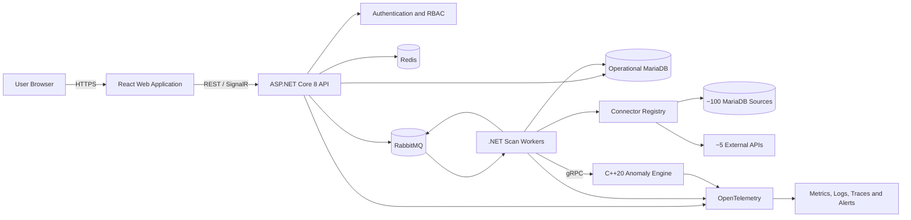
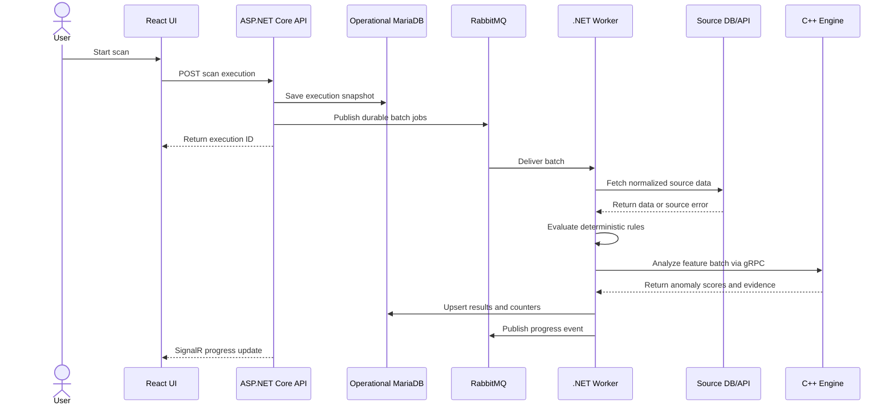

# AutoVerify System - Project Plan

## 1. Executive Summary

AutoVerify is a centralized platform for automatically verifying records, detecting anomalies, and reporting data-quality issues across approximately 100 MariaDB data sources and 5 external APIs.

Users submit or paste lists of business IDs and mapping data. The system normalizes the input, creates a scan list, retrieves related data from configured sources, executes verification rules and computationally intensive anomaly-detection algorithms, stores the results, and presents operational history and error-rate dashboards by system and time range.

The proposed technology stack is:

- Frontend: React with TypeScript.
- Backend API and orchestration: ASP.NET Core 8.0.
- Heavy processing engine: modern C++20.
- Operational database: MariaDB.
- Cache and distributed coordination: Redis.
- Message broker: RabbitMQ for the initial implementation.
- Internal backend-to-engine communication: gRPC with Protocol Buffers.
- Deployment: Windows or Linux services for MVP, with a production process manager or orchestrator selected during discovery.

The application, source code, API contracts, database objects, logs, documentation, and user interface must be written in English.

## 2. Goals

### 2.1 Business Goals

- Automatically verify records across heterogeneous systems.
- Detect missing, inconsistent, duplicated, stale, invalid, or suspicious data.
- Reduce manual verification work and time to detect incidents.
- Provide a single operational view of verification health across all connected systems.
- Maintain a traceable history of every scan, result, configuration change, and user action.
- Allow verification logic and source connections to expand without redesigning the platform.

### 2.2 Technical Goals

- Process large ID lists asynchronously without blocking the web application.
- Scale API, connectors, and C++ workers independently.
- Isolate native C++ failures from the ASP.NET Core API process.
- Support controlled concurrency for approximately 100 MariaDB connections.
- Be resilient to temporary database, network, and external API failures.
- Preserve source-system safety through read-only access, timeouts, rate limits, and query controls.
- Provide observable, auditable, and reproducible verification executions.

## 3. Scope

### 3.1 MVP Scope

- Login page with temporary credentials `admin` / `admin!`.
- JWT-based authenticated session after login.
- Dashboard with scan volume, pass/fail/error rates, anomaly counts, and system health.
- Time filters for day, week, month, and custom UTC date range.
- ID input page supporting pasted text and mapping configuration.
- Input parsing, preview, validation, duplicate removal, and accepted/rejected row reporting.
- Scan list management and manual scan execution.
- MariaDB and REST API source configuration.
- Connectivity testing for each source.
- Asynchronous scan orchestration through a message queue.
- Connector execution with bounded concurrency, timeout, retry, and circuit breaker policies.
- Rule-based verification and C++ anomaly processing.
- Scan history, execution details, per-ID results, and error details.
- Export of filtered results to CSV.
- Basic audit log, structured logging, health checks, metrics, and alerts.

### 3.2 Post-MVP Scope

- Scheduled and recurring scans.
- Role-based access control and enterprise authentication.
- Versioned visual rule builder.
- Baselines and statistical or machine-learning anomaly models.
- Notifications through email, Microsoft Teams, Slack, or webhooks.
- Result comparison between two scan executions.
- Incident acknowledgement, assignment, comments, and resolution workflow.
- Bulk source onboarding and connection-template inheritance.
- High availability, multi-node processing, and Kubernetes autoscaling.
- Long-term analytical storage and advanced reports.

### 3.3 Out of Scope for the Initial Release

- Writing data back to source MariaDB databases.
- Automatically correcting source-system data.
- Training complex machine-learning models inside the web application.
- Supporting arbitrary user-supplied SQL without validation or access controls.
- Multi-region disaster recovery.

## 4. Assumptions and Decisions to Validate

- All source MariaDB connections are read-only.
- Each submitted ID can be mapped to a canonical internal field such as `entityId`.
- Source schemas and verification expectations can differ by system.
- Verification definitions will specify which sources and fields are required for each scan.
- External APIs use REST/JSON unless a source-specific adapter is added.
- UTC is used for storage, APIs, scheduling, and aggregation. The UI may display a configured local timezone.
- Results must be retained for a configurable period; the initial recommendation is 90 days for detailed results and 24 months for aggregates.
- RabbitMQ is preferred over an in-process queue because scan jobs must survive API restarts.
- The C++ engine runs as a separate service rather than an in-process native library to improve fault isolation and independent scaling.
- Authentication with `admin` / `admin!` is strictly a temporary development/MVP bootstrap mechanism and must not be used unchanged in production.

## 5. User Roles

### 5.1 MVP Role

- Administrator: full access to scans, sources, mappings, rules, results, dashboard, and audit history.

### 5.2 Recommended Production Roles

- Administrator: manages users, security, sources, global settings, and retention.
- Operator: creates scan lists, starts scans, retries jobs, and reviews results.
- Analyst: views dashboards, investigates anomalies, comments, and exports reports.
- Viewer: read-only access to dashboards and scan history.

## 6. Primary User Flows

### 6.1 Login

1. The user opens the login page.
2. The user enters `admin` and `admin!` during MVP development.
3. The backend verifies the stored password hash and issues a short-lived access token plus a secure refresh token.
4. The frontend redirects the user to the dashboard.
5. Authentication failures are rate-limited and written to the security audit log.

### 6.2 Create a Scan List

1. The user opens the ID Import page.
2. The user selects a mapping template or defines input columns.
3. The user pastes newline-, comma-, tab-, or CSV-formatted data.
4. The frontend sends the input to the backend preview endpoint.
5. The backend parses, trims, normalizes, validates, and deduplicates the rows.
6. The UI shows accepted rows, rejected rows, duplicate count, validation messages, and a sample preview.
7. The user confirms the import.
8. The backend stores the immutable normalized items in a scan list.

### 6.3 Run Verification

1. The user selects a scan list, verification profile, and target systems.
2. The API creates a scan execution with a unique correlation ID.
3. The orchestrator partitions work into bounded batches and publishes jobs to RabbitMQ.
4. Connector workers retrieve data from MariaDB and external APIs.
5. Normalized data is passed to the rule evaluator and C++ anomaly engine.
6. Workers store result details and update aggregate counters idempotently.
7. The UI receives progress through SignalR or periodic polling.
8. The completed execution appears in history and dashboard aggregates.

### 6.4 Investigate an Issue

1. The user filters history by system, status, error type, scan list, and date range.
2. The user opens an execution and selects a failed ID.
3. The UI displays the evaluated rule, expected value, actual value, source, severity, evidence, processing duration, and error trace.
4. The user exports the filtered evidence or creates an incident in a later phase.

## 7. Functional Requirements

### 7.1 Authentication and Security

- Provide a dedicated login page and protected application routes.
- Seed the temporary administrator account from deployment configuration, not directly in frontend code.
- Store the password using ASP.NET Core `PasswordHasher` or Argon2id; never store plaintext credentials.
- Use short-lived JWT access tokens and rotating refresh tokens stored in secure, HTTP-only, same-site cookies.
- Support logout, token revocation, idle timeout, account lockout, and login throttling.
- Add role and permission claims even if MVP initially exposes only the Administrator role.
- Record login success, login failure, logout, source changes, rule changes, scan actions, and exports.
- Require the bootstrap administrator password to be changed before production activation.

### 7.2 ID Import and Mapping

- Accept pasted newline, comma, tab, semicolon, and CSV content.
- Support configurable maximum rows and payload size.
- Allow one or more input columns such as `entityId`, `systemCode`, `externalId`, or other metadata.
- Map input columns to canonical fields.
- Support mapping templates that can be named, versioned, reused, and deactivated.
- Normalize whitespace, casing, separators, optional prefixes, and leading zeros according to mapping rules.
- Validate required fields, data type, length, pattern, and allowed values.
- Remove exact duplicates and optionally identify semantic duplicates after normalization.
- Display a preview before persistence.
- Keep rejected rows and rejection reasons available for download.
- Calculate a checksum for each imported list to identify accidental repeated imports.
- Make confirmed list versions immutable so scan executions remain reproducible.

### 7.3 Source Management

- Manage approximately 100 MariaDB source definitions and approximately 5 REST API definitions.
- Group sources by environment, business domain, region, owner, or system type.
- Store host, port, database, query template or stored procedure, timeout, concurrency limit, and credential reference.
- Store API base URL, authentication type, endpoint template, headers, timeout, rate limit, and credential reference.
- Encrypt secrets at rest and hide secret values after creation.
- Test connectivity without exposing credentials or sensitive source data.
- Track source health, last successful access, latency, failure count, and circuit-breaker state.
- Allow a source to be disabled without deleting its history.
- Use read-only database accounts with the minimum required grants.
- Validate configured SQL and use parameters for IDs; do not concatenate user input into SQL.
- Prefer controlled query templates or stored procedures over arbitrary SQL.

### 7.4 Verification Profiles and Rules

- A verification profile defines target systems, mappings, extraction behavior, rules, severities, and algorithm version.
- Rules must be versioned and immutable after being used by a scan.
- Initial rule types should include:
  - Record exists or does not exist.
  - Required field is present.
  - Value equals an expected value.
  - Cross-system values match.
  - Value is within a numeric or date range.
  - Timestamp is not stale.
  - Duplicate record detection.
  - Count or cardinality threshold.
  - Regex or format validation.
  - Reference integrity and mapping completeness.
- Each rule returns status, severity, code, human-readable message, and structured evidence.
- Rule outcomes are `Passed`, `Warning`, `Failed`, `Skipped`, or `ExecutionError`.
- Verification failures and technical execution errors must be reported separately.

### 7.5 Anomaly Detection Engine

- Use C++20 for computationally intensive feature extraction and anomaly algorithms.
- Expose a versioned gRPC contract to the .NET worker.
- Initial algorithm options should include robust z-score/MAD, interquartile range, rate-of-change, frequency deviation, missing-pattern detection, and configurable threshold scoring.
- Return an anomaly score, classification, contributing features, algorithm version, and evidence.
- Set per-call deadlines and payload limits.
- Reject incompatible contract or algorithm versions explicitly.
- Keep algorithms deterministic when given the same input, configuration, and version.
- Record feature schema and algorithm version with every result.
- Provide a pure C++ test suite and benchmark suite using representative workloads.

### 7.6 Scan Orchestration

- Support manual scans in MVP and scheduled scans after MVP.
- Create immutable execution snapshots containing source, mapping, rule, and algorithm versions.
- Partition IDs into configurable batches based on source capability.
- Enforce global, per-source, and per-tenant concurrency limits.
- Use idempotency keys for job submission and result persistence.
- Support cancellation, safe retry, and manual replay of failed batches.
- Apply exponential backoff with jitter for transient failures.
- Move permanently failed messages to a dead-letter queue.
- Distinguish execution states: `Queued`, `Running`, `PartiallyCompleted`, `Completed`, `Failed`, and `Cancelled`.
- Track total, processed, passed, warned, failed, errored, skipped, and remaining items.
- Ensure restart recovery when an API or worker process terminates unexpectedly.
- Prevent two active executions of the same schedule unless overlap is explicitly allowed.

### 7.7 Dashboard

- Show total scans, total IDs processed, pass rate, verification failure rate, technical error rate, warning rate, and anomaly rate.
- Show trends by day, week, month, and custom date range.
- Show breakdown by system, verification profile, error code, severity, and source type.
- Show top failing systems and top recurring rule failures.
- Show scan duration, throughput, queue depth, and source latency.
- Show active, queued, failed, and recently completed scans.
- Allow dashboard filters to be encoded in the URL for sharing and refresh persistence.
- Define rate denominators clearly and exclude `Skipped` items unless explicitly selected.
- Compare the selected period with the previous equivalent period in a later phase.

### 7.8 History and Reporting

- List scan executions with pagination, sorting, and server-side filtering.
- Filter by UTC date range, system, scan list, profile, status, severity, rule, error code, and initiating user.
- Show execution summary and batch progress.
- Drill down to source-, ID-, and rule-level results.
- Display expected value, actual value, evidence, timestamps, duration, and correlation ID.
- Export filtered summaries and details to CSV; support XLSX in a later phase.
- Apply permission checks and audit logging to every export.
- Redact configured sensitive fields from the UI, logs, exports, and error messages.

### 7.9 Notifications and Incident Workflow

Recommended after MVP:

- Alert when failure rate or anomaly rate exceeds a configured threshold.
- Alert when a critical system is unavailable or a scheduled scan does not complete.
- Support email, Teams, Slack, and generic webhook channels.
- Deduplicate and throttle repeated notifications.
- Allow users to acknowledge, assign, comment on, and resolve findings.
- Preserve incident history and link incidents to scan results.

### 7.10 Administration

- Manage users, roles, permissions, sources, mappings, verification profiles, schedules, notification channels, retention, and feature flags.
- Validate configurations before activation.
- Use draft/published states for mappings and verification profiles.
- Allow safe rollback to a prior published version.
- Expose audit history for every configuration object.

## 8. Non-Functional Requirements

### 8.1 Performance Targets

Initial targets must be confirmed with representative source systems:

- Login and normal metadata endpoints: p95 below 500 ms under normal load.
- Dashboard queries: p95 below 2 seconds for a 30-day range using pre-aggregated data.
- Import preview: 100,000 simple ID rows processed within 10 seconds under target hardware.
- Scan job submission: below 2 seconds, independent of the eventual scan duration.
- Initial sustained throughput target: at least 500 verified IDs per minute across healthy sources, while respecting source limits.
- The platform must support horizontal worker scaling without duplicate final results.

### 8.2 Availability and Resilience

- MVP service availability target: 99.5%, excluding planned maintenance.
- Production target: 99.9% after high-availability deployment.
- Queue jobs survive process restarts.
- No single source failure prevents unrelated sources from processing.
- Connector timeouts, bulkheads, retry policies, circuit breakers, and dead-letter queues are required.
- Operational database backups and restore tests are required before production launch.

### 8.3 Security

- Follow OWASP ASVS Level 2 and OWASP API Security guidance.
- Enforce TLS for browser, API, database, queue, Redis, and gRPC traffic where supported.
- Use a secret manager such as HashiCorp Vault, Azure Key Vault, AWS Secrets Manager, or Kubernetes Secrets backed by encryption.
- Encrypt sensitive operational data at rest.
- Use parameterized SQL, strict validation, CSP, CORS allowlists, and request-size limits.
- Run services with least-privilege operating-system accounts where practical.
- Generate dependency and source vulnerability reports in CI.
- Produce a software bill of materials for release artifacts.

### 8.4 Privacy and Data Governance

- Classify IDs and source fields as public, internal, confidential, or restricted.
- Collect and persist only data needed for verification evidence.
- Configure field-level masking and redaction.
- Define detailed-result and aggregate retention separately.
- Support deletion or anonymization according to organizational policy.
- Record who viewed or exported restricted result data if required by compliance policy.

### 8.5 Maintainability

- Use modular boundaries and versioned contracts.
- Enforce formatting, static analysis, unit tests, integration tests, and API compatibility checks in CI.
- Keep source connectors behind a common adapter interface.
- Keep domain rules independent of transport and persistence code.
- Publish OpenAPI documentation for external HTTP APIs and Protocol Buffer contracts for internal gRPC APIs.

## 9. Proposed Architecture



### 9.1 Architectural Components

#### React Web Application

- Authentication UI and protected routes.
- Dashboard, ID import, scan list, history, result detail, source, rule, and administration pages.
- TanStack Query for server state and caching.
- React Router for navigation.
- A mature accessible component library such as MUI or Ant Design.
- Chart library such as Apache ECharts for dashboard visualizations.
- SignalR client for scan progress, with polling fallback.

#### ASP.NET Core 8 API

- HTTP API, authentication, authorization, validation, and rate limiting.
- Source, mapping, profile, scan list, execution, result, dashboard, and audit endpoints.
- OpenAPI generation and problem-details error responses.
- Clean modular-monolith organization for MVP, avoiding unnecessary microservices.

#### .NET Worker Service

- Consumes scan and batch jobs from RabbitMQ.
- Retrieves source data through connector adapters.
- Applies deterministic verification rules.
- Calls the C++ service for intensive feature extraction and anomaly scoring.
- Persists results and emits progress events.
- Uses bounded channels and connection pools to prevent resource exhaustion.

#### C++20 Processing Service

- Stateless service where practical.
- Receives normalized feature batches by gRPC.
- Executes versioned algorithms and returns structured results.
- Built with CMake and a dependency manager such as vcpkg or Conan.
- Uses GoogleTest for unit tests and Google Benchmark for performance regression tests.
- Exposes health, build version, algorithm versions, metrics, and tracing metadata.

#### Operational MariaDB

- Stores users, configuration, scan lists, executions, result summaries, detailed findings, audit data, and aggregate dashboard facts.
- Must be separate from the approximately 100 read-only source databases.
- Uses schema migrations and indexed, partition-aware result tables.

#### RabbitMQ

- Durable scan, batch, retry, progress, and dead-letter queues.
- Manual acknowledgements and publisher confirms.
- Message schema versioning.
- At-least-once delivery with idempotent consumers.

#### Redis

- Distributed cache for dashboard aggregates and metadata.
- Rate-limit counters, short-lived locks, and SignalR backplane if multiple API instances are used.
- Redis must not be the system of record for scan results.

### 9.2 Connector Architecture

Define a common connector contract in .NET:

```csharp
public interface IDataSourceConnector
{
    Task<ConnectionTestResult> TestConnectionAsync(
        SourceDefinition source,
        CancellationToken cancellationToken);

    Task<SourceBatchResult> FetchAsync(
        SourceDefinition source,
        IReadOnlyCollection<CanonicalScanItem> items,
        CancellationToken cancellationToken);
}
```

Initial implementations:

- `MariaDbConnector`: parameterized queries, connection pooling, command timeout, query-template validation, and read-only transaction behavior.
- `RestApiConnector`: configurable authentication, pagination, rate limiting, retry policies, response mapping, and schema validation.

Create specialized adapters only when a source cannot be represented safely through the generic connectors.

### 9.3 C++ Integration Decision

Use an out-of-process gRPC service for production rather than P/Invoke as the default design.

Benefits:

- A native crash does not terminate the API or worker process.
- C++ workers can be scaled independently.
- Contract versioning is explicit.
- Linux or Windows service deployment is straightforward.
- Resource limits and timeouts can be enforced at service boundaries.

P/Invoke may be considered only for a measured latency requirement that gRPC cannot satisfy and after adding strict ABI, memory ownership, crash recovery, and platform compatibility controls.

## 10. Suggested Repository Structure

```text
AutoVerify_System/
|-- src/
|   |-- web/                         # React + TypeScript
|   |-- backend/
|   |   |-- AutoVerify.Api/          # ASP.NET Core HTTP API
|   |   |-- AutoVerify.Application/  # Use cases and orchestration
|   |   |-- AutoVerify.Domain/       # Domain models and rules
|   |   |-- AutoVerify.Infrastructure/
|   |   |-- AutoVerify.Worker/       # RabbitMQ consumers
|   |   `-- AutoVerify.Contracts/    # HTTP/message contracts
|   `-- engine/
|       |-- include/
|       |-- src/
|       |-- tests/
|       `-- benchmarks/
|-- contracts/
|   `-- proto/                       # gRPC definitions
|-- tests/
|   |-- backend-unit/
|   |-- backend-integration/
|   |-- contract/
|   |-- end-to-end/
|   `-- performance/
|-- deploy/
|   |-- windows-service/
|   `-- linux-service/
|-- docs/
|-- scripts/
|-- Directory.Build.props
`-- AutoVerify.sln
```

## 11. Domain Model and Data Design

### 11.1 Core Entities

- `User`: identity, password hash, status, and security metadata.
- `Role` and `Permission`: authorization model.
- `DataSource`: MariaDB or API connection metadata and secret reference.
- `MappingTemplate`: canonical input mapping and normalization rules.
- `VerificationProfile`: selected sources, mappings, rules, and algorithm configuration.
- `VerificationRule`: versioned validation definition and severity.
- `ScanList`: imported list metadata, checksum, status, and immutable version.
- `ScanItem`: normalized ID and non-sensitive metadata.
- `ScanExecution`: execution snapshot, state, counters, timing, and initiator.
- `ScanBatch`: partition state, retry count, lease, and worker information.
- `SourceFetchResult`: source call state, latency, record count, and technical error.
- `VerificationResult`: per-item overall status and score.
- `RuleResult`: per-rule status, expected/actual evidence, and severity.
- `AnomalyResult`: score, category, features, and algorithm version.
- `DashboardAggregate`: precomputed metrics by time bucket and dimensions.
- `AuditEvent`: actor, action, target, timestamp, correlation ID, and change summary.
- `NotificationRule` and `NotificationDelivery`: post-MVP alert configuration and state.

### 11.2 Recommended Tables

- `users`, `roles`, `permissions`, `user_roles`, `role_permissions`
- `refresh_tokens`
- `data_sources`, `data_source_health`
- `mapping_templates`, `mapping_template_versions`
- `verification_profiles`, `verification_profile_versions`
- `verification_rules`, `verification_rule_versions`
- `scan_lists`, `scan_items`, `scan_import_rejections`
- `scan_executions`, `scan_batches`
- `source_fetch_results`
- `verification_results`, `rule_results`, `anomaly_results`
- `dashboard_hourly`, `dashboard_daily`
- `audit_events`
- `schedules`, `notification_rules`, `notification_deliveries`

### 11.3 Data Strategy

- Use UUIDv7 or another time-sortable unique identifier for distributed entities.
- Store all timestamps in UTC with sufficient precision.
- Save a configuration snapshot or immutable version references with each execution.
- Index detailed results by execution, source, status, error code, entity ID hash, and timestamp.
- Partition large result and audit tables by month when volume justifies it.
- Store a keyed hash of sensitive IDs for lookup where displaying the raw ID is not required.
- Store only redacted evidence unless raw evidence is explicitly approved.
- Generate hourly/daily aggregates asynchronously to avoid scanning detail tables for every dashboard request.

## 12. API Design

### 12.1 API Standards

- Base path: `/api/v1`.
- JSON property names: `camelCase`.
- Endpoint names and messages: English.
- Use RFC 9457 Problem Details for errors.
- Use cursor pagination for very large result sets and page-number pagination for smaller configuration lists.
- Support an `Idempotency-Key` header for scan creation and imports.
- Return or accept a `traceparent`/correlation identifier across API, queue, worker, connector, and C++ calls.
- Version breaking contracts through the URL or explicit media types.

### 12.2 Initial Endpoint Groups

```text
POST   /api/v1/auth/login
POST   /api/v1/auth/refresh
POST   /api/v1/auth/logout
GET    /api/v1/auth/me

GET    /api/v1/dashboard/summary
GET    /api/v1/dashboard/trends
GET    /api/v1/dashboard/breakdown

POST   /api/v1/imports/preview
POST   /api/v1/scan-lists
GET    /api/v1/scan-lists
GET    /api/v1/scan-lists/{scanListId}
GET    /api/v1/scan-lists/{scanListId}/rejections

POST   /api/v1/scan-executions
GET    /api/v1/scan-executions
GET    /api/v1/scan-executions/{executionId}
POST   /api/v1/scan-executions/{executionId}/cancel
POST   /api/v1/scan-executions/{executionId}/retry
GET    /api/v1/scan-executions/{executionId}/results
GET    /api/v1/scan-executions/{executionId}/export

GET    /api/v1/data-sources
POST   /api/v1/data-sources
PUT    /api/v1/data-sources/{sourceId}
POST   /api/v1/data-sources/{sourceId}/test
POST   /api/v1/data-sources/{sourceId}/enable
POST   /api/v1/data-sources/{sourceId}/disable

GET    /api/v1/mapping-templates
POST   /api/v1/mapping-templates
POST   /api/v1/mapping-templates/{mappingId}/publish

GET    /api/v1/verification-profiles
POST   /api/v1/verification-profiles
POST   /api/v1/verification-profiles/{profileId}/publish

GET    /api/v1/audit-events
GET    /api/v1/system/health
```

### 12.3 Example Scan Creation Request

```json
{
  "scanListId": "0198d915-7d64-7000-a93e-52e8d68a7031",
  "verificationProfileId": "0198d916-3118-7000-b694-6b11c5a23b91",
  "sourceIds": [
    "0198d917-6f5c-7000-b2f0-982dd2999655"
  ],
  "priority": "normal"
}
```

## 13. Processing Pipeline



### 13.1 Failure Classification

- `VerificationFailure`: source data was read successfully but did not meet a rule.
- `AnomalyDetected`: algorithm produced a score above the configured threshold.
- `SourceUnavailable`: connection, DNS, authentication, or availability failure.
- `Timeout`: source or engine exceeded its deadline.
- `RateLimited`: external API rejected requests due to quota or throttling.
- `InvalidSourceData`: data could not be mapped or validated.
- `EngineError`: C++ processing failed or returned an incompatible response.
- `InternalError`: unexpected platform failure.
- `Cancelled`: user or system cancellation was applied.

This separation is essential because a business verification failure must not be counted as a platform error.

## 14. User Interface Plan

### 14.1 Pages

- `/login`: username, password, validation feedback, and security notice.
- `/dashboard`: KPI cards, time-series trends, system breakdown, top issues, queue status, and recent executions.
- `/scan-lists`: list, filters, create/import action, item count, checksum, creator, and creation time.
- `/scan-lists/new`: paste input, delimiter detection, mapping selection, preview, validation, and confirmation.
- `/scans`: paginated execution history with filters.
- `/scans/{id}`: execution progress, counters, source states, failures, anomalies, and result grid.
- `/sources`: source registry, type, environment, health, latency, enabled state, and connection test.
- `/mappings`: mapping templates and version status.
- `/verification-profiles`: rules, source selection, algorithm configuration, draft/published state, and versions.
- `/audit`: searchable audit event history.
- `/administration`: users, roles, retention, feature flags, and system settings.

### 14.2 Dashboard Visuals

- KPI cards: pass rate, verification failure rate, technical error rate, anomaly rate, processed IDs, and average duration.
- Line chart: rates and execution volume over time.
- Stacked bar chart: Passed, Warning, Failed, and ExecutionError by system.
- Horizontal bar chart: top error codes and top failing rules.
- Table: active/queued scans and unhealthy sources.
- Heatmap in a later phase: system error rate by day and hour.

### 14.3 UX Requirements

- Desktop-first operations interface with responsive support for tablet and mobile monitoring.
- Accessible keyboard navigation and WCAG 2.1 AA contrast targets.
- Virtualized tables for large result sets.
- Server-side filtering and sorting rather than loading all records into the browser.
- Explicit empty, loading, partial, stale, retry, and error states.
- Confirmation for destructive or high-impact operations.
- Preserve filters when navigating between history and detail pages.
- Use English labels, validation messages, chart legends, date formats, and export headers.

## 15. Observability and Operations

### 15.1 Structured Logs

Every service must emit JSON logs containing, when applicable:

- Timestamp, level, service, environment, build version.
- Trace ID, span ID, correlation ID, execution ID, batch ID.
- Source ID, connector type, rule code, algorithm version.
- Duration, retry attempt, outcome, and sanitized error code.

Raw credentials, access tokens, passwords, connection strings, and unapproved source values must never be logged.

### 15.2 Metrics

- HTTP request count, duration, and error rate.
- Queue depth, message age, retries, dead-letter count, and consumer utilization.
- Active scans, throughput, batch duration, and completion rate.
- Connector latency, timeout count, failure count, and circuit state per source.
- MariaDB and Redis connection-pool utilization.
- C++ request duration, batch size, algorithm duration, memory, CPU, and failure rate.
- Dashboard aggregate freshness.

### 15.3 Tracing

- Use OpenTelemetry in React where appropriate, ASP.NET Core, workers, MariaDB clients, RabbitMQ instrumentation, HTTP clients, and the C++ service.
- Propagate trace context through RabbitMQ headers and gRPC metadata.
- Sample normal traffic and retain all traces for failed or slow executions where supported.

### 15.4 Alerts

- Dead-letter queue contains messages.
- Oldest queued message exceeds its service-level threshold.
- Scheduled scan is missed or exceeds expected duration.
- Source failure rate or latency exceeds threshold.
- C++ engine crash/restart or error rate exceeds threshold.
- Operational database disk, connections, replication, or backup status is unhealthy.
- Dashboard aggregate pipeline is delayed.

## 16. Testing Strategy

### 16.1 Backend

- Unit tests for domain rules, mappings, normalization, state transitions, and rate calculations.
- Integration tests using dedicated local or CI service instances for MariaDB, Redis, and RabbitMQ.
- Connector tests for timeouts, retries, pagination, rate limiting, and malformed data.
- API authorization, validation, idempotency, pagination, and Problem Details tests.
- Migration upgrade and rollback safety tests.

### 16.2 C++ Engine

- GoogleTest unit tests for feature extraction and algorithms.
- Golden-data tests that confirm stable outputs for fixed inputs and versions.
- Fuzz tests for malformed payloads and edge-case numeric data.
- AddressSanitizer, UndefinedBehaviorSanitizer, and static analysis in CI where supported.
- Google Benchmark tests with regression thresholds.

### 16.3 Contract and End-to-End

- Protocol Buffer compatibility checks.
- Consumer-driven tests for external API adapters where feasible.
- End-to-end tests covering login, import preview, scan creation, progress, results, filters, and export.
- Failure-path tests for unavailable sources, partial completion, retries, cancellation, and worker restart.

### 16.4 Performance and Reliability

- Load-test import preview and dashboard endpoints.
- Run scans with realistic source latency and data distributions.
- Soak-test workers and C++ engine for memory leaks and connection exhaustion.
- Verify that source concurrency limits are never exceeded.
- Perform queue redelivery and worker termination tests to confirm idempotency.
- Restore a production-like backup in a test environment before launch.

## 17. DevOps and Environments

### 17.1 Environments

- Local: native development processes with synthetic source databases and mock APIs.
- Development: shared integration environment with non-sensitive test data.
- Staging: production-like topology, scale test, security test, and release validation.
- Production: high-availability deployment, managed secrets, backups, alerts, and controlled access.

### 17.2 CI Pipeline

1. Restore dependencies and verify locked versions.
2. Format and lint TypeScript, C#, SQL migrations, Protocol Buffers, and C++.
3. Build React, .NET, and C++ artifacts.
4. Run unit, integration, contract, and selected end-to-end tests.
5. Run static analysis, dependency scanning, and secret scanning.
6. Produce versioned release packages and an SBOM.
7. Sign release artifacts where organizational tooling supports it.

### 17.3 CD Pipeline

1. Deploy migrations through a controlled migration job.
2. Deploy API, workers, web application, and C++ engine.
3. Run readiness and smoke tests.
4. Use rolling or blue/green deployment for application services.
5. Stop promotion and roll back application images on failed health checks.
6. Do not automatically roll back destructive database migrations; design migrations to be backward compatible during rollout.

## 18. Delivery Roadmap

The following estimate assumes a cross-functional team of approximately 7-9 people: one product owner/business analyst, one solution architect or technical lead, two backend engineers, one C++ engineer, two frontend engineers, one QA automation engineer, and shared DevOps/security support. Duration changes materially with source complexity and team size.

### Phase 0 - Discovery and Proof of Concept (2 weeks)

- Confirm canonical ID formats, source ownership, schemas, expected verification rules, throughput, retention, and security constraints.
- Inventory all MariaDB and API sources.
- Classify sources by schema/query pattern and identify reusable connector templates.
- Build a vertical proof of concept for one MariaDB source, one API source, one rule, and one C++ algorithm.
- Benchmark gRPC batch size and end-to-end throughput.
- Produce architecture decision records for queue, C++ boundary, operational database, secrets, and deployment target.

Exit criteria:

- Representative data can travel from an imported ID through both source types to a persisted result.
- C++ integration is stable and measurable.
- Critical unknowns and source limitations are documented.

### Phase 1 - Platform Foundation (2 weeks)

- Create repository structure, build system, CI, local run scripts, and environment configuration.
- Implement operational MariaDB schema migrations.
- Add authentication, temporary administrator seed, JWT/refresh flow, authorization skeleton, and audit foundation.
- Add health checks, structured logging, OpenTelemetry, and error standards.
- Establish React shell, navigation, protected routes, API client, and component library.

Exit criteria:

- A user can log in and access a protected English-language application shell.
- All services build, test, and run locally through documented automation.

### Phase 2 - ID Import and Configuration (3 weeks)

- Implement source registry and connectivity tests.
- Implement mapping templates and input normalization.
- Build paste/import preview, rejection handling, deduplication, checksum, and scan-list persistence.
- Build verification profile and initial rule configuration.
- Add security redaction and secret references.

Exit criteria:

- An administrator can configure representative sources and create a validated immutable scan list.
- Invalid inputs and duplicate rows are clearly reported.

### Phase 3 - Execution Pipeline and C++ Engine (4 weeks)

- Implement RabbitMQ topology, job schemas, dead-letter queues, and idempotent consumers.
- Implement MariaDB and REST connectors with concurrency controls and resilience policies.
- Implement scan partitioning, cancellation, retry, state transitions, and progress events.
- Implement gRPC contracts and initial C++ algorithms.
- Persist detailed rule, source, and anomaly results.

Exit criteria:

- A scan can run asynchronously across representative sources.
- Partial failures do not block unrelated work.
- Worker restart and message redelivery do not create duplicate final results.

### Phase 4 - Dashboard, History, and Reporting (3 weeks)

- Implement aggregate pipeline and cache strategy.
- Build dashboard KPIs, trends, system breakdown, and active scan monitoring.
- Build history, detail drill-down, filters, pagination, and CSV export.
- Add SignalR progress with polling fallback.
- Complete audit views and production-oriented error messages.

Exit criteria:

- Users can understand current health and investigate a result from dashboard to rule evidence.
- Day, week, month, and custom-range statistics use validated rate formulas.

### Phase 5 - Hardening and Pilot (3 weeks)

- Complete automated test coverage for critical paths.
- Run performance, soak, failure-injection, security, backup, and restore tests.
- Tune source-specific concurrency and query behavior.
- Onboard a pilot group of sources and validate operational runbooks.
- Resolve accessibility, usability, and observability gaps.

Exit criteria:

- No unresolved critical or high-severity defects.
- Performance and reliability targets are met for the agreed pilot load.
- Backup restoration, source isolation, and incident response are demonstrated.

### Phase 6 - Production Rollout and Expansion (ongoing)

- Roll out source groups incrementally rather than enabling all 100 databases at once.
- Monitor source load, false-positive rates, processing capacity, and user adoption.
- Add schedules, notifications, RBAC, incident workflow, advanced anomaly models, and source templates.
- Conduct a security review before replacing bootstrap authentication with enterprise identity.

### Indicative Total

- MVP pilot: approximately 17 weeks after discovery begins.
- Production hardening and broader source onboarding: approximately 20-24 weeks total.
- Add contingency for undocumented schemas, slow source queries, restricted network routes, and unclear rule definitions.

## 19. Work Breakdown Structure

### Epic A - Identity and Access

- Login, logout, refresh, password hashing, lockout, and bootstrap user.
- Authorization policies and production RBAC.
- Security audit events and session management.

### Epic B - Source Connectivity

- Source registry, secret references, connection test, and health monitoring.
- MariaDB connector templates and REST API adapters.
- Concurrency, timeout, retry, circuit breaker, and rate limiting.

### Epic C - Import and Mapping

- Paste parser, delimiter detection, validation, normalization, preview, and deduplication.
- Mapping templates, versions, publishing, and rejected-row exports.
- Immutable scan-list storage and checksums.

### Epic D - Verification and Anomaly Engine

- Verification profiles and deterministic rule evaluator.
- C++ gRPC service, feature extraction, algorithms, versioning, tests, and benchmarks.
- Structured evidence and severity model.

### Epic E - Scan Orchestration

- RabbitMQ topology and message schemas.
- Batch planner, idempotent workers, progress, cancellation, retry, recovery, and dead-letter processing.
- Aggregate counters and execution snapshots.

### Epic F - Dashboard and Investigation

- KPI aggregation, caching, trends, breakdowns, and source health.
- History, result drill-down, filtering, pagination, SignalR, and CSV export.

### Epic G - Platform Engineering

- CI/CD, service hosting, migrations, secrets, observability, alerts, backups, and runbooks.
- Performance, security, disaster recovery, and release readiness.

## 20. Definition of Done

A feature is complete only when:

- Acceptance criteria are implemented and reviewed.
- UI and API behavior use English text and consistent terminology.
- Authorization and input validation are applied.
- Errors are classified, safe, observable, and actionable.
- Unit and appropriate integration/end-to-end tests pass.
- Logs, metrics, traces, and audit events are added where operationally relevant.
- API/OpenAPI or Protocol Buffer contracts are updated.
- Database migrations are reviewed and tested.
- Accessibility and responsive behavior are checked for UI changes.
- Security and sensitive-data handling are reviewed.
- Deployment configuration and runbooks are updated where applicable.

## 21. MVP Acceptance Criteria

- The seeded administrator can log in with the temporary credentials and unauthorized users cannot access protected pages.
- Passwords are hashed, tokens expire, failed logins are throttled, and authentication events are audited.
- A user can paste at least 100,000 simple IDs, map fields, preview results, reject invalid rows, remove duplicates, and create an immutable scan list.
- An administrator can configure and test representative MariaDB and REST API sources without exposing credentials.
- A user can launch a scan and receive an execution ID immediately.
- The scan continues if the browser or API instance disconnects.
- Source access is read-only, parameterized, time-limited, and concurrency-limited.
- C++ algorithms execute through a versioned gRPC contract and record their version with results.
- Worker retries and restarts do not create duplicate final results.
- Verification failures, anomalies, and technical errors are distinguishable in storage and UI.
- The dashboard reports validated pass, warning, verification failure, anomaly, and technical error rates by system and day/week/month/custom range.
- History supports filters, drill-down, pagination, and CSV export.
- Logs and exports do not contain passwords, tokens, connection strings, or configured sensitive fields.
- Health checks, metrics, traces, dead-letter alerts, backup, and restore procedures are operational.

## 22. Key Risks and Mitigations

| Risk | Impact | Mitigation |
|---|---|---|
| One hundred MariaDB sources overload the platform or source systems | High | Per-source pools, bulkheads, concurrency limits, batch sizing, read replicas, query reviews, and staged onboarding |
| Source schemas and ID formats are inconsistent | High | Canonical model, versioned mapping templates, connector contracts, preview validation, and source inventory |
| Verification requirements are ambiguous | High | Rule catalog, examples, business owner approval, versioned profiles, and golden datasets |
| Native C++ defect crashes processing | High | Out-of-process service, deadlines, health probes, resource limits, sanitizers, fuzzing, and automatic restart |
| RabbitMQ redelivery causes duplicate results | High | Idempotency keys, unique constraints, transactional outbox/inbox patterns, and deterministic upserts |
| External API quotas block scans | Medium | Rate limiters, caching where valid, adaptive batching, retry-after handling, and schedule windows |
| Detailed results grow rapidly | High | Retention policy, partitioning, aggregation, archival, compression, and capacity monitoring |
| Temporary default credentials reach production | Critical | Deployment guard, forced password change, secret-provided bootstrap password, and enterprise identity before launch |
| Sensitive data leaks into logs or exports | Critical | Field classification, redaction middleware, secure logging rules, export authorization, and security tests |
| Dashboard calculations disagree with detail data | Medium | Shared metric definitions, aggregate reconciliation jobs, deterministic denominators, and automated tests |
| False-positive anomalies reduce trust | Medium | Explainable evidence, configurable thresholds, baseline periods, analyst feedback, and algorithm versioning |
| Network access to sources is restricted or unstable | High | Early connectivity discovery, private routing, timeouts, circuit breakers, source health, and partial completion |

## 23. Supporting Features Added to the Original Scope

The following capabilities are necessary to make the requested system production-ready:

- Durable asynchronous queue and dead-letter processing.
- Scheduling and overlap controls.
- Per-source connection pools, concurrency limits, rate limits, retries, and circuit breakers.
- Immutable and versioned mappings, rules, profiles, and algorithm references.
- Separation of business verification failures from technical execution errors.
- Source health monitoring and connectivity tests.
- Scan cancellation, safe retry, replay, partial completion, and restart recovery.
- SignalR progress updates with a polling fallback.
- Dashboard aggregates and cache to keep historical reporting responsive.
- Role-based access, audit logs, export controls, and sensitive-field redaction.
- Secret management and read-only source credentials.
- Data retention, partitioning, backup, restore, and archival strategy.
- OpenTelemetry logs, metrics, distributed tracing, alerts, and runbooks.
- Automated contract, integration, end-to-end, performance, soak, fuzz, and security testing.
- Algorithm explainability, deterministic versioning, golden datasets, and benchmark regression checks.
- Notification and incident-management workflow for later phases.

## 24. Open Questions for Discovery

These questions should be resolved in Phase 0 and do not block using this plan as the initial baseline:

- What business object does each ID represent, and can one row contain multiple IDs?
- What are the exact mapping rules and expected source fields for each system?
- Are all 100 MariaDB sources independent servers, databases, schemas, or tenants?
- What MariaDB versions, network zones, query limits, and read replicas are available?
- What authentication mechanisms and quotas apply to the external APIs?
- What volume of IDs is expected per list, per day, and at peak time?
- What is the maximum acceptable time for a complete scan?
- Which errors are critical, warning, informational, or suppressible?
- Must scans compare systems with each other, compare against a master source, or both?
- Which data fields are sensitive and may be stored as evidence?
- What retention, audit, and compliance obligations apply?
- Which deployment platform and secret manager are available?
- Is enterprise SSO required, and which identity provider will be used?
- What notification channels and support escalation process are required?
- What false-positive rate is acceptable for anomaly detection?

## 25. Recommended Immediate Next Actions

1. Appoint a business owner for verification rules and a technical owner for source connectivity.
2. Create a source inventory spreadsheet containing owner, environment, network route, MariaDB/API version, schema, authentication, expected load, and sample query or endpoint.
3. Select 3 representative MariaDB sources and 1 external API for the proof of concept.
4. Define 5-10 concrete verification rules with example passing and failing records.
5. Confirm ID volume, latency target, retention, data classification, and deployment environment.
6. Build the Phase 0 vertical slice before onboarding all sources.
7. Replace the temporary `admin!` credential with a deployment secret and forced password-change flow before any shared or production environment is opened.
