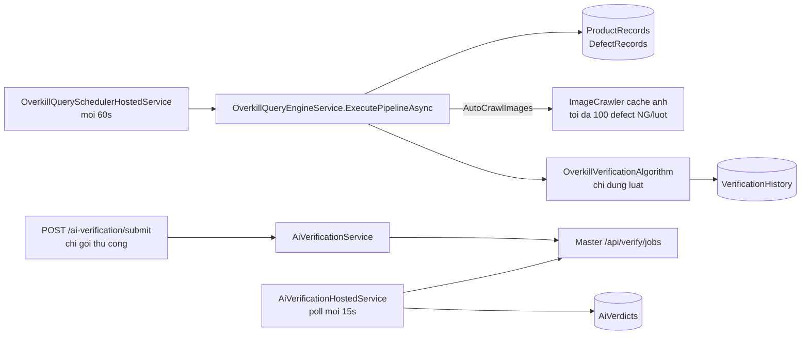
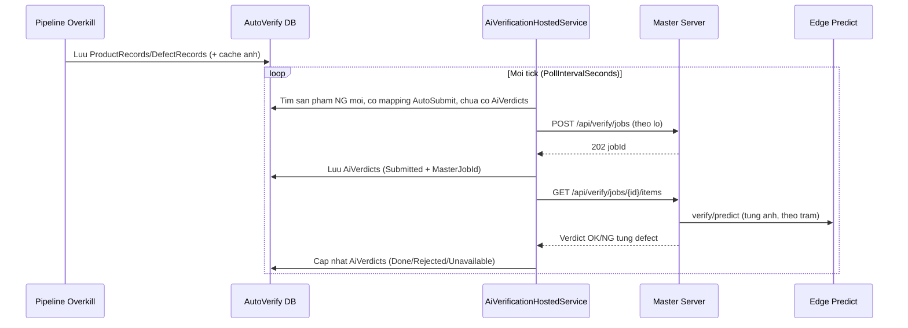

# Kế hoạch: Tự động gửi sản phẩm NG sang Deeplearning (Master Server) để AI xác nhận OK/NG

> Trạng thái: **Đã chốt 3 quyết định (mục 9). Đang làm giai đoạn 1.**
> Phạm vi code: `AutoVerify_System` (backend + web). Master Server (`Deeplearning_AutoServer`) **không cần sửa**.

---

## 1. Mục tiêu

Khi sản phẩm mới vào AutoVerify (sản phẩm **NG** từ pipeline Overkill, và sản phẩm **OK** từ hàng đợi Leakage), hệ thống **tự động** gửi ảnh defect của sản phẩm đó sang Master Server. Master chuyển ảnh cho Edge Predict của đúng trạm, rồi AutoVerify nhận kết quả **OK/NG của AI** cho từng defect, kết hợp với judge của máy để ra kết luận:

| Máy báo | AI trả về | Kết luận (`aiStatus`) |
|---|---|---|
| NG | Mọi ảnh OK | `OverkillConfirmed` (báo động giả) |
| NG | Có ảnh NG | `ConsistentNg` |
| OK | Có ảnh NG | `LeakageConfirmed` (lọt lỗi) |
| OK | Mọi ảnh OK | `ConsistentOk` |
| bất kỳ | Thiếu kết quả cho ít nhất một ảnh | `AiUnavailable` (giữ kết luận theo luật) |

Kết quả AI phải **xem được trên giao diện** AutoVerify, không chỉ qua API.

### Ngoài phạm vi
- Thay kết luận theo luật (`VerificationHistory`) bằng kết luận AI. Bản này **hiện song song**, xem quyết định Q2.
- Tự động đưa defect của **mọi** sản phẩm OK trong DB máy kiểm tra vào AutoVerify. Pipeline Overkill chỉ lấy defect của sản phẩm NG (xem 3.4), nên sản phẩm OK chỉ được gửi khi defect của nó đã có trong AutoVerify (qua hàng đợi Leakage).
- Sửa Master Server hoặc Edge.

---

## 2. Hiện trạng (đã kiểm tra trong code, 21/10/2026)

### 2.1 Luồng đang chạy



- **Lấy dữ liệu:** tự động. Pipeline đọc MariaDB của máy kiểm tra trong `LookbackHours`, lưu sản phẩm và bỏ qua sản phẩm đã lưu. **Defect chỉ được lấy cho sản phẩm NG** (`OverkillQueryEngineService`, bước 2: "OK products have 0 defects"). Defect của sản phẩm OK chỉ vào AutoVerify qua hàng đợi Leakage (`LeakageProcessingService`), nơi người dùng dán hoặc upload danh sách mã.
- **Kết luận Overkill:** chỉ bằng luật ([OverkillVerificationAlgorithm.cs](../src/backend/AutoVerify.Api/Verification/OverkillVerificationAlgorithm.cs)). Máy báo NG mà không có defect NG thì ra `Overkill`, có defect NG thì ra `ConsistentNG`.
- **Gửi sang AI:** **không tự động.** Chỗ duy nhất gọi `SubmitProductsAsync` là `POST /api/v1/ai-verification/submit`.
- **Nhận kết quả AI:** tự động (poll mỗi 15 giây khi `AiVerification:Enabled = true`).
- **Giao diện:** chưa có màn hình nào cho AI (không có nút gửi, không hiện verdict, không có trang mapping).

### 2.2 Đã sửa trước plan này (21/10/2026)
- Master: giới hạn body thực tế 30 MB đã được nâng lên 128 MB (`Server:MaxRequestBodyMb`).
- AutoVerify: gửi theo lô, mỗi lô lưu DB ngay. Chia lô theo cả số ảnh và dung lượng (`AiVerification:MaxBytesPerJob`, mặc định 48 MB).
- Test connection kiểm cả `verify.read` lẫn `verify.submit`.
- `PUT /mappings` kiểm định dạng `StationId` (≤ 64 ký tự) và `ProductId` (≤ 128 ký tự).

### 2.3 Hạn chế hiện tại sẽ ảnh hưởng tới chế độ tự động
1. **Master tắt là mất kết quả.** Gửi lỗi thì defect bị ghi `Unavailable` vĩnh viễn, và sản phẩm đó không bao giờ được gửi lại vì đã có dòng `AiVerdicts`.
2. **Kết quả về muộn bị bỏ.** Quá `GiveUpAfterMinutes` (60 phút) thì dòng bị ghi `Unavailable`. Kết quả Master trả sau đó bị bỏ qua vì poll chỉ đọc các dòng `Submitted`.
3. **Thiếu index.** `ProductRecords` chưa có index theo `InspectedAtUtc`, nên câu quét "sản phẩm NG mới" sẽ phải đọc cả bảng.

---

## 3. Thiết kế

### 3.1 Nguyên tắc
- **Không gọi AI bên trong pipeline Overkill.** Pipeline giữ nguyên tốc độ, và Master tắt không làm pipeline lỗi.
- **Quét rồi gửi:** job AI tự tìm sản phẩm NG chưa có kết quả, gửi theo lô có giới hạn. Master tắt thì tick sau gửi lại.
- **Mặc định tắt:** chỉ chạy khi bật công tắc tổng **và** công tắc trên từng mapping.
- **Không bịa kết quả:** ảnh không có câu trả lời thì không bao giờ được tính là OK (đã đảm bảo trong `AiVerdictMatrix`).

### 3.2 Luồng mới



### 3.3 Công tắc và cấu hình

`appsettings.json` → mục `AiVerification` (các khóa mới in đậm):

| Khóa | Mặc định | Ý nghĩa |
|---|---|---|
| `Enabled` | `false` | Đã có. Bật job nền (poll). |
| **`AutoSubmit`** | `false` | Công tắc tổng cho tự động gửi. |
| **`AutoSubmitMaxProductsPerTick`** | `20` | Số sản phẩm tối đa mỗi tick. Mỗi sản phẩm tối đa `MaxDefectsPerProduct` (20) ảnh. |
| **`AutoSubmitLookbackHours`** | `24` | Chỉ xét sản phẩm kiểm tra trong khoảng này. Tránh gửi lại toàn bộ lịch sử khi vừa bật. |
| **`AutoSubmitBackoffMinutes`** | `5` | Tạm dừng gửi sau khi Master không phản hồi. |
| **`AcceptLateResultsHours`** | `24` | Vẫn nhận kết quả về muộn trong khoảng này (mục 4.6). |
| `PollIntervalSeconds` | `15` | Đã có. Chu kỳ tick. |
| `MaxDefectsPerProduct` | `20` | Đã có. |
| `MaxBytesPerJob` | 48 MB | Đã có. |
| `GiveUpAfterMinutes` | `60` | Đã có. |

Công tắc theo line: thêm cột **`AutoSubmit`** (bool, mặc định `false`) vào bảng `MasterStationMappings`. Một sản phẩm chỉ được tự động gửi khi `AiVerification:AutoSubmit = true` **và** mapping khớp với nó có `Enabled = true` và `AutoSubmit = true`.

> Lý do đặt công tắc trên mapping thay vì pipeline: mapping vốn bắt buộc phải có để gửi được, và nó có cùng khóa máy/line/model với sản phẩm. Thêm cờ vào pipeline sẽ phải sửa khoảng 10 chỗ (entity, 5 contract, controller, `AutoVerifyStore`, 2 form UI), như cờ `AutoCrawlImages` hiện tại. Xem Q3.

### 3.4 Điều kiện chọn sản phẩm

Quyết định Q1: gửi cả sản phẩm **NG** (kiểm Overkill) và sản phẩm **OK** (kiểm Leakage). Một sản phẩm được chọn khi **tất cả** điều kiện sau đúng:
1. Có mapping `Enabled && AutoSubmit` khớp `MachineCode`, `LineCode`, `ModelCode` của **defect** (không phân biệt hoa thường), vì `AiVerificationService` ghép mapping theo defect.
2. Có **defect có `ImageUri` được tạo trong khoảng `AutoSubmitLookbackHours`** (`DefectRecords.CreatedAtUtc`, tức thời điểm defect vào AutoVerify).
3. **Chưa có dòng `AiVerdicts` nào** cho `KeyId` đó.
4. Sản phẩm có tồn tại trong `ProductRecords`.
5. Bộ lọc defect giống `AiDefectSelector`: sản phẩm NG chỉ lấy defect NG có ảnh, sản phẩm OK lấy mọi defect có ảnh. Phải có ít nhất một defect qua bộ lọc này, nếu không sản phẩm bị chọn lại mãi mỗi tick mà không bao giờ có dòng nào được ghi.

Điều kiện thời gian dùng `DefectRecords.CreatedAtUtc` thay vì `InspectedAtUtc` của sản phẩm: người dùng có thể dán mã sản phẩm cũ vào hàng đợi Leakage, và sản phẩm đó phải được gửi vì vừa mới vào hệ thống.

Thứ tự: sản phẩm có defect mới nhất trước, lấy tối đa `AutoSubmitMaxProductsPerTick`.

**Lưu ý về sản phẩm OK:** pipeline Overkill không lấy defect cho sản phẩm OK, nên chế độ tự động chỉ gửi được sản phẩm OK khi chúng đã đi qua hàng đợi Leakage. Muốn gửi mọi sản phẩm OK mới thì pipeline phải được sửa để lấy cả defect của sản phẩm OK, rất nặng với DB máy kiểm tra, nên không nằm trong bản này.

Sản phẩm NG mà **0 defect** không có ảnh để AI xem, nên không được gửi. Kết luận của chúng vẫn là `NoImages`.

### 3.5 Phân loại lỗi khi gửi

| Tình huống | Hành vi mới | Lý do |
|---|---|---|
| Lỗi mạng, timeout, HTTP 5xx, 408, 429 | **Không ghi dòng nào**, bật backoff `AutoSubmitBackoffMinutes` | Tạm thời. Tick sau tự gửi lại. |
| HTTP 4xx khác (400, 403, 413…) | Ghi `Unavailable` kèm lỗi (như hiện tại) | Gửi lại cũng sẽ lỗi. Cần người sửa cấu hình. |
| Không lấy được ảnh | Ghi `Unavailable` cho defect đó (như hiện tại) | Đảm bảo không chọn lại mãi. |
| Người dùng hủy request (gửi thủ công) | Ném lỗi, không ghi (đã làm) | |

Lưu ý: lỗi 403 do sai cấu hình (sai IP, sai key) cũng nên dừng tự động gửi để không ghi `Unavailable` hàng loạt. Nếu Master trả 403 thì bật backoff **và** không ghi dòng nào. `TestConnection` sẽ chỉ ra nguyên nhân.

---

## 4. Giai đoạn 1: Backend tự động gửi

### 4.1 Cấu hình
- [AiVerificationService.cs](../src/backend/AutoVerify.Api/Integration/AiVerificationService.cs) → class `AiVerificationOptions`: thêm 5 khóa ở mục 3.3.
- [appsettings.json](../src/backend/AutoVerify.Api/appsettings.json): thêm các khóa với giá trị mặc định (`AutoSubmit: false`).

### 4.2 Cột `AutoSubmit` trên mapping
- [MasterStationMappingEntity.cs](../src/backend/AutoVerify.Api/Persistence/Entities/MasterStationMappingEntity.cs): `public bool AutoSubmit { get; set; }`.
- [DatabaseSeeder.cs](../src/backend/AutoVerify.Api/Persistence/DatabaseSeeder.cs):
  - Thêm `AutoSubmit tinyint(1) NOT NULL DEFAULT 0` vào `MasterStationMappingsCreateTableSql` (cho DB mới).
  - Sau dòng tạo bảng (khoảng dòng 791), thêm câu nâng cấp cho DB đang có:
    ```sql
    ALTER TABLE `MasterStationMappings` ADD COLUMN IF NOT EXISTS `AutoSubmit` tinyint(1) NOT NULL DEFAULT 0;
    ```
    Nếu chạy SQLite thì dùng biến thể không có `IF NOT EXISTS`, như mẫu `AutoCrawlImages`.
- [AiVerificationController.cs](../src/backend/AutoVerify.Api/Controllers/AiVerificationController.cs): `UpsertStationMappingRequest` thêm `bool AutoSubmit = false`, và gán vào entity.

### 4.3 Index
Trong `DatabaseSeeder` và `AutoVerifyDbContext`:
```sql
CREATE INDEX IF NOT EXISTS `IX_DefectRecords_CreatedAtUtc` ON `DefectRecords` (`CreatedAtUtc`);
```

### 4.4 Hàm chọn và gửi tự động
Trong `AiVerificationService`, thêm vào `IAiVerificationService`:
```csharp
Task<AiAutoSubmitResult> AutoSubmitAsync(CancellationToken cancellationToken);
```
Các bước:
1. Thoát sớm nếu `!_options.AutoSubmit || !_master.IsConfigured`.
2. Tải danh sách mapping `Enabled && AutoSubmit` (bảng nhỏ). Không có mapping nào thì thoát.
3. Truy vấn `DefectRecords` có ảnh, tạo trong khoảng lookback, rồi nhóm theo `KeyId`. Mapping khớp được kiểm tra trong bộ nhớ vì số lượng mapping nhỏ. Bỏ các `KeyId` đã có `AiVerdicts`. Sắp xếp theo thời điểm tạo defect mới nhất và lấy tối đa N sản phẩm.
4. Gọi `SubmitProductsAsync(keyIds, resubmit: false, ct)`. Hàm này đã có sẵn chia lô, lưu từng lô và giới hạn dung lượng.
5. Trả về `AiAutoSubmitResult(Picked, Submitted, NoImage, Deferred, Message)`.

### 4.5 Không ghi dòng khi lỗi tạm thời
Trong `SubmitProductsAsync` → `FlushAsync`, tách khối `catch` theo bảng ở mục 3.5:
- Lỗi tạm thời (và 403): bỏ qua lô, **không gọi `Stage`**, đặt cờ `transientFailure = true` rồi dừng gửi các lô còn lại.
- 4xx khác: giữ hành vi hiện tại.

Thêm `Deferred` (số defect chưa gửi) vào `AiSubmitResult` để gọi thủ công cũng thấy được.

### 4.6 Nhận kết quả về muộn
Khi hết `GiveUpAfterMinutes`, dòng vẫn bị ghi `Unavailable` để giao diện không treo ở `Pending`, nhưng **giữ `MasterJobId`** và ghi `Error` có tiền tố cố định, ví dụ `TIMEOUT:`. Trong `PollAsync`, đọc thêm các dòng `Unavailable` có tiền tố `TIMEOUT:` và `SubmittedAtUtc` còn trong `AcceptLateResultsHours`. Nếu Master đã có kết quả thì cập nhật thành `Done`.

### 4.7 Job nền
[AiVerificationHostedService.cs](../src/backend/AutoVerify.Api/Integration/AiVerificationHostedService.cs), mỗi tick:
1. Nếu chưa tới `pausedUntil` (backoff) thì bỏ qua bước gửi.
2. Gọi `AutoSubmitAsync`. Nếu có lỗi tạm thời thì đặt `pausedUntil = now + AutoSubmitBackoffMinutes`.
3. Gọi `PollAsync` như hiện tại.
4. Ghi trạng thái vào singleton mới `AiDispatchState` (lần gửi cuối, số đã gửi, lỗi cuối, `pausedUntil`) để giao diện đọc.

Hai tick không chạy chồng lên nhau: `PeriodicTimer` vốn tuần tự trong một vòng lặp. Không cần thêm khóa, trừ khi gọi thủ công `/submit` cùng lúc. Trường hợp đó đã an toàn nhờ điều kiện "chưa có `AiVerdicts`" và chỉ mục unique `IX_AiVerdicts_DefectId`.

### 4.8 Log
- Mỗi tick có gửi: `AI auto-submit: picked {Picked}, submitted {Submitted} defect(s), deferred {Deferred}, noImage {NoImage}`.
- Khi backoff: `AI auto-submit paused until {Time}: {Reason}`.

### Tiêu chí hoàn thành giai đoạn 1
- [x] Bật `AutoSubmit` và mapping `AutoSubmit` → sản phẩm NG và OK mới được gửi, không cần gọi API (unit test `AutoSubmit_PicksNgAndOkProductsWithImages`).
- [x] Tắt bất kỳ công tắc nào → không gửi gì.
- [x] Master tắt → không có dòng `Unavailable` mới. Master bật lại → các sản phẩm đó tự được gửi.
- [x] Kết quả về sau 60 phút vẫn được nhận, và ngừng nhận sau `AcceptLateResultsHours`.
- [x] Toàn bộ test mới đều pass; test `AnalyzeClsf_RealD992File` fail từ trước, không liên quan.
- [ ] Chưa chạy thử trên MariaDB thật: câu `ALTER`/`CREATE INDEX` của seeder và luồng đầu-cuối (mục 6.2).

**Khác với thiết kế ban đầu (đã làm):**
- Lỗi 403 từ Master được coi là tạm thời (tạm dừng, không ghi dòng), để lỗi cấu hình không làm hàng loạt defect bị `Unavailable`.
- Khi tự động gửi, một sản phẩm được chọn lại cho đến khi **mọi defect được chọn** của nó đã có dòng `AiVerdicts` (theo từng defect, không theo từng `KeyId`). Nhờ vậy lô bị lỗi tạm thời giữa chừng không để sót defect.
- `AiDispatchState` đã có (ghi lần chạy cuối, lỗi cuối, thời điểm tạm dừng); API `/status` để giai đoạn 2.

---

## 5. Giai đoạn 2: Giao diện

### 5.1 API bổ sung
| Method | Đường dẫn | Mục đích |
|---|---|---|
| `GET` | `/api/v1/ai-verification/status` | Trạng thái job: `enabled`, `autoSubmit`, `lastSubmitAtUtc`, `lastError`, `pausedUntilUtc`, số dòng theo `Status` trong 24 giờ. |
| `POST` | `/api/v1/ai-verification/products/status` | Body `{ keyIds: string[] }` (≤ 500). Trả về `[{ keyId, aiStatus, done, ng, ok, unavailable, maxAnomalyScore }]`, để bảng không phải gọi từng sản phẩm. |

Các API đã có và sẽ dùng: `POST /master/test-connection`, `GET/PUT/DELETE /ai-verification/mappings`, `POST /ai-verification/submit`, `GET /ai-verification/products/{keyId}`.

### 5.2 Trang cài đặt "AI Verification"
- [App.tsx](../src/web/src/App.tsx): thêm sub-tab `ai-verification` vào nhóm **Configuration & Data**.
- File mới `src/web/src/tabs/AiVerificationTab.tsx`, gồm:
  1. **Kết nối:** nút Test connection, hiện `reachable`, `authorized` và `message`.
  2. **Trạng thái job:** dữ liệu từ `/status`, có bảng đếm Done/Rejected/Unavailable trong 24 giờ.
  3. **Bảng mapping:** thêm, sửa, xóa. Cột: Machine, Line, Model, StationId, ProductId, Enabled, **AutoSubmit**. Hiện lỗi `INVALID_STATION_ID` / `INVALID_PRODUCT_ID` ngay trên form.
- [api.ts](../src/web/src/api.ts): thêm `aiVerificationApi` theo cùng kiểu với `overkillPipelineApi`.

### 5.3 Hiện kết quả AI trên bảng sản phẩm
- [OverkillTab.tsx](../src/web/src/tabs/OverkillTab.tsx) (danh sách nghi Overkill) và [ProductsTab.tsx](../src/web/src/tabs/ProductsTab.tsx):
  - Thêm cột **AI** hiện badge `aiStatus`, lấy theo lô qua `/products/status` cho các dòng đang hiển thị.
  - Khung chi tiết sản phẩm: bảng defect với `verdict`, `anomalyScore`, `defectClass`, `clientMode`, `error`.
  - Nút **Gửi AI** cho các dòng đang chọn, và **Gửi lại** (`resubmit: true`) cho dòng `AiUnavailable`.
- Màu badge (dùng token sẵn có):

  | `aiStatus` | Màu |
  |---|---|
  | `OverkillConfirmed` | xanh lá |
  | `ConsistentNg` | đỏ |
  | `LeakageConfirmed` | cam |
  | `Pending` | xám, có spinner |
  | `AiUnavailable`, `NoImages` | xám nhạt, có tooltip lỗi |

### Tiêu chí hoàn thành giai đoạn 2
- [ ] Cấu hình mapping và chạy Test connection được hoàn toàn trên giao diện.
- [ ] Bảng Overkill hiện cột AI, tự cập nhật khi kết quả về (làm mới mỗi 15–30 giây khi còn dòng `Pending`).
- [ ] Gửi thủ công và gửi lại được từ giao diện.
- [ ] `npm run build` và `npm run lint` không lỗi, frontend được nhúng lại vào `wwwroot`.

---

## 6. Giai đoạn 3: Test

### 6.1 Unit test
Thêm vào `tests/AutoVerify.Analytics.Tests/AiVerificationServiceTests.cs` (EF InMemory và `FakeMaster` đã có):

| Test | Kiểm tra |
|---|---|
| `AutoSubmit_Disabled_SendsNothing` | Công tắc tổng tắt → `master.Jobs` rỗng. |
| `AutoSubmit_MappingWithoutFlag_SendsNothing` | Mapping `AutoSubmit = false` → không gửi. |
| `AutoSubmit_PicksNgAndOkProductsWithImages` | Cả sản phẩm NG (defect NG có ảnh) lẫn sản phẩm OK (defect có ảnh) được gửi. |
| `AutoSubmit_SkipsOldDefectsNoImagesAndJudgedProducts` | Defect cũ hơn lookback, defect không có ảnh, NG chỉ có defect OK và sản phẩm đã có verdict đều bị bỏ qua. |
| `AutoSubmit_RespectsMaxProductsPerTick` | 50 sản phẩm, giới hạn 20 → gửi đúng 20, mới nhất trước. |
| `AutoSubmit_TransientFailure_WritesNoRows_AndRetriesNextTick` | `FakeMaster` ném lỗi mạng → `AiVerdicts` rỗng. Lần sau thành công → có dòng. |
| `AutoSubmit_ClientError_MarksUnavailable` | `FakeMaster` ném 400 → dòng `Unavailable`. |
| `Poll_AcceptsLateResultWithinWindow` | Dòng `TIMEOUT:` vẫn nhận kết quả `Done`. |
| `NgProductWithoutDefects_IsNotPickedRepeatedly` | Không bị chọn ở tick nào. |

Lưu ý: test `AnalyzeClsf_RealD992File_*` đang fail từ trước, không liên quan tới thay đổi này.

### 6.2 Test đầu-cuối (môi trường thật hoặc DB tạm)
Điều kiện: Master chạy, client `autoverify` loại REQUEST đã có API key, Edge của trạm chạy chế độ **Production**.

1. `POST /api/v1/master/test-connection` trả `authorized: true`.
2. Tạo mapping cho một line với `autoSubmit: true`. Đặt `AiVerification:AutoSubmit = true` rồi restart.
3. Chờ pipeline Overkill nhập sản phẩm NG mới (hoặc chạy tay `POST /overkill-pipeline/configs/{id}/run`).
4. Trong 1–2 tick, log có dòng `AI auto-submit: picked …`. Trên Master, bảng `verify_items` có item mới.
5. Kiểm tra DB AutoVerify:
   ```sql
   SELECT Status, COUNT(*) FROM AiVerdicts
   WHERE SubmittedAtUtc > UTC_TIMESTAMP() - INTERVAL 1 HOUR GROUP BY Status;
   ```
6. Tab Overkill hiện cột AI với `OverkillConfirmed` hoặc `ConsistentNg`.
7. Tắt Master 10 phút: không có dòng `Unavailable` mới, log báo `paused until …`. Bật lại Master: sản phẩm tồn được gửi.

---

## 7. Triển khai

1. Build, test và publish vào `artifacts/AutoVerify_release`, với `AutoSubmit = false`.
2. Restart AutoVerify. Seeder tự thêm cột `AutoSubmit` và index.
3. Bật `AiVerification:AutoSubmit = true`, nhưng **chỉ một mapping** có `AutoSubmit` (một line).
4. Theo dõi 1 ngày:
   - Tỷ lệ `Unavailable` / `Rejected` (SQL ở mục 6.2).
   - Độ dài hàng chờ trên Master: `SELECT COUNT(*) FROM verify_items WHERE Status IN ('Pending','Processing')`.
   - Edge có trả 429 (bận sản xuất) nhiều không.
5. Ổn định thì bật thêm từng line một.

**Quay lui:** đặt `AiVerification:AutoSubmit = false` (hoặc tắt `AutoSubmit` trên mapping) rồi restart. Dữ liệu đã có giữ nguyên, không cần sửa DB.

---

## 8. Rủi ro

| Rủi ro | Ảnh hưởng | Giảm thiểu |
|---|---|---|
| Hàng đợi Leakage lớn | Người dán hàng nghìn mã OK thì từng ấy sản phẩm đều được gửi, mỗi sản phẩm tối đa 20 ảnh. | `AutoSubmitMaxProductsPerTick` giới hạn tốc độ. Hàng tồn được gửi dần qua các tick. |
| Tải lên Edge | Mỗi sản phẩm tối đa 20 ảnh, và Edge xử lý từng ảnh một cho mỗi trạm. Tỷ lệ NG cao thì hàng chờ dài, có thể vượt `GiveUpAfterMinutes`. | `AutoSubmitMaxProductsPerTick`, bật dần từng line, nhận kết quả muộn (4.6). Cân nhắc giảm `MaxDefectsPerProduct`. |
| Cạnh tranh với sản xuất | Edge ưu tiên sản xuất và trả 429. | Master đã tự thử lại với backoff (`Verify:MaxAttempts = 8`). |
| Ảnh không lấy được | Defect `Unavailable`. | Bật `AutoCrawlImages` trên pipeline để có sẵn cache. Kiểm tra `ImageCrawler:DefaultApiUrl` khớp với API ảnh của line. |
| Dung lượng DB Master | `verify_items.ImageData` là LONGBLOB. | Master đã xóa ảnh khi item xong (`ImageData = NULL`). Item treo vẫn giữ ảnh, nên theo dõi số item `Pending`. |
| Sai mapping | AI chấm bằng model của trạm hoặc sản phẩm khác, cho kết quả sai mà không báo lỗi. | Bật từng line, đối chiếu thủ công vài chục sản phẩm đầu tiên. |
| Lệch đồng hồ hai máy > 60 giây | Mọi request bị 403 `EXPIRED_ENVELOPE`. | Đồng bộ NTP. Lỗi này sẽ hiện ở `lastError` trên trang trạng thái. |

---

## 9. Quyết định cần chốt

| # | Câu hỏi | Đề xuất | Lý do |
|---|---|---|---|
| Q1 | Tự động gửi sản phẩm nào? | **Đã chốt: NG (Overkill) và OK (Leakage)** | Sản phẩm OK chỉ gửi được khi defect đã vào AutoVerify qua hàng đợi Leakage (mục 3.4). |
| Q2 | Kết quả AI có thay kết luận theo luật không? | **Đã chốt: hiện song song, không thay** | Cần thời gian đối chiếu độ tin cậy của model. |
| Q3 | Công tắc đặt ở đâu? | **Đã chốt: trên mapping trạm** | Mapping vốn bắt buộc, ít chỗ phải sửa, bật/tắt theo line. |

---

## 10. Danh sách file dự kiến thay đổi

**Backend**
- `src/backend/AutoVerify.Api/Integration/AiVerificationService.cs`: options, `AutoSubmitAsync`, phân loại lỗi, nhận kết quả muộn.
- `src/backend/AutoVerify.Api/Integration/AiVerificationHostedService.cs`: gọi gửi tự động, backoff.
- `src/backend/AutoVerify.Api/Integration/AiDispatchState.cs` (mới): trạng thái job cho UI.
- `src/backend/AutoVerify.Api/Persistence/Entities/MasterStationMappingEntity.cs`: `AutoSubmit`.
- `src/backend/AutoVerify.Api/Persistence/DatabaseSeeder.cs`: cột và index.
- `src/backend/AutoVerify.Api/Persistence/AutoVerifyDbContext.cs`: index.
- `src/backend/AutoVerify.Api/Controllers/AiVerificationController.cs`: `AutoSubmit` trên mapping, `/status`, `/products/status`.
- `src/backend/AutoVerify.Api/Program.cs`: đăng ký `AiDispatchState`.
- `src/backend/AutoVerify.Api/appsettings.json`: khóa mới.

**Frontend**
- `src/web/src/api.ts`: `aiVerificationApi`.
- `src/web/src/App.tsx`: sub-tab mới.
- `src/web/src/tabs/AiVerificationTab.tsx` (mới).
- `src/web/src/tabs/OverkillTab.tsx`, `src/web/src/tabs/ProductsTab.tsx`: cột AI, chi tiết, nút gửi.

**Test**
- `tests/AutoVerify.Analytics.Tests/AiVerificationServiceTests.cs`.

**Master Server:** không đổi.
