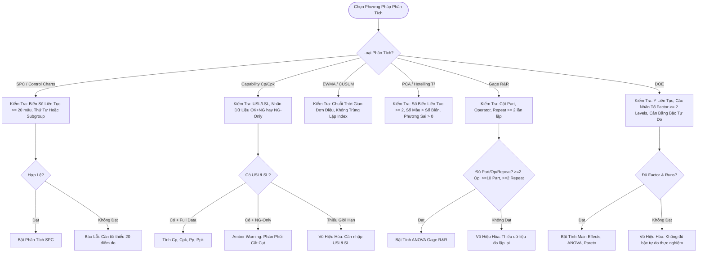
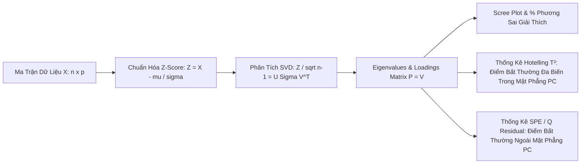
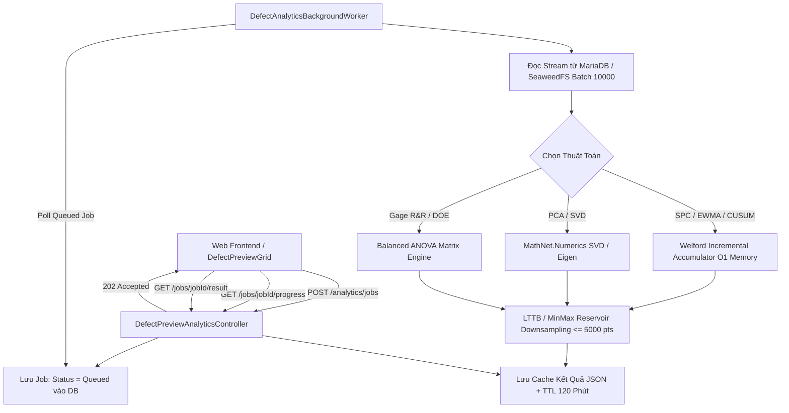
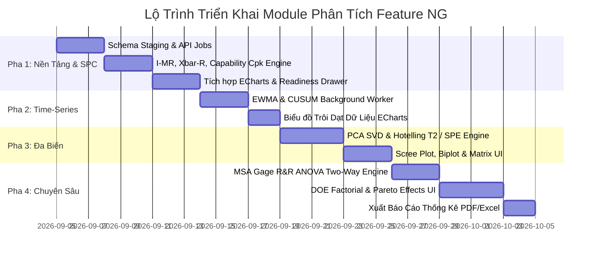

# Kế Hoạch Kiến Trúc: Module Phân Tích Dữ Liệu Feature NG (SPC, MSA, PCA, EWMA, CUSUM, DOE)

Tài liệu thiết kế kiến trúc toàn diện cho module Phân tích Nâng cao Dữ liệu Feature NG (Defect Feature Analytics), tích hợp liền mạch với hệ thống Defect Preview và SeaweedFS hiện hữu trong AutoVerify System.

---

## 1. Khảo Sát Hiện Trạng Dữ Liệu Feature & Pipeline Defect Preview

### 1.1. Thực Trạng Schema & Ingestion Pipeline Hiện Hữu

Qua phân tích mã nguồn tại [`DefectPreviewRecordEntity.cs`](src/backend/AutoVerify.Api/Persistence/Entities/DefectPreviewRecordEntity.cs:3), [`DefectPreviewSessionEntity.cs`](src/backend/AutoVerify.Api/Persistence/Entities/DefectPreviewSessionEntity.cs:3), [`DefectStreamParser.cs`](src/backend/AutoVerify.Api/Services/DefectStreamParser.cs:11), và [`DefectPreviewIngestionService.cs`](src/backend/AutoVerify.Api/Services/DefectPreviewIngestionService.cs:11):

| Trường Dữ Liệu | Kiểu & Lưu Trữ Hiện Hữu | Đánh Giá Khả Năng Sử Dụng Cho Analytics | Điểm Nghẽn / Khoảng Trống (Gap) |
|---|---|---|---|
| `CoordinateX`, `CoordinateY` | `double?` (MariaDB column) | Sẵn sàng cho SPC, tương quan không gian, PCA | Giá trị tọa độ vật lý, chỉ phản ánh 2 chiều không gian. |
| `ConfidenceScore` | `double?` (MariaDB column) | Sẵn sàng cho SPC univariate (I-MR, EWMA) | Điểm tin cậy từ model AI, giá trị từ 0.0 - 1.0. |
| `Severity`, `Judge` | `string` (MariaDB column) | Phân tầng (Stratification), Subgrouping | Đa số phiên preview tập trung lọc bản ghi `"NG"`. |
| `EqpName`, `EmNo`, `SpecName` | `string?` (MariaDB column) | Phân nhóm máy móc, mã thiết bị, cấu hình | Thích hợp làm nhân tố phụ (covariate) hoặc phân nhóm Gage R&R. |
| `InspectedAtUtc` | `DateTimeOffset?` (MariaDB) | Thứ tự thời gian cho EWMA, CUSUM, I-MR run chart | Cần fallback về `RowIndex` nếu timestamp bị thiếu hoặc đồng nhất. |
| `HasFeatureJson` | `bool` (MariaDB column) | Flag kiểm tra sự tồn tại của vector feature | Chỉ là cờ logic. |
| `FeatureJsonSnippet` | `string?` (MariaDB column, max 500 chars) | **KHÔNG ĐỦ** cho analytics đa biến | [`DefectStreamParser.cs`](src/backend/AutoVerify.Api/Services/DefectStreamParser.cs:337) chủ động cắt chuỗi tại `maxSnippetLength = 500`. Các mảng embedding hoặc dictionary 20-100 tham số bị cắt cụt, không parse lại thành số được. |
| `RawFeatureUri` | `string?` (MariaDB column) | Trỏ đến tệp feature gốc trên SeaweedFS | Lưu URI nhưng chưa có worker tải bất đồng bộ theo batch để phục vụ analytics. |

### 1.2. Khoảng Trống Kỹ Thuật Cần Khắc Phục

1. **Vấn đề Cắt Cụt Feature**: `FeatureJsonSnippet` hiện tại chỉ phục vụ hiển thị JSON xem trước ở modal UI ([`DefectPreviewGrid.tsx`](src/web/src/components/DefectPreviewGrid.tsx:398)). Để chạy PCA hoặc phân tích thống kê đa biến, cần một cơ chế trích xuất và chuẩn hóa feature đầy đủ.
2. **Quản Lý Bộ Nhớ Khi Tải Lớn**: Phiên xem trước có thể đạt tới `MaxRowsLimit = 500,000` dòng ([`DefectPreviewOptions.cs`](src/backend/AutoVerify.Api/Services/DefectPreviewOptions.cs:8)). Không thể load toàn bộ 500,000 vector số học vào RAM của tiến trình web API mà không gây Out-Of-Memory (OOM) hoặc nghẽn Garbage Collection (GC).
3. **Mô Hình Dữ Liệu Đa Dạng (Wide vs Long)**: Dữ liệu feature từ thiết bị có thể đến dưới dạng:
   - Dạng rộng (Wide columns): Mỗi bản ghi là 1 dòng với các cột số `Area`, `Aspect_Ratio`, `Contrast`, `Roughness`, v.v.
   - Dạng dài (Key-Value long-form): Mảng JSON `[{"name": "Area", "value": 12.4}, ...]`.
   - Dạng mảng số nguyên thủy (Vector array): `[0.23, 0.88, 1.45, ...]`.

---

## 2. Cơ Sở Thống Kê & Quy Tắc Kiểm Tra Tính Sẵn Sàng Của Dữ Liệu (Data-Readiness Rules)

Phân tích thống kê công nghiệp đòi hỏi nghiêm ngặt về các giả định toán học. Nếu áp dụng sai dữ liệu (ví dụ tính $C_{pk}$ chỉ trên tập lỗi NG), kết quả sẽ gây sai lệch nghiêm trọng cho quyết định chất lượng.

### 2.1. Cảnh Báo Tính Hợp Lệ Của SPC / Năng Lực Quy Trình ($C_p, C_{pk}$) Trên Tập NG-Only

- **Bản Chất Thống Kê**: Chỉ số năng lực quy trình $C_p, C_{pk}, P_p, P_{pk}$ phản ánh tỷ lệ sản phẩm nằm trong giới hạn đặc tính kỹ thuật (USL/LSL) dựa trên phân phối chuẩn của **toàn bộ quá trình sản xuất** (gồm cả sản phẩm Đạt - OK và Không đạt - NG).
- **Hiện Tượng Cắt Cụt (Truncated / Survival Bias)**: Khi dữ liệu nạp vào chỉ gồm các bản ghi NG (đã bị bộ lọc phân loại giữ lại), phân phối đo lường thực chất là phân phối có điều kiện (conditional distribution) bị cắt cụt tại các ngưỡng phán định. Việc tính $\bar{X}$ và $\hat{\sigma}$ trực tiếp trên tập NG sẽ làm sai lệch phương sai quá trình, khiến $C_{pk}$ tính toán không phản ánh năng lực thực tế.
- **Giải Pháp Kiến Trúc & UI**:
  - **Quy tắc Kiểm tra**: Hệ thống phân tích tỷ lệ `Judge == 'OK'` vs `Judge == 'NG'` trong phiên.
  - **Chế độ Tính Toán**:
    1. *Toàn thể (Full Population)*: Cho phép tính toán $C_p / C_{pk}$ tiêu chuẩn khi có đủ cả OK và NG.
    2. *Tập lỗi (NG-Only Conditional)*: Khi chỉ có bản ghi NG, hệ thống bắt buộc hiển thị nhãn cảnh báo màu hổ phách (Amber Warning): `"NG-Only Conditional Distribution: Standard Cpk is mathematically biased. Metric displayed as Truncated Defect Margin."` Đồng thời vô hiệu hóa phán đoán tự động $C_{pk} \ge 1.33$.

### 2.2. Ma Trận Quy Tắc Sẵn Sàng (Data-Readiness Matrix) Cho Từng Phương Pháp



---

## 3. Kiến Trúc Ánh Xạ Dữ Liệu Động (Flexible Mapping & Configuration)

Module phân tích cung cấp giao diện Wizard và cấu hình Schema linh hoạt, cho phép người dùng tự do ánh xạ các cột dữ liệu hoặc trường JSON vào các vai trò phân tích:

### 3.1. Các Trường Ánh Xạ Thống Kê (Mapping Roles)

```typescript
export interface AnalyticsDataMapping {
  // Định danh quan sát
  observationIdColumn: string; // Mặc định: 'RowIndex' hoặc 'DefectId'
  timestampColumn?: string;    // Mặc định: 'InspectedAtUtc' (fallback 'RowIndex')
  
  // Biến mục tiêu / Feature liên tục
  continuousVariables: {
    sourceType: 'COLUMN' | 'JSON_PATH';
    sourcePath: string;        // Ví dụ: 'CoordinateX' hoặc 'features.defect_area'
    displayName: string;
    target?: number;           // Giá trị danh định (Nominal Target)
    usl?: number;              // Giới hạn quy cách trên
    lsl?: number;              // Giới hạn quy cách dưới
  }[];

  // Phân nhóm cho Xbar-R / Xbar-S
  subgrouping: {
    mode: 'FIXED_SIZE' | 'COLUMN_GROUP' | 'TIME_WINDOW';
    fixedSize?: number;        // Ví dụ n = 5
    groupColumn?: string;      // Ví dụ: 'EqpName', 'SpecName'
    timeWindowMinutes?: number;
  };

  // Cấu hình đặc thù cho MSA (Gage R&R)
  msaMapping?: {
    partColumn: string;        // Định danh chi tiết (Part/Sample ID)
    operatorColumn: string;    // Định danh nhân viên đo/máy đo
    replicateColumn?: string;  // Lần đo lặp lại (nếu có cột riêng)
  };

  // Cấu hình đặc thù cho DOE
  doeMapping?: {
    responseVariable: string;  // Biến đáp ứng Y
    factors: {
      column: string;
      name: string;
      type: 'NUMERIC' | 'CATEGORICAL';
      levels?: (string | number)[];
    }[];
    blockColumn?: string;      // Khối (Block)
    runOrderColumn?: string;   // Thứ tự thực nghiệm
  };
}
```

### 3.2. Cơ Chế Auto-Detection Thông Minh

Khi người dùng mở Analytics Wizard:
1. **Auto-Detect Timestamp**: Quét các trường `DateTimeOffset` (`InspectedAtUtc`).
2. **Auto-Detect Numeric Features**: Quét các cột kiểu số `CoordinateX`, `CoordinateY`, `ConfidenceScore`, `Severity` và các thuộc tính số trong `FeatureJsonSnippet` (nếu có).
3. **Auto-Detect Factors**: Các cột chuỗi có số giá trị phân biệt nhỏ (`Cardinality` từ 2 đến 10, ví dụ `EqpName`, `Judge`, `SpecJudge`) được gợi ý làm nhân tố phân nhóm hoặc DOE factors.

---

## 4. Thuật Toán Thống Kê Chi Tiết, Công Thức & Chuẩn Đầu Ra

### 4.1. SPC (Statistical Process Control) & Process Capability

#### A. Biểu Đồ I-MR (Individual - Moving Range) Cho Mẫu Đơn Lẻ ($n = 1$)
- Dữ liệu: $X_1, X_2, \dots, X_N$.
- Khoảng biến thiên động: $MR_i = |X_i - X_{i-1}|$ với $i = 2, \dots, N$.
- Giá trị trung bình: $\bar{X} = \frac{1}{N}\sum_{i=1}^N X_i$, $\overline{MR} = \frac{1}{N-1}\sum_{i=2}^N MR_i$.
- Giới hạn kiểm soát Biểu đồ I ($d_2 = 1.128$ khi kích thước cửa sổ di động $w = 2$):
  $$\text{CL}_X = \bar{X}, \quad \text{UCL}_X = \bar{X} + 3\frac{\overline{MR}}{d_2} = \bar{X} + 2.66\overline{MR}, \quad \text{LCL}_X = \bar{X} - 3\frac{\overline{MR}}{d_2} = \bar{X} - 2.66\overline{MR}$$
- Giới hạn kiểm soát Biểu đồ MR ($D_4 = 3.267, D_3 = 0$):
  $$\text{CL}_{MR} = \overline{MR}, \quad \text{UCL}_{MR} = D_4 \overline{MR} = 3.267\overline{MR}, \quad \text{LCL}_{MR} = 0$$

#### B. Biểu Đồ $\bar{X}-R$ và $\bar{X}-S$ (Subgroups $n \ge 2$)
- Chia $N$ quan sát thành $k$ nhóm mẫu, mỗi nhóm có $n$ mẫu.
- Trung bình nhóm $\bar{X}_j$, biên độ nhóm $R_j = \max(X_j) - \min(X_j)$, độ lệch chuẩn nhóm $s_j = \sqrt{\frac{1}{n-1}\sum_{i=1}^n (X_{ji} - \bar{X}_j)^2}$.
- Đại lượng tổng quát: $\bar{\bar{X}} = \frac{1}{k}\sum_{j=1}^k \bar{X}_j$, $\bar{R} = \frac{1}{k}\sum_{j=1}^k R_j$, $\bar{s} = \frac{1}{k}\sum_{j=1}^k s_j$.
- **Giới hạn $\bar{X}-R$**:
  $$\text{UCL}_{\bar{X}} = \bar{\bar{X}} + A_2 \bar{R}, \quad \text{LCL}_{\bar{X}} = \bar{\bar{X}} - A_2 \bar{R}$$
  $$\text{UCL}_R = D_4 \bar{R}, \quad \text{LCL}_R = D_3 \bar{R}$$
  *(Với hệ số tra bảng phụ thuộc $n$: $n=5 \implies A_2=0.577, D_3=0, D_4=2.114$)*.
- **Giới hạn $\bar{X}-S$**:
  $$\text{UCL}_{\bar{X}} = \bar{\bar{X}} + A_3 \bar{s}, \quad \text{LCL}_{\bar{X}} = \bar{\bar{X}} - A_3 \bar{s}$$
  $$\text{UCL}_s = B_4 \bar{s}, \quad \text{LCL}_s = B_3 \bar{s}$$

#### C. Năng Lực Quy Trình ($C_p, C_{pk}, P_p, P_{pk}$)
- **Độ biến thiên nội bộ (Within-Subgroup Dispersion)**:
  $$\hat{\sigma}_{\text{within}} = \frac{\overline{MR}}{d_2} \quad (\text{với I-MR}), \quad \hat{\sigma}_{\text{within}} = \frac{\bar{R}}{d_2} \quad (\text{với Xbar-R}), \quad \hat{\sigma}_{\text{within}} = \frac{\bar{s}}{c_4} \quad (\text{với Xbar-S})$$
- **Độ biến thiên tổng thể (Overall Dispersion)**:
  $$s_{\text{overall}} = \sqrt{\frac{1}{N-1}\sum_{i=1}^N (X_i - \bar{X})^2}$$
- **Chỉ số năng lực tiềm năng (Potential Capability)**:
  $$C_p = \frac{\text{USL} - \text{LSL}}{6\hat{\sigma}_{\text{within}}}, \quad C_{pk} = \min\left(\frac{\text{USL} - \bar{X}}{3\hat{\sigma}_{\text{within}}}, \frac{\bar{X} - \text{LSL}}{3\hat{\sigma}_{\text{within}}}\right)$$
- **Chỉ số hiệu năng tổng thể (Overall Performance)**:
  $$P_p = \frac{\text{USL} - \text{LSL}}{6 s_{\text{overall}}}, \quad P_{pk} = \min\left(\frac{\text{USL} - \bar{X}}{3 s_{\text{overall}}}, \frac{\bar{X} - \text{LSL}}{3 s_{\text{overall}}}\right)$$

#### D. Nelson Rules & Western Electric Rules
Hệ thống cài đặt 8 quy tắc phát hiện bất thường tự động:
1. **Rule 1**: 1 điểm vượt ngoài vùng $3\sigma$ ($>\text{UCL}$ hoặc $<\text{LCL}$).
2. **Rule 2**: 9 điểm liên tiếp nằm về một phía của đường trung tâm $\bar{X}$.
3. **Rule 3**: 6 điểm liên tiếp tăng dần đều hoặc giảm dần đều (Trend).
4. **Rule 4**: 14 điểm liên tiếp luân phiên tăng giảm xen kẽ (Systematic oscillation).
5. **Rule 5**: 2 trong 3 điểm liên tiếp nằm ngoài vùng $2\sigma$ về cùng một phía.
6. **Rule 6**: 4 trong 5 điểm liên tiếp nằm ngoài vùng $1\sigma$ về cùng một phía.
7. **Rule 7**: 15 điểm liên tiếp nằm trong vùng $1\sigma$ (Stratification / Hugging center line).
8. **Rule 8**: 8 điểm liên tiếp nằm ngoài vùng $1\sigma$ về cả hai phía không điểm nào trong $1\sigma$ (Mixture pattern).

---

### 4.2. MSA (Measurement Systems Analysis) - Gage R&R ANOVA

Đánh giá độ lặp lại (Repeatability) và độ tái lập (Reproducibility) của hệ thống đo kiểm quang học / nhân viên kiểm tra.

#### A. Mô Hình Hai Nhân Tố Giao Nhau (Two-Way Crossed ANOVA with Interaction)
Mô hình tuyến tính:
$$Y_{ijk} = \mu + P_i + O_j + (PO)_{ij} + \epsilon_{ijk}$$
với $i = 1\dots p$ (Chi tiết/Parts), $j = 1\dots o$ (Người đo/Operators), $k = 1\dots r$ (Lần lặp/Repeats).

#### B. Phân Tích Phương Sai (ANOVA Table)
1. **Tổng bình phương (Sum of Squares)**:
   - $SS_{\text{Total}} = \sum_{i}\sum_{j}\sum_{k} (Y_{ijk} - \bar{Y}_{\dots})^2$
   - $SS_{\text{Part}} = o \cdot r \sum_{i} (\bar{Y}_{i\dots} - \bar{Y}_{\dots})^2, \quad df_P = p - 1$
   - $SS_{\text{Operator}} = p \cdot r \sum_{j} (\bar{Y}_{\cdot j \cdot} - \bar{Y}_{\dots})^2, \quad df_O = o - 1$
   - $SS_{PO} = r \sum_{i}\sum_{j} (\bar{Y}_{ij\cdot} - \bar{Y}_{i\dots} - \bar{Y}_{\cdot j \cdot} + \bar{Y}_{\dots})^2, \quad df_{PO} = (p - 1)(o - 1)$
   - $SS_{\text{Repeatability}} = \sum_{i}\sum_{j}\sum_{k} (Y_{ijk} - \bar{Y}_{ij\cdot})^2, \quad df_E = p \cdot o \cdot (r - 1)$
2. **Mean Squares**: $MS = \frac{SS}{df}$.
3. **Kiểm định tương tác**: Nếu $p\text{-value của } F = \frac{MS_{PO}}{MS_E} \ge 0.05$, tương tác $PO$ không có ý nghĩa thống kê $\implies$ gộp sai số (pooling) vào $MS_E$.
4. **Ước lượng thành phần phương sai (Variance Components)**:
   $$\sigma^2_{\text{Repeatability}} = MS_E$$
   $$\sigma^2_{PO} = \max\left(0, \frac{MS_{PO} - MS_E}{r}\right)$$
   $$\sigma^2_{\text{Operator}} = \max\left(0, \frac{MS_O - MS_{PO}}{p \cdot r}\right)$$
   $$\sigma^2_{\text{Gage R&R}} = \sigma^2_{\text{Repeatability}} + \sigma^2_{\text{Operator}} + \sigma^2_{PO}$$
   $$\sigma^2_{\text{Part}} = \max\left(0, \frac{MS_P - MS_{PO}}{o \cdot r}\right)$$
   $$\sigma^2_{\text{Total}} = \sigma^2_{\text{Gage R&R}} + \sigma^2_{\text{Part}}$$
5. **Chỉ số đánh giá hệ thống đo (AIAG Standard)**:
   - $\%GRR_{\text{TV}} = \frac{\sigma_{\text{Gage R&R}}}{\sigma_{\text{Total}}} \times 100\%$
   - $\%GRR_{\text{Tol}} = \frac{6 \sigma_{\text{Gage R&R}}}{\text{USL} - \text{LSL}} \times 100\%$
   - Số phân nhóm phân biệt (Number of Distinct Categories):
     $$\text{ndc} = 1.41 \frac{\sigma_{\text{Part}}}{\sigma_{\text{Gage R&R}}}$$
   - **Quy tắc phán định**:
     - $\%GRR < 10\%$: Hệ thống đo lường Chấp Nhận Tốt (Acceptable).
     - $10\% \le \%GRR \le 30\%$: Chấp nhận có điều kiện (Marginal).
     - $\%GRR > 30\%$ hoặc $\text{ndc} < 5$: Không chấp nhận (Unacceptable), cần hiệu chuẩn thiết bị.

---

### 4.3. Phân Tích Thành Phần Chính (PCA) & Giám Sát Đa Biến (Hotelling $T^2$ / SPE)

Phát hiện cụm dị thường đa chiều khi các biến số đơn lẻ vẫn nằm trong giới hạn kiểm soát nhưng mối tương quan liên biến bị vi phạm.



#### A. Chuẩn Hóa & Phân Rã Giá Trị Suy Biến (SVD)
1. Ma trận dữ liệu quan sát $X \in \mathbb{R}^{n \times p}$ (với $n$ mẫu defect, $p$ đặc trưng số).
2. Chuẩn hóa về $Z \in \mathbb{R}^{n \times p}$ với trung bình từng cột bằng 0 và độ lệch chuẩn bằng 1: $z_{ij} = \frac{x_{ij} - \bar{x}_j}{s_j}$.
3. Ma trận hiệp phương sai / tương quan: $R = \frac{1}{n-1} Z^T Z$.
4. Phân tích giá trị kỳ dị (SVD): $\frac{1}{\sqrt{n-1}} Z = U \Sigma V^T$.
   - Ma trận Loadings: $P = V \in \mathbb{R}^{p \times p}$.
   - Phương sai thành phần: $\lambda_j = \Sigma_{jj}^2$.
   - Điểm số (Scores): $T = Z P = [t_1, t_2, \dots, t_p] \in \mathbb{R}^{n \times p}$.
5. Tỷ lệ phương sai giải thích thành phần thứ $j$: $\gamma_j = \frac{\lambda_j}{\sum_{k=1}^p \lambda_k}$. Giữ lại $k$ thành phần đầu sao cho $\sum_{j=1}^k \gamma_j \ge 80\%-90\%$.

#### B. Giám Sát Thống Kê Hotelling $T^2$ (Điểm Dị Thường Trong Không Gian Mô Hình)
Khoảng cách Mahalanobis trong không gian thu giảm chiều:
$$T_i^2 = \sum_{j=1}^k \frac{t_{ij}^2}{\lambda_j} = t_{i, 1:k} \Lambda_k^{-1} t_{i, 1:k}^T$$
- **Ngưỡng kiểm soát (Control Limit)** ở mức ý nghĩa $\alpha = 0.05$ hoặc $0.01$:
  $$T^2_{\text{UCL}} = \frac{k (n^2 - 1)}{n (n - k)} F_{\alpha}(k, n - k)$$
  Khi $n \gg 1000$, xấp xỉ bằng phân phối Chi-Square: $T^2_{\text{UCL}} \approx \chi^2_{\alpha}(k)$.

#### C. Thống Kê Sai Số Dự Báo Bình Phương (SPE / Q-Residual)
Đo lường mức độ sai khác giữa vector thực tế và không gian tái tạo của $k$ thành phần chính:
$$\hat{z}_i = t_{i, 1:k} P_k^T, \quad e_i = z_i - \hat{z}_i = z_i (I - P_k P_k^T)$$
$$Q_i = \text{SPE}_i = e_i e_i^T = \sum_{j=1}^p (z_{ij} - \hat{z}_{ij})^2$$
- **Ngưỡng kiểm soát Jackson-Mudholkar**:
  $$\theta_1 = \sum_{j=k+1}^p \lambda_j, \quad \theta_2 = \sum_{j=k+1}^p \lambda_j^2, \quad \theta_3 = \sum_{j=k+1}^p \lambda_j^3$$
  $$h_0 = 1 - \frac{2\theta_1 \theta_3}{3\theta_2^2}, \quad c_{\alpha} = \text{phân vị chuẩn } z_{1-\alpha}$$
  $$Q_{\alpha} = \theta_1 \left(1 + \frac{c_{\alpha} \sqrt{2\theta_2 h_0^2}}{\theta_1} + \frac{\theta_2 h_0 (h_0 - 1)}{\theta_1^2}\right)^{1/h_0}$$

---

### 4.4. EWMA & CUSUM Time-Series Anomaly Detection

Phát hiện sự trôi dạt nhỏ (Small Process Shifts từ $0.5\sigma$ đến $1.5\sigma$) mà Shewhart control charts thường bỏ sót.

#### A. EWMA (Exponentially Weighted Moving Average)
- Công thức đệ quy:
  $$Z_i = \lambda X_i + (1 - \lambda) Z_{i-1}, \quad Z_0 = \mu_0 \quad (\text{hoặc } \bar{X})$$
  *(Với tham số trọng số làm mịn $\lambda \in [0.05, 0.25]$, khuyến nghị $\lambda = 0.1$, $L = 2.7$)*.
- **Giới hạn kiểm soát thời gian biến thiên (Time-varying limits)**:
  $$\text{CL} = \mu_0$$
  $$\text{UCL}_i = \mu_0 + L \sigma \sqrt{\frac{\lambda}{2 - \lambda} \left[1 - (1 - \lambda)^{2i}\right]}$$
  $$\text{LCL}_i = \mu_0 - L \sigma \sqrt{\frac{\lambda}{2 - \lambda} \left[1 - (1 - \lambda)^{2i}\right]}$$
  Khi $i \to \infty$, giới hạn tiệm cận ổn định: $\mu_0 \pm L \sigma \sqrt{\frac{\lambda}{2 - \lambda}}$.

#### B. CUSUM Dạng Bảng Hai Phía (Tabular Two-Sided Cumulative Sum)
- Tham số cấu hình: Độ dịch chuyển cần phát hiện $\delta = 1.0\sigma$, tham số dung sai $K = \frac{\delta}{2} \sigma = 0.5\sigma$, ngưỡng quyết định $H = 5\sigma$ (hoặc $4\sigma$).
- Đệ quy CUSUM tích lũy trên ($C^+$) và dưới ($C^-$):
  $$C_i^+ = \max\left(0, X_i - (\mu_0 + K) + C_{i-1}^+\right), \quad C_0^+ = 0$$
  $$C_i^- = \max\left(0, (\mu_0 - K) - X_i + C_{i-1}^-\right), \quad C_0^- = 0$$
- **Cảnh báo bất thường**:
  - Nếu $C_i^+ > H \implies$ Quy trình dịch chuyển lên phía trên.
  - Nếu $C_i^- > H \implies$ Quy trình dịch chuyển xuống phía dưới.

---

### 4.5. DOE (Design of Experiments) Module

Phân tích ảnh hưởng của các yếu tố thiết bị, cài đặt thông số và ca làm việc đến thuộc tính lỗi.

#### A. Mô Hình Giai Thừa (Factorial Screening Design)
- Tính toán hiệu ứng chính (Main Effects):
  $$E_A = \bar{Y}_{A^+} - \bar{Y}_{A^-}$$
- Hiệu ứng tương tác hai nhân tố (Two-factor Interactions):
  $$E_{AB} = \frac{1}{2}\left[\left(\bar{Y}_{A^+B^+} - \bar{Y}_{A^+B^-}\right) - \left(\bar{Y}_{A^-B^+} - \bar{Y}_{A^-B^-}\right)\right]$$
- **Biểu đồ Pareto Hiệu ứng Chuẩn Hóa (Pareto Chart of Standardized Effects)**:
  Thống kê $t = \frac{|Effect|}{SE_{Effect}}$. Đường tham chiếu mức ý nghĩa $\alpha = 0.05$ theo phân phối Student $t_{\alpha/2, df_E}$ hoặc Lenth's Pseudo Standard Error (PSE) khi không có đo lặp (unreplicated factorial).
- **Chẩn Đoán Phần Dư (Residual Diagnostics)**:
  - Normal Probability Plot của phần dư $e_i = Y_i - \hat{Y}_i$ kiểm tra phân phối chuẩn.
  - Đồ thị Residuals vs Fits kiểm tra phương sai đồng nhất (Homoscedasticity).

---

## 5. Kiến Trúc Backend Analytics Job, Caching & Xử Lý Big Data

Để hỗ trợ tới 500,000 bản ghi mà không tràn RAM hệ thống backend, kiến trúc áp dụng mô hình Streaming Ingestion, Phân rã theo Lô và Tối ưu hóa tính toán ma trận.



### 5.1. Bảng Dữ Liệu Staging Cho Feature Chuẩn Hóa

Nhằm khắc phục việc `FeatureJsonSnippet` bị cắt 500 ký tự, khi một phiên preview yêu cầu phân tích chuyên sâu, worker sẽ trích xuất vector số vào bảng phụ trợ hoặc binary column:

```csharp
namespace AutoVerify.Api.Persistence.Entities;

public sealed class DefectAnalyticsJobEntity
{
    public Guid Id { get; set; } = Guid.NewGuid();
    public Guid SessionId { get; set; }
    public string AnalysisType { get; set; } = string.Empty; // "SPC", "PCA", "MSA", "EWMA", "CUSUM", "DOE"
    public string Status { get; set; } = "Queued"; // "Queued", "Computing", "Completed", "Failed", "Cancelled"
    public int ProgressPercent { get; set; }
    public string ConfigurationJson { get; set; } = "{}"; // Tham số người dùng chọn
    public string? ResultJson { get; set; } // Kết quả thống kê đã downsampling
    public string? ErrorMessage { get; set; }
    public DateTimeOffset CreatedAtUtc { get; set; } = DateTimeOffset.UtcNow;
    public DateTimeOffset? StartedAtUtc { get; set; }
    public DateTimeOffset? CompletedAtUtc { get; set; }
    public DateTimeOffset ExpiresAtUtc { get; set; }
}

public sealed class DefectPreviewFeatureEntity
{
    public long Id { get; set; }
    public Guid SessionId { get; set; }
    public long RecordId { get; set; }
    public string FeatureName { get; set; } = string.Empty;
    public double FeatureValue { get; set; }
}
```

*Đánh chỉ mục MariaDB*:
- `INDEX IX_DefectAnalyticsJob_Session_Status (SessionId, Status)`
- `INDEX IX_DefectPreviewFeature_Session_Name (SessionId, FeatureName, FeatureValue)`

### 5.2. Đánh Giá Thư Viện Toán Học: MathNet.Numerics vs Tự Phát Triển (Custom)

| Tiêu Chí | MathNet.Numerics (v5.0.0) | Custom Implementation | Kiến Trúc Lựa Chọn |
|---|---|---|---|
| **Đại Số Tuyến Tính (SVD, Eigenvalue)** | Rất mạnh, chuẩn hóa cao, hỗ trợ SIMD MKL/OpenBLAS nếu cần. | Dễ lỗi số học (numerical instability) ở ma trận suy biến. | **Dùng MathNet.Numerics** cho PCA và giải ma trận phương sai ANOVA. |
| **Tính Toán SPC (I-MR, Xbar, Rules)** | Không có sẵn các quy tắc chuyên biệt như Nelson Rules. | Đơn giản, cực nhẹ, không phân bổ bộ nhớ (Zero-allocation). | **Tự cài đặt Custom C# Engine** theo chuẩn AIAG / ISO 7870. |
| **Thuật Toán Luồng (Streaming / Incremental)** | Yêu cầu load mảng vào Vector/Matrix trong bộ nhớ. | Cài đặt thuật toán Welford tính $\bar{X}$ và $s^2$ trong 1 vòng lặp duy nhất ($O(1)$ RAM). | **Tự cài đặt Welford Stream Accumulator** cho bước nạp dữ liệu. |
| **Downsampling Dữ Liệu Cho Chart** | Không hỗ trợ trực tiếp. | Cài đặt Largest Triangle Three Buckets (LTTB) để giảm 500k điểm xuống 5000 điểm vẽ biểu đồ. | **Tự cài đặt LTTB Downsampling Engine**. |

---

## 6. Thiết Kế REST API Contracts & Mô Hình Trạng Thái

Các endpoint được định tuyến dưới namespace controller [`DefectPreviewController.cs`](src/backend/AutoVerify.Api/Controllers/DefectPreviewController.cs:6):

### 6.1. Chi Tiết API Contracts

```csharp
// POST /api/defect-preview/{sessionId}/analytics/jobs
public record CreateAnalyticsJobRequest(
    string AnalysisType, // "SPC" | "PCA" | "MSA" | "EWMA" | "CUSUM" | "DOE"
    AnalyticsDataMapping Mapping,
    Dictionary<string, object> Parameters
);

public record AnalyticsJobResponse(
    Guid JobId,
    Guid SessionId,
    string AnalysisType,
    string Status,
    int ProgressPercent,
    DateTimeOffset CreatedAtUtc
);

// GET /api/defect-preview/{sessionId}/analytics/readiness
public record AnalyticsReadinessResponse(
    bool IsSpcReady,
    bool IsMsaReady,
    bool IsPcaReady,
    bool IsDoeReady,
    List<string> Warnings,
    List<string> AvailableNumericColumns,
    List<string> AvailableCategoricalColumns,
    int TotalRecordCount,
    int NgCount,
    int OkCount
);

// GET /api/defect-preview/{sessionId}/analytics/jobs/{jobId}/result
public record AnalyticsResultResponse(
    Guid JobId,
    string AnalysisType,
    Dictionary<string, double> SummaryMetrics, // Cp, Cpk, Pp, Ppk, T2_UCL, %GRR, ndc
    List<ControlViolationPoint> Violations,     // Các điểm vi phạm Nelson Rules
    List<DownsampledSeriesPoint> ChartPoints,   // Dữ liệu hiển thị biểu đồ
    Dictionary<string, object> ModelMetadata   // Scree values, ANOVA tables, Loadings
);
```

---

## 7. Đánh Giá & Lựa Chọn Thư Viện Biểu Đồ Frontend

Hiện tại [`package.json`](src/web/package.json:12) của frontend chưa cài đặt thư viện biểu đồ nào. Đánh giá lựa chọn giữa 3 thư viện mã nguồn mở:

| Tiêu Chí Đánh Giá | Apache ECharts (`echarts-for-react`) | Recharts | Plotly.js (`react-plotly.js`) |
|---|---|---|---|
| **Công Nghệ Vẽ (Renderer)** | **Canvas / WebGL** (Cực nhanh với tập dữ liệu lớn 10k - 100k điểm) | SVG (Chậm khi vượt quá 2,000 phần tử DOM) | Canvas / WebGL |
| **Kích Thước Bundle (Bundle Size)** | Vừa phải, hỗ trợ tree-shaking chia nhỏ module | Nhẹ (~500KB) | Rất nặng (~3MB+ minified) |
| **Biểu Đồ SPC & Dây Ruy-băng / Dải LCL-UCL** | Hỗ trợ cực tốt qua `markLine`, `markArea`, `visualMap` | Khá thủ công với `ReferenceArea` | Hỗ trợ tốt |
| **Biểu Đồ PCA Biplot & Heatmap Ma Trận** | Rất phong phú, có sẵn Scatter 2D/3D, Heatmap, Scree bar | Rất hạn chế, không có heatmap hiệu năng cao | Rất mạnh mẽ |
| **Điều Hướng & Tương Tác Dữ Liệu Lớn** | **Tích hợp sẵn `dataZoom`** (slider + mousewheel), tooltips mượt | Giật lag khi zoom tập dữ liệu lớn | Tương tác tốt nhưng UI cổ điển |
| **Giấy Phép Bản Quyền (License)** | **Apache-2.0** (Hoàn toàn miễn phí, thương mại thoải mái) | MIT | MIT |
| **Kết Luận Đề Xuất** | **LỰA CHỌN TỐI ƯU (RECOMMENDED)** | Loại (Không chịu tải nổi dữ liệu công nghiệp) | Loại (Quá nặng cho giao diện quản trị gọn nhẹ) |

---

## 8. Tích Hợp UI/UX Pro Max Design System & Bảng Màu Khoa Học

Dựa trên kết quả tra cứu kỹ thuật từ skill `ui-ux-pro-max` (Phong cách **Style 28: Data-Dense Dashboard / Scientific Analytics**, High Visual Density, Low Motion):

### 8.1. Bảng Màu Thống Kê Chuẩn Công Nghiệp (WCAG AA Contrast $\ge 4.5:1$)

| Vai Trò Trực Quan | Mã Màu Hex | Ứng Dụng Trong Biểu Đồ Analytics |
|---|---|---|
| **Center Line (CL / Mean)** | `#0284c7` (Sky Blue 600) | Đường trung bình $\bar{X}, \bar{R}, \bar{s}, \mu_0$ (Đường liền nét 1.5px). |
| **Control Limits (UCL / LCL)** | `#dc2626` (Red 600) | Giới hạn kiểm soát thống kê $\pm 3\sigma$ (Đường nét đứt `[4, 4]`). |
| **Specification Limits (USL / LSL)** | `#ea580c` (Orange 600) | Giới hạn dung sai kỹ thuật khách hàng (Đường liền nét đậm 2px). |
| **In-Control Points** | `#2563eb` (Blue 600) | Các điểm mẫu đạt trạng thái ổn định (Chấm tròn đường kính 4px). |
| **Nelson Rule Violations** | `#ef4444` (Bright Red 500) | Điểm bất thường vi phạm quy tắc Nelson (Halo hào quang + biểu tượng tam giác). |
| **Hotelling $T^2$ Dị Thường** | `#9333ea` (Purple 600) | Điểm ngoài giới hạn Mahalanobis đa biến. |
| **Amber Warning (Phân Phối Cắt Cụt)**| `#d97706` (Amber 600) | Khung thông báo và cảnh báo thống kê chưa đủ điều kiện tiêu chuẩn. |
| **Background Grid & Axis** | `#e2e8f0` (Light) / `#334155` (Dark) | Lưới tọa độ tinh giản, không gây nhiễu thị giác. |

### 8.2. Quy Chuẩn Typography & Bố Cục
- **Font Số Liệu**: Sử dụng font monospace chuyên dụng `JetBrains Mono` hoặc `font-variant-numeric: tabular-nums` cho toàn bộ các chỉ số thống kê ($C_{pk}, P_p, \%GRR, ndc$).
- **Mật Độ Giao Diện**: High Density (padding `4px - 8px`, border radius `4px - 6px`, không dùng bóng đổ nặng nề).

---

## 9. Thiết Kế Giao Diện Người Dùng (Dashboard UX & Interaction Flow)

Giao diện phân tích được tích hợp trong không gian làm việc **Products & Analysis** -> **Defect & Feature Analysis** ([`DefectAnalysisTab.tsx`](src/web/src/tabs/DefectAnalysisTab.tsx)), khởi chạy trực tiếp qua thanh công cụ của [`DefectPreviewGrid.tsx`](src/web/src/components/DefectPreviewGrid.tsx:420) sau khi luồng dữ liệu defect stream từ SeaweedFS được giải nén và nạp thành công vào staging MariaDB. Phần **Configuration & Data** (`StorageTab.tsx`) chỉ phục vụ cấu hình/quản trị storage. Giao diện phân tích gồm 4 phân vùng chính:

```
+---------------------------------------------------------------------------------------------------+
| AutoVerify - NG Feature Analytics                                       [Close Analytics Canvas] |
+---------------------------------------------------------------------------------------------------+
| [SPC / Capability] | [MSA Gage R&R] | [PCA / Hotelling T²] | [EWMA / CUSUM] | [DOE Analysis]     |
+---------------------------------------------------------------------------------------------------+
| Session: 50,000 Records | Filter: NG Only (Amber Warning: Truncated Cpk) | [Configure Variables] |
+------------------------------------+--------------------------------------------------------------+
| CONFIGURATION & READINESS DRAWER   | PRIMARY STATISTICAL CHART (ECharts Canvas)                   |
| - Target Variable: [CoordinateX v] |  (Hiển thị Run Chart, UCL, LCL, USL, LSL, DataZoom Slider)  |
| - Subgroup Size: [ 5 ]             |                                                              |
| - USL: [ 105.0 ]  LSL: [ 95.0 ]    |                                                              |
| [✓] Readiness Check Passed         +--------------------------------------------------------------+
|                                    | SECONDARY DIAGNOSTICS MATRIX (Tabs / 2-Grid)                 |
| Statistical Readouts:              | [Histogram & Normal Fit]     | [Range / S Chart / Pareto]    |
| - Cp:  1.42     - Cpk: 1.18        |                              |                               |
| - Pp:  1.35     - Ppk: 1.09        |                              |                               |
| - Nelson Violations: 3 pts         |                              |                               |
+------------------------------------+--------------------------------------------------------------+
| VIOLATION DRILL-DOWN TABLE (Nhấn vào điểm dị thường trên Chart để lọc trực tiếp bản ghi Grid)      |
| [Row 1,420] CoordinateX: 106.2 | Rule 1: Beyond UCL | [Inspect Modal] [Locate in Preview Grid]    |
+---------------------------------------------------------------------------------------------------+
```

### 9.1. Tương Tác Drill-Down Chi Tiết (Chart-to-Grid Traceability)
Khi kỹ sư bấm vào bất kỳ điểm dị thường nào trên biểu đồ ECharts (ví dụ điểm vi phạm Nelson Rule 1 hoặc vượt ngưỡng Hotelling $T^2$):
1. Sự kiện `chart.on('click')` thu nhận `RowIndex` hoặc `RecordId`.
2. Hệ thống tự động cuộn và làm nổi bật (Highlight Row) dòng lỗi tương ứng trong bảng TanStack Table của Defect Preview.
3. Mở nhanh modal xem ảnh chi tiết lỗi và chuỗi snippet dữ liệu feature gốc.

---

## 10. Kế Hoạch Triển Khai Theo Từng Pha & Bộ Dữ Liệu Kiểm Thử (Synthetic Tests)

### 10.1. Phân Chia Các Giai Đoạn Triển Khai (Phased Rollout)



### 10.2. Bộ Dữ Liệu Kiểm Thử Giả Lập Chuẩn (Synthetic Benchmark Datasets)

Để đảm bảo tính chính xác tuyệt đối của các thuật toán toán học, bộ unit tests phải đối chiếu với các giá trị kỳ vọng chuẩn (Benchmark Ground Truth):

1. **Bộ Dữ Liệu NIST StRD (Standard Reference Data for Statistical Algorithms)**:
   - *Mục tiêu*: Kiểm tra độ chính xác số học của trung bình $\bar{X}$, độ lệch chuẩn $s$, và kiểm định ANOVA. Sai số thuật toán cho phép $\le 10^{-10}$.
2. **Bộ Dữ Liệu AIAG SPC Benchmark (Mẫu I-MR $N=30$)**:
   - Dữ liệu đo đường kính: `[10.1, 10.2, 9.9, 10.0, 10.3, ...]`
   - Giá trị kỳ vọng: $\bar{X} = 10.05$, $\overline{MR} = 0.21$, $\text{UCL}_X = 10.608$, $\text{LCL}_X = 9.491$.
3. **Bộ Dữ Liệu AIAG Gage R&R Crossed 10-Parts x 3-Operators x 3-Replicates**:
   - Dữ liệu chuẩn mực theo cẩm nang AIAG MSA Ấn bản lần 4.
   - Giá trị kỳ vọng: $\%GRR = 24.3\%$, $\text{ndc} = 5.2 \implies$ Kết quả phán định: Marginal.
4. **Bộ Dữ Liệu PCA Dị Thường Đa Biến (Synthetic Multivariate 5-D)**:
   - 10,000 điểm bình thường có phân phối $\mathcal{N}(\mathbf{0}, \mathbf{\Sigma})$ và 50 điểm dị thường đa biến có $T^2 > \chi^2_{0.01}(5)$ nhưng từng biến đơn lẻ vẫn nằm trong khoảng $[-2\sigma, +2\sigma]$.
   - Kiểm tra khả năng phát hiện đúng 100% của Hotelling $T^2$ detector.

---

## 11. Đánh Giá Trải Nghiệm Cấu Hình: Wizard Tự Động Hóa vs Nhập Liệu Người Dùng

Nhằm mang lại trải nghiệm tiện dụng tối đa cho kỹ sư kiểm tra chất lượng (QA/QC Engineer):
- **Không yêu cầu người dùng phải tự cấu hình thủ công từ đầu**: Hệ thống tự động phân tích metadata của phiên, nhận diện các cột số khả dĩ, tính toán trước phân phối và tự động điền các tham số mặc định an toàn (Smart Defaults).
- **Giữ toàn quyền tùy biến nâng cao**: Cung cấp thanh trượt tùy chỉnh nhanh kích thước nhóm mẫu $n$, giới hạn $USL/LSL$, trọng số $\lambda$ của EWMA, và số thành phần chính $k$ của PCA với phản hồi biểu đồ tức thì.

---

## 12. Báo Cáo QA Tích Hợp End-to-End & Khắc Phục Lỗi Cuối (Post-Implementation QA Audit)

Sau khi hoàn thành toàn diện mã nguồn backend, frontend và cơ sở dữ liệu, một đợt kiểm thử tích hợp chuyên sâu (E2E Integration QA) đã phát hiện và khắc phục triệt để các vấn đề:

1. **Sửa Lỗi Phân Trang Drill-Down (Chart-to-Grid Traceability)**:
   - *Nguyên nhân*: Công thức `Math.floor(rowIndex / pageSize) + 1` làm sai lệch trang khi `rowIndex` là bội số của `pageSize` (ví dụ `rowIndex = 20` với `pageSize = 20` bị đẩy sang trang 2 thay vì trang 1).
   - *Khắc phục*: Cập nhật công thức chuẩn hóa 1-based index: `Math.floor((rowIndex - 1) / pageSize) + 1`.
2. **Khắc Phục Vòng Lặp Polling & Timer Churn Trong Dashboard**:
   - *Nguyên nhân*: Hook `useEffect` lắng nghe trực tiếp object tham chiếu `activeJob`, khiến mỗi lần `setActiveJob` làm trigger re-run timer polling không mong muốn.
   - *Khắc phục*: Tách các scalar primitive dependencies `activeJobId` và `activeJobStatus`, đảm bảo timer polling giữ vững chu kỳ 2500ms đến khi hoàn tất.
3. **Thay Thế Hoàn Toàn Emojis Bằng Biểu Tượng SVG Chuẩn Hóa**:
   - Thay thế toàn bộ ký tự Unicode emojis (`📊`, `⚠️`) trong `DefectPreviewGrid.tsx`, `JobLifecycleBar.tsx`, `ReadinessOverview.tsx`, `SpcCharts.tsx`, `TimeSeriesCharts.tsx`, và `PcaCharts.tsx` bằng SVG vectors chuẩn trợ năng và text badge `[Violation]`, `[Outlier]`.
4. **Phòng Ngừa Xung Đột Dữ Liệu Trùng Lặp Trong PCA / DOE**:
   - Cải tiến gom nhóm feature theo dòng (`Dictionary` indexer thay cho `ToDictionary`), ngăn chặn hoàn toàn lỗi ngoại lệ `ArgumentException` khi gặp trùng tên feature hoặc khoảng trắng.
5. **Khôi Phục Tiến Trình Khi Khởi Động Lại Server (Restart Job Recovery)**:
   - Thêm cơ chế tự động quét bảng `DefectAnalyticsJobs` khi khởi động dịch vụ: chuyển các tác vụ đang `Computing` bị ngắt quãng sang trạng thái `Failed` và tái xếp hàng (`_jobChannel.Writer`) các tác vụ `Queued`.
6. **Bổ Sung Cảnh Báo Timestamp Cho Phân Tích Chuỗi Thời Gian**:
   - Đánh giá trường `InspectedAtUtc` trong `EvaluateReadiness` và hiển thị cảnh báo hướng dẫn người dùng khi dữ liệu chuỗi thiếu thông tin thời gian thực.
7. **Đạt Tiêu Chuẩn Quality Gates**:
   - Toàn bộ unit/regression tests (`dotnet test`) vượt qua 16/16 kiểm thử; bản dựng backend (`dotnet build`) đạt 0 warnings, 0 errors; frontend build (`npm run build`) và linter (`npm run lint`) đạt 0 errors.

---

*Tài liệu kiến trúc và báo cáo QA được hoàn thiện và xác thực bởi Zoo.*
