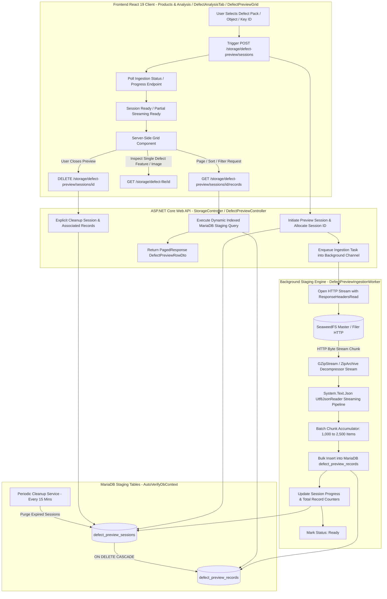
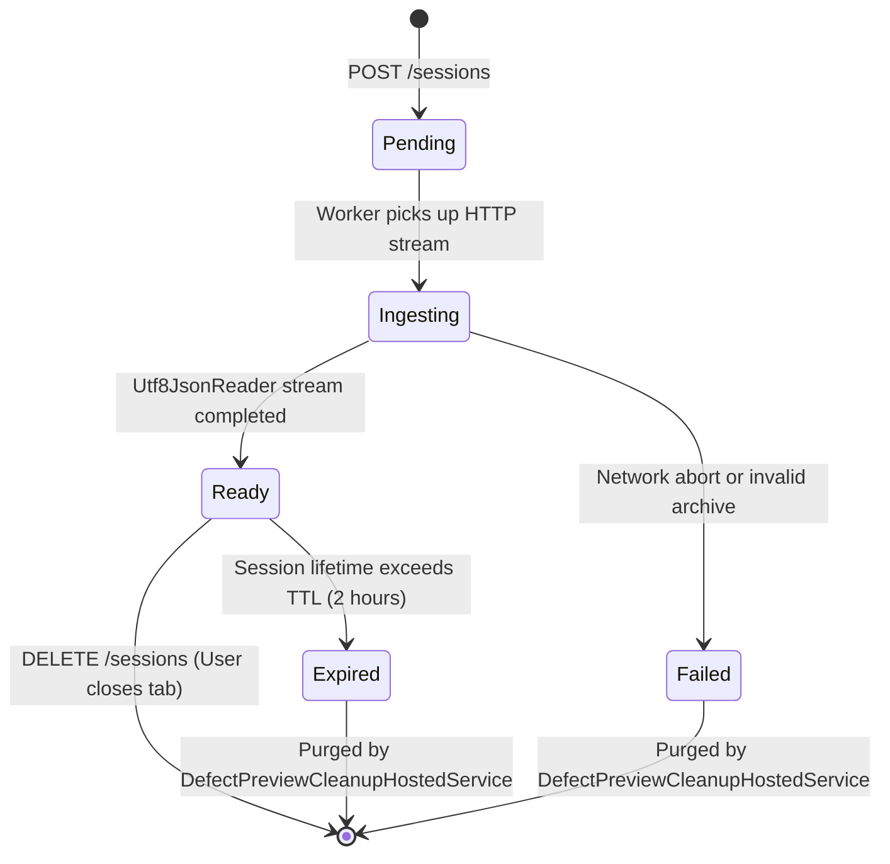

# Technical Specification: SeaweedFS Large-Scale Defect Data Preview Architecture & Server-Side Grid

## 1. Context & Problem Statement

In the AutoVerify Quality Assurance system, defect data is produced by high-speed Automated Optical Inspection (AOI) and Solder Paste Inspection (SPI) machines. When defect records are consolidated into unified defect packs (`.json.gz`), product defect bundles (`.zip`), or bulk JSON exports, the number of individual defect occurrences per product or inspection batch often scales from tens of thousands up to over 500,000 records, spanning tens or hundreds of megabytes in compressed format (and gigabytes uncompressed).

### Current System Bottlenecks
1. **Memory Exhaustion (Backend LOH Fragmentation & OOM)**:
   - In [`SeaweedFsStorageManager.cs`](src/backend/AutoVerify.Api/Storage/SeaweedFsStorageManager.cs:489) and [`SeaweedFsStorageManager.cs`](src/backend/AutoVerify.Api/Storage/SeaweedFsStorageManager.cs:650), data retrieval executes `await response.Content.ReadAsByteArrayAsync()` followed by `new MemoryStream(rawBytes)` and `reader.ReadToEndAsync()`.
   - Loading 50MB–500MB compressed archives directly into byte arrays allocates onto the .NET Large Object Heap (LOH), triggering severe garbage collection pauses and potential `OutOfMemoryException`.
2. **Database Overcrowding & High Coupling**:
   - The existing [`StorageController.PreviewDefects()`](src/backend/AutoVerify.Api/Controllers/StorageController.cs:247) queries MariaDB's persistent [`DefectRecordEntity`](src/backend/AutoVerify.Api/Persistence/Entities/DefectRecordEntity.cs:3) table with a hard limit of 100 rows (`Math.Clamp(limit, 1, 100)`).
   - The system lacks a dedicated staging or isolation mechanism to inspect external or offloaded defect packs stored in SeaweedFS without committing them directly into production database tables.
3. **Frontend Thread Blocking & DOM Crash**:
   - In [`StorageTab.tsx`](src/web/src/tabs/StorageTab.tsx:617), defect rows are rendered inside standard HTML `<table>` elements using [`DataTable`](src/web/src/ui.tsx:153) and unpaged arrays.
   - Streaming large payloads (e.g. 50MB+ JSON) directly to browser memory causes Chromium V8 heap starvation, locks up the JavaScript event loop, and crashes the browser tab ("Aw, Snap!").
4. **Client-Side vs Server-Side Confusion**:
   - Traditional table virtualization (e.g. rendering only visible table rows in viewport) prevents DOM overload but **does not prevent network or memory overload** if the browser still has to download 100,000 objects upfront.
   - A true large-scale preview requires **Server-Side Data Source Streaming and Staging**, where the server unpacks and stages data in a queryable, indexed backend store, serving strictly page-sized slices (e.g., 25–100 rows) with server-side filtering, sorting, and pagination.

---

## 2. End-to-End System Architecture



---

## 3. Storage & Staging Architecture

### 3.1 Backend Staging Strategy Comparison

| Strategy | Architecture | Latency & Query Capability | Memory Footprint | Cleanup / Isolation | Decision |
| :--- | :--- | :--- | :--- | :--- | :--- |
| **A. In-Memory (RAM / MemoryCache)** | Keep parsed objects in .NET memory dictionary | Microseconds, in-memory LINQ | **Extremely Dangerous**: 500k records can consume 1.5GB+ RAM, causing GC thrashing and OOM | Requires explicit eviction; process restart loses data | **Rejected** for big datasets |
| **B. Temporary SQLite File per Session** | Write staging records into `data/staging/{sessionId}.db` | Fast indexed queries on local NVMe disk | Zero heap allocation; low RAM impact | Clean up by deleting single file on disk | **Viable alternative**, but introduces multi-database connection pooling and SQLite concurrency locks |
| **C. Dedicated MariaDB Staging Tables (Selected)** | `defect_preview_sessions` & `defect_preview_records` with composite indexing and automated TTL | Milliseconds (indexed B-Tree scans for `LIMIT/OFFSET`, sort, filter) | Streamed chunk inserts; zero memory spikes in backend | Cascade delete foreign keys; scheduled background TTL sweeper | **Recommended & Optimal**: Unifies EF Core context, leverages MariaDB query planner, scales transparently |

### 3.2 Database Schema & Entity Design

#### 1. `DefectPreviewSessionEntity`
Represents an active preview session associated with a SeaweedFS asset or product pack.

```csharp
namespace AutoVerify.Api.Persistence.Entities;

public sealed class DefectPreviewSessionEntity
{
    public Guid Id { get; set; }
    public string SourceUri { get; set; } = string.Empty;
    public string? KeyId { get; set; }
    public string SourceType { get; set; } = "DefectPackJson"; // DefectPackJson, BundleZip, RawNdjson, StorageFile
    public string Status { get; set; } = "Pending"; // Pending, Ingesting, Ready, Failed, Expired
    public int TotalRecords { get; set; }
    public int ProcessedRecords { get; set; }
    public long SourceSizeBytes { get; set; }
    public string? ErrorMessage { get; set; }
    public string? FilterSummaryJson { get; set; } // Cached counts: { "NG": 12040, "OK": 482000, "Review": 50 }
    public DateTimeOffset CreatedAtUtc { get; set; }
    public DateTimeOffset ExpiresAtUtc { get; set; }
    public string CreatedBy { get; set; } = "system";

    public ICollection<DefectPreviewRecordEntity> Records { get; set; } = new List<DefectPreviewRecordEntity>();
}
```

#### 2. `DefectPreviewRecordEntity`
Contains the flattened defect rows extracted from the SeaweedFS payload, indexed for instant pagination and filtering.

```csharp
namespace AutoVerify.Api.Persistence.Entities;

public sealed class DefectPreviewRecordEntity
{
    public long Id { get; set; } // Auto-increment bigint primary key
    public Guid SessionId { get; set; }
    public DefectPreviewSessionEntity Session { get; set; } = null!;

    public int RowIndex { get; set; }
    public string? DefectId { get; set; }
    public string? KeyId { get; set; }
    public string DefectName { get; set; } = string.Empty;
    public string DefectTable { get; set; } = "AOI_DEFECTS";
    public string DefectType { get; set; } = "Optical";
    public string? ComponentName { get; set; }
    public double? CoordinateX { get; set; }
    public double? CoordinateY { get; set; }
    public string Severity { get; set; } = "Minor";
    public string Judge { get; set; } = "NG";
    public double ConfidenceScore { get; set; } = 1.0;
    public string? Reason { get; set; }
    public string? EqpName { get; set; }
    public string? EmNo { get; set; }
    public string? SpecName { get; set; }
    public string? SpecJudge { get; set; }
    public string? SpecReason { get; set; }
    public int? Priority { get; set; }

    // External Reference URIs (Payload offloading preservation)
    public bool HasFeatureJson { get; set; }
    public string? FeatureJsonSnippet { get; set; } // Up to 512 chars for instant inline preview
    public string? RawFeatureUri { get; set; }      // URI pointer to full feature payload in SeaweedFS
    public string? RawImageUri { get; set; }        // Direct image link in SeaweedFS
    public DateTimeOffset? InspectedAtUtc { get; set; }
}
```

#### 3. Database Indexes & EF Core Configuration
In [`AutoVerifyDbContext.OnModelCreating()`](src/backend/AutoVerify.Api/Persistence/AutoVerifyDbContext.cs:27):

```csharp
modelBuilder.Entity<DefectPreviewSessionEntity>(b =>
{
    b.ToTable("defect_preview_sessions");
    b.HasKey(x => x.Id);
    b.HasIndex(x => x.ExpiresAtUtc);
    b.HasIndex(x => x.Status);
    b.Property(x => x.SourceUri).HasMaxLength(1024).IsRequired();
    b.Property(x => x.KeyId).HasMaxLength(128);
    b.Property(x => x.SourceType).HasMaxLength(64);
    b.Property(x => x.Status).HasMaxLength(32);
    b.Property(x => x.CreatedBy).HasMaxLength(128);
});

modelBuilder.Entity<DefectPreviewRecordEntity>(b =>
{
    b.ToTable("defect_preview_records");
    b.HasKey(x => x.Id);
    b.Property(x => x.Id).ValueGeneratedOnAdd();
    b.Property(x => x.DefectName).HasMaxLength(128);
    b.Property(x => x.DefectTable).HasMaxLength(128);
    b.Property(x => x.DefectType).HasMaxLength(64);
    b.Property(x => x.ComponentName).HasMaxLength(128);
    b.Property(x => x.Severity).HasMaxLength(32);
    b.Property(x => x.Judge).HasMaxLength(32);
    b.Property(x => x.FeatureJsonSnippet).HasMaxLength(512);

    b.HasOne(x => x.Session)
        .WithMany(x => x.Records)
        .HasForeignKey(x => x.SessionId)
        .OnDelete(DeleteBehavior.Cascade);

    // Critical Performance Indexes for Server-Side Pagination, Filter, and Sort
    b.HasIndex(x => new { x.SessionId, x.RowIndex }).HasDatabaseName("IX_DefectPreview_Session_RowIndex");
    b.HasIndex(x => new { x.SessionId, x.Judge }).HasDatabaseName("IX_DefectPreview_Session_Judge");
    b.HasIndex(x => new { x.SessionId, x.DefectName }).HasDatabaseName("IX_DefectPreview_Session_DefectName");
    b.HasIndex(x => new { x.SessionId, x.ComponentName }).HasDatabaseName("IX_DefectPreview_Session_Component");
});
```

---

## 4. Zero-Memory Streaming, Decode Pipeline & Safeguards

### 4.1 Decode Definition & Pipeline Clarification
In this system, **decode** strictly means:
```
Stream -> Detect Format -> Decompress (GZIP/ZIP) -> Parse (JSON/JSONL) -> Normalize & Stage Records/Features
```
It is an operational format detection, decompression, and parsing pipeline, **NOT cryptographic decryption**. No private keys, decryption profiles, or encryption ciphers are involved.

### 4.2 Canonical Formats & Format Resolver
The backend officially supports five canonical formats with complete backward compatibility for legacy aliases:

| Canonical Format | Description | Accepted Legacy Aliases |
| :--- | :--- | :--- |
| `auto` | Automatic deterministic format detection | `storagefile`, `storage_file`, null/empty |
| `json` | Standard JSON (root array, wrapper array, or single object) | `json` |
| `jsonl` | Newline-delimited JSON (NDJSON) with blank lines | `ndjson`, `jsonlines`, `rawndjson`, `raw_ndjson` |
| `gzip` | GZIP-compressed JSON or JSONL stream (`.json.gz`) | `gz`, `defect_pack_gz`, `defectpackgz`, `defectpackjson`, `defect_pack_json` |
| `zip` | Product defect bundle ZIP archive (`.zip`) | `bundle_zip`, `bundlezip`, `product_bundle_zip` |

#### Deterministic Format Resolution Priority Order
Resolution is performed in `DefectFormatResolver.ResolveFormat()` following this exact precedence order:
1. **Explicit Canonical/Legacy Hint**: If specified and not `auto`, normalized to canonical format.
2. **Magic Bytes**:
   - `0x1F, 0x8B` -> `gzip` (handles extensionless and signed SeaweedFS URLs)
   - `0x50, 0x4B` (`PK`) -> `zip`
3. **Storage / HTTP Metadata**:
   - `ContentEncoding`: Contains `gzip` -> `gzip`
   - `ContentType`: `application/gzip`, `application/zip`, `application/x-ndjson`, `application/jsonl`
   - Source URI / Filename extension: `.tar.gz`, `.json.gz`, `.gz` -> `gzip`; `.zip` -> `zip`; `.jsonl`, `.ndjson` -> `jsonl`; `.json` -> `json`
4. **Text Stream Sniffing** (`PeekableStream`):
   - Starts with `[` -> `json` (root array)
   - Starts with `{`:
     - Subsequent line starts with `{` -> `jsonl` (line-delimited)
     - Contains wrapper array property (`defects`, `items`, `rows`, `data`, `records`) -> `json`
     - Otherwise -> `json` (single defect record or root object)

### 4.3 Stream-Safe Peek / Pushback Mechanism (`PeekableStream`)
To inspect magic bytes and sniff text without seeking or buffering entire files in memory:
- `PeekableStream` reads a small prefix buffer (up to 2KB) from the underlying network stream.
- Consumers (`GZipStream`, `ZipArchive`, `StreamReader`, `Utf8JsonReader`) read through the peeked buffer first, then seamlessly continue reading from the underlying stream.
- Works transparently with non-seekable streams such as HTTP `NetworkStream` without LOH allocation.

### 4.4 ZIP Bundle Handling & Security Safeguards
When unpacking ZIP archives (e.g. bundles created by `SeaweedFsStorageManager.UploadProductDefectBundleAsync`):
1. **Entry Selection Strategy**:
   - Directories (`/`), hidden files (`.`), and OS metadata (`__MACOSX`, `.DS_Store`) are filtered out.
   - If `manifest.json` exists and explicitly specifies data entries (`files`, `dataFiles`, `entries`, `dataFile`), those entries are prioritized.
   - If dedicated defect payload files exist (`*defect*.json*`, `*record*.json*`, `*data*.json*`), they are parsed directly; individual defect feature files (`*_feature.json`, `*_custom_feature.json`) are not mistaken for primary defect tables.
   - If `manifest.json` itself embeds defect records (`Defects: [...]`), `manifest.json` is parsed.
   - Multiple data entries are streamed sequentially and merged seamlessly up to `maxRowsLimit`.
2. **Zip Bomb & Zip Slip Safeguards** (`ZipSafeguardOptions`):
   - **Max Entries**: 1,000 entries max. Archives exceeding this are rejected.
   - **Zip Slip Protection**: Any entry containing path traversal characters (`..`, rooted paths, absolute paths) is rejected immediately before decompression.
   - **Max Per-Entry Uncompressed Size**: 250 MB max per entry.
   - **Max Total Uncompressed Size**: 500 MB max total across all entries.
   - **Max Compression Ratio**: 100x max compression ratio threshold for entries over 10 MB.
   - **Temp File Jail**: If spooling non-seekable streams to disk, temp files are created in `Path.GetTempPath()`, strictly size-capped (500 MB), and guaranteed to be deleted in `finally` blocks.

### 4.5 Robust JSON / JSONL Parsing & Safe Diagnostics
- **Root Array**: `[ {...}, {...} ]` streamed via `Utf8JsonReader` and `PipeReader`.
- **Wrapper Object**: `{ "productId": "...", "defects": [ ... ] }` streams array items with zero root object memory bloat.
- **Single Object**: One-record JSON objects `{ "defect_id": "...", ... }` parsed cleanly and yielded as a single staged record.
- **JSONL / NDJSON**: Multi-line feeds with leading, trailing, and blank lines parsed safely line by line.
- **Safe Diagnostics (`DefectParseException`)**: Syntax errors report stage (`ParseJson`, `ParseJsonl`, `DecompressZip`), format (`json`, `jsonl`, `gzip`, `zip`), entry name, and row number, while preventing internal runtime stack traces from leaking to clients.

---

## 5. API Contracts & Controller Specifications

### 5.1 Endpoint Definitions

#### 1. Create Preview Session
- **`POST /api/v1/storage/defect-preview/sessions`**
- **Request Body**:
  ```json
  {
    "sourceUri": "http://localhost:8888/autoverify/defects/a1/b2/c3/d4/PROD-001/PROD-001_defects.json.gz",
    "keyId": "PROD-001",
    "ttlMinutes": 120
  }
  ```
- **Response** (`202 Accepted`):
  ```json
  {
    "sessionId": "b47c0b89-612b-426b-9c71-33161c5c7d85",
    "status": "Ingesting",
    "sourceUri": "http://localhost:8888/autoverify/...",
    "createdAtUtc": "2026-09-04T04:20:00Z",
    "expiresAtUtc": "2026-09-04T06:20:00Z"
  }
  ```

#### 2. Get Session Ingestion Progress
- **`GET /api/v1/storage/defect-preview/sessions/{sessionId}/progress`**
- **Response** (`200 OK`):
  ```json
  {
    "sessionId": "b47c0b89-612b-426b-9c71-33161c5c7d85",
    "status": "Ready", // Ingesting | Ready | Failed
    "processedRecords": 145200,
    "totalRecords": 145200,
    "percentComplete": 100.0,
    "filterSummary": {
      "total": 145200,
      "ngCount": 1240,
      "okCount": 143960,
      "severityBreakdown": { "Fatal": 12, "Major": 340, "Minor": 888 }
    },
    "errorMessage": null
  }
  ```

#### 3. Query Staged Records (Server-Side Grid Data Source)
- **`GET /api/v1/storage/defect-preview/sessions/{sessionId}/records`**
- **Query Parameters**:
  - `page`: default `1`
  - `pageSize`: default `50` (min 10, max 200)
  - `sortBy`: `rowIndex` | `defectName` | `judge` | `severity` | `coordinateX` | `coordinateY` (default: `rowIndex`)
  - `sortDir`: `asc` | `desc` (default: `asc`)
  - `keyword`: partial search on `defectName`, `componentName`, `defectId`
  - `judge`: filter by judge (`NG`, `OK`, `REVIEW`, `ALL`)
  - `severity`: filter by severity (`Fatal`, `Major`, `Minor`, `ALL`)
  - `defectTable`: filter by table name
- **Response** (`200 OK`):
  ```json
  {
    "items": [
      {
        "id": 10024,
        "rowIndex": 24,
        "defectId": "DEF-90042",
        "keyId": "PROD-001",
        "defectName": "Solder_Bridge_U4",
        "defectTable": "AOI_DEFECTS",
        "defectType": "Optical",
        "componentName": "U4",
        "coordinateX": 142.504,
        "coordinateY": 88.210,
        "severity": "Major",
        "judge": "NG",
        "confidenceScore": 0.985,
        "hasFeatureJson": true,
        "featureJsonSnippet": "{\"area\":142,\"perimeter\":48,\"contrast\":0.82}",
        "rawFeatureUri": "/autoverify/defects/a1/b2/c3/d4/PROD-001/defects.json.gz#DEF-90042",
        "rawImageUri": "/autoverify/defects/a1/b2/c3/d4/PROD-001/images/DEF-90042.jpg",
        "inspectedAtUtc": "2026-09-04T04:15:10Z"
      }
    ],
    "page": 1,
    "pageSize": 50,
    "totalCount": 1240,
    "totalPages": 25
  }
  ```

#### 4. Delete / Close Preview Session
- **`DELETE /api/v1/storage/defect-preview/sessions/{sessionId}`**
- Deletes session immediately and cascades deletion to all staged defect rows.

---

## 6. Frontend Grid Evaluation & Selection

### 6.1 Virtualization vs. Server-Side Data Source

| Aspect | DOM Virtualization (e.g. `@tanstack/react-virtual`) | Server-Side Data Source (Pagination / Filter / Sort) | Combined Production Architecture |
| :--- | :--- | :--- | :--- |
| **Problem Solved** | Browser freezes when rendering 5,000+ DOM nodes simultaneously. | Browser runs out of RAM downloading 200MB+ JSON across HTTP. | **Both**: Server delivers 50 rows per page; Grid renders virtualized row items. |
| **Network Payload** | Huge (All records downloaded to client upfront). | Minimal (~25KB–50KB per page request). | Minimal network traffic + zero memory bloat. |
| **Search & Filtering** | Executes in browser memory via JS `array.filter()`. | Executes in MariaDB via indexed SQL `WHERE` clauses. | Instant response on millions of rows. |
| **Client Memory** | High (grows linearly with row count). | Constant (O(1), fixed to `pageSize`). | Constant footprint regardless of dataset size (100k or 10M rows). |

### 6.2 Grid Library Options for React 19

| Library | License | React 19 Compatibility | Server-Side Architecture | Bundle Impact | Assessment |
| :--- | :--- | :--- | :--- | :--- | :--- |
| **`@tanstack/react-table` (v8)** | **MIT (Free)** | **Full Support** | Native `manualPagination`, `manualSorting`, `manualFiltering` | Lightweight (~14KB gzip), zero stylesheet lock-in | **Recommended Winner**: Fits AutoVerify's existing custom CSS design system seamlessly. |
| **`ag-grid-community`** | MIT (Community) | Supported | Basic client-side & infinite scroll; **Server-Side Row Model (SSRM) requires Commercial Enterprise license ($$$)** | Heavy (>400KB gzip) + external CSS themes | Not ideal for strictly open-source/free requirements. |
| **Custom Paged Grid (Building on `DataTable` in `ui.tsx`)** | **Internal MIT** | **100% Native** | Server-side paged queries, custom column renderers, sticky headers | 0KB external dependency | **Recommended Base Implementation**: Clean, robust, matches existing system components. |

### 6.3 Recommended Frontend Grid Strategy
1. **Primary UI Component**: Implement a specialized [`DefectPreviewGrid.tsx`](src/web/src/components/DefectPreviewGrid.tsx) leveraging either `@tanstack/react-table` v8 or an extended Server-Side [`DataTable`](src/web/src/ui.tsx:153) component.
2. **Features**:
   - Server-side page size selection (25, 50, 100, 200).
   - Column sorting with ascending/descending visual indicators.
   - Quick Filter Bar: Judge multi-select (`NG`, `OK`, `Review`), Severity pills, Component / Defect Name search with 300ms debounce.
   - Inline Quick-View Drawer / Modal: Clicking a row displays coordinate overlays, the truncated JSON snippet with syntax highlighting, and an on-demand image preview loaded directly via [`storageApi.defectFileUrl()`](src/web/src/api.ts:246).
   - Live Session Progress Indicator: Shows animated badge while ingestion is buffering in background (`Ingesting... 45,000 / 120,000 rows`).

---

## 7. Lifecycle, Cleanup & Performance Optimization

### 7.1 Lifecycle State Machine


### 7.2 Automated Cleanup Service (`DefectPreviewCleanupHostedService`)
- ASP.NET Core `BackgroundService` executing every 15 minutes.
- Issues raw SQL bulk purge:
  ```sql
  DELETE FROM defect_preview_sessions 
  WHERE expires_at_utc < UTC_TIMESTAMP() 
  LIMIT 50;
  ```
- Because foreign keys specify `ON DELETE CASCADE`, MariaDB automatically deletes associated `defect_preview_records`.
- If MariaDB tables contain millions of rows, batch deletion is capped at 50 sessions per run to avoid database lock escalation.

### 7.3 Security & Resource Protection
1. **Path Sanitization**: `SourceUri` is strictly validated against configured SeaweedFS filer/master URLs or `LocalFallbackPath`. Relative traversal attacks (e.g. `../../etc/passwd` or arbitrary URLs) are rejected with HTTP 400.
2. **Concurrency Limiting**: Semaphore limit on background workers (max 5 simultaneous streaming ingestion jobs) to protect MariaDB connection pool and network bandwidth.
3. **Cancellation Token Integration**: If a user navigates away or deletes a session while ingestion is in progress, the active `CancellationToken` cancels the HTTP stream and aborts DB operations immediately.

---

## 8. Step-by-Step Implementation Plan by File

### Phase 1: Persistence & Staging Entities (Backend)
- **[`src/backend/AutoVerify.Api/Persistence/Entities/DefectPreviewSessionEntity.cs`](src/backend/AutoVerify.Api/Persistence/Entities/DefectPreviewSessionEntity.cs)**: Create session entity model with metadata, status, counts, and expiration timestamp.
- **[`src/backend/AutoVerify.Api/Persistence/Entities/DefectPreviewRecordEntity.cs`](src/backend/AutoVerify.Api/Persistence/Entities/DefectPreviewRecordEntity.cs)**: Create staging record entity model with indexed fields (`SessionId`, `RowIndex`, `Judge`, `DefectName`, `Severity`, `CoordinateX`, `CoordinateY`).
- **[`src/backend/AutoVerify.Api/Persistence/AutoVerifyDbContext.cs`](src/backend/AutoVerify.Api/Persistence/AutoVerifyDbContext.cs)**:
  - Register `DbSet<DefectPreviewSessionEntity>` and `DbSet<DefectPreviewRecordEntity>`.
  - Configure composite indexes, foreign key relationships, and cascade delete behavior in `OnModelCreating`.
- **Database Migration**: Generate and apply EF Core database migration or verify database schema startup updater.

### Phase 2: Streaming Ingestion & Background Worker (Backend)
- **[`src/backend/AutoVerify.Api/Storage/IStorageService.cs`](src/backend/AutoVerify.Api/Storage/IStorageService.cs)**:
  - Add method `Task<Stream> OpenReadStreamAsync(string locationOrUrl, CancellationToken cancellationToken = default);` for memory-safe streaming without reading entire byte arrays.
- **[`src/backend/AutoVerify.Api/Storage/SeaweedFsStorageManager.cs`](src/backend/AutoVerify.Api/Storage/SeaweedFsStorageManager.cs)**:
  - Implement `OpenReadStreamAsync` using `httpClient.GetAsync(requestUrl, HttpCompletionOption.ResponseHeadersRead, cancellationToken)`.
  - Add helper for streamed decompressors (`GZipStream`, `ZipArchive`).
- **[`src/backend/AutoVerify.Api/Services/IDefectPreviewService.cs`](src/backend/AutoVerify.Api/Services/IDefectPreviewService.cs)**:
  - Define contracts for `CreateSessionAsync`, `GetSessionProgressAsync`, `QueryRecordsAsync`, `DeleteSessionAsync`.
- **[`src/backend/AutoVerify.Api/Services/DefectPreviewService.cs`](src/backend/AutoVerify.Api/Services/DefectPreviewService.cs)**:
  - Implement streaming JSON parser (`Utf8JsonReader`) reading from `OpenReadStreamAsync`.
  - Batch chunk accumulation (1,000–2,500 rows per batch) and bulk insertion into MariaDB.
  - Implement dynamic SQL query builder for server-side sorting (`OrderBy`), filtering (`Where`), and pagination (`Skip/Take`).
- **[`src/backend/AutoVerify.Api/Services/DefectPreviewCleanupHostedService.cs`](src/backend/AutoVerify.Api/Services/DefectPreviewCleanupHostedService.cs)**:
  - Background hosted service running every 15 minutes to purge expired preview sessions and their records.
- **[`src/backend/AutoVerify.Api/Program.cs`](src/backend/AutoVerify.Api/Program.cs)**:
  - Register `IDefectPreviewService`, `DefectPreviewService`, and `DefectPreviewCleanupHostedService`.

### Phase 3: REST API Controllers & Contracts (Backend)
- **[`src/backend/AutoVerify.Api/Contracts.cs`](src/backend/AutoVerify.Api/Contracts.cs)**:
  - Add DTOs: `CreateDefectPreviewSessionRequest`, `DefectPreviewSessionDto`, `DefectPreviewProgressDto`, `DefectPreviewQueryRequest`, `DefectPreviewRecordDto`, `PagedResponse<DefectPreviewRecordDto>`.
- **[`src/backend/AutoVerify.Api/Controllers/DefectPreviewController.cs`](src/backend/AutoVerify.Api/Controllers/DefectPreviewController.cs)**:
  - Create dedicated controller with endpoints:
    - `POST /api/v1/storage/defect-preview/sessions`
    - `GET /api/v1/storage/defect-preview/sessions/{id}/progress`
    - `GET /api/v1/storage/defect-preview/sessions/{id}/records`
    - `DELETE /api/v1/storage/defect-preview/sessions/{id}`

### Phase 4: Frontend API & Types (Frontend)
- **[`src/web/src/types.ts`](src/web/src/types.ts)**:
  - Define TypeScript types matching the backend DTOs: `DefectPreviewSession`, `DefectPreviewProgress`, `DefectPreviewRecord`, `DefectPreviewQueryParams`.
- **[`src/web/src/api.ts`](src/web/src/api.ts)**:
  - Add `defectPreviewApi` namespace providing `createSession()`, `getProgress()`, `getRecords()`, `deleteSession()`.

### Phase 5: UI Server-Side Grid & Defect Analysis Workspace Integration (Frontend)
- **[`src/web/src/tabs/DefectAnalysisTab.tsx`](src/web/src/tabs/DefectAnalysisTab.tsx)** (new workspace tab under Products & Analysis):
  - Dedicated workspace owning source URI / Key ID selection, canonical input format mapping, max rows, background streaming decompress & parse sessions, and SeaweedFS object picker.
  - Houses the full defect processing lifecycle and mounts `DefectPreviewGrid`.
- **[`src/web/src/components/DefectPreviewGrid.tsx`](src/web/src/components/DefectPreviewGrid.tsx)** (reusable grid component):
  - Server-side data table with sorting headers, debounce search bar, judge/severity filter dropdowns, and pagination bar.
  - Integrated defect feature/image inspect modal and direct launchpad into Defect Feature Analytics.
  - Ingestion progress bar and explicit session close cleanup.
- **[`src/web/src/tabs/StorageTab.tsx`](src/web/src/tabs/StorageTab.tsx)** (Configuration & Data):
  - Retains purely storage administration, connection health diagnostics, bucket configurations, upload, download, metadata, and database migration workbench. Preview Grid and Analytics triggers relocated to Products & Analysis.
- **[`src/web/src/tabs/ProductsTab.tsx`](src/web/src/tabs/ProductsTab.tsx)**:
  - Added "Analyze Defects" product handoff action triggering seamless navigation into `DefectAnalysisTab` with prefilled source URI and Key ID.

---

## 9. Verification & Acceptance Criteria

### 9.1 Unit & Integration Testing
- **Streaming Parser Test**: Verify `DefectPreviewService` parses a 50MB `.json.gz` file containing 100,000 defects without allocating more than 32MB of working RAM in the .NET runtime.
- **Archive Extraction Test**: Verify extracting defect packs embedded in `.zip` bundles using streamed `ZipArchive` works without extracting unneeded files to disk.
- **SQL Injection Prevention**: Verify all filter parameters (`keyword`, `judge`, `severity`, `sortBy`, `sortDir`) are strictly sanitized via EF Core parameterized queries and allowlists.

### 9.2 Performance Benchmarks
- **Page Load Latency**: Querying `GET /records?page=1&pageSize=50&judge=NG` against a 200,000-row staged dataset must return within **< 60 milliseconds**.
- **Memory Ceiling**: .NET API process working set must remain stable (< 150MB increase) during active streaming ingestion.
- **Browser Responsiveness**: Frontend memory consumption must remain < 50MB during pagination through a 500,000-defect dataset; UI frame rate must stay at 60 FPS without scroll stuttering.

### 9.3 Lifecycle & TTL Cleanup Validation
- Expired sessions older than TTL (e.g. 2 hours) must be automatically cleaned up by `DefectPreviewCleanupHostedService` without orphaned records in `defect_preview_records`.
- Explicit session deletion via `DELETE /api/v1/storage/defect-preview/sessions/{id}` must release MariaDB storage immediately.
