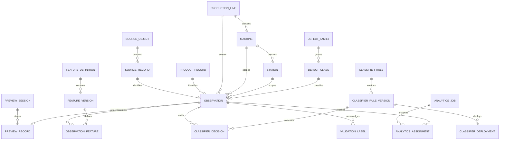
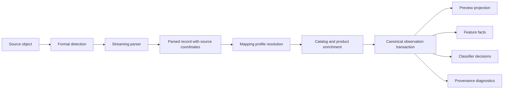
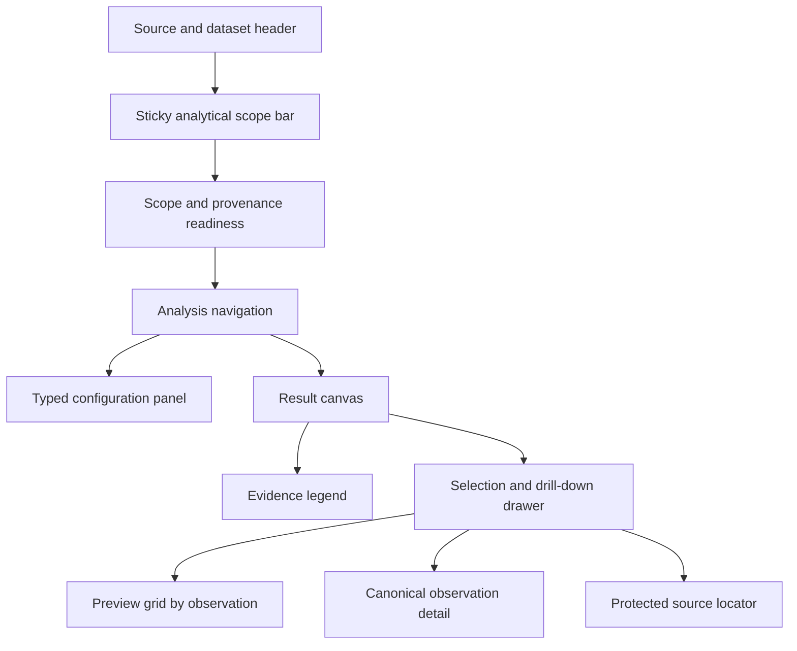

# Feature Relationship and Classifier-Aware Analytics Architecture

## 0. Purpose and decision summary

This plan extends AutoVerify_System from session-wide feature analysis into a provenance-aware analytics platform that can segment and compare evidence by product, line, machine, station, classifier rule, immutable classifier rule version, defect family, defect class, feature, and time.

The principal decisions are:

1. Treat observed machine or station classifier output as an **overlay and comparator**, never as verified truth.
2. Introduce a separate, optional human-review truth model in the first schema phase. Statistical and unsupervised outputs can never populate this model automatically.
3. Resolve scope in this order: explicit canonical source fields, then deterministic versioned catalog or mapping enrichment. Ambiguous values remain Unknown.
4. Preserve ambiguous legacy values such as `EqpName`, `EmNo`, and `SpecName` as raw source attributes. Do not rename or silently reinterpret them.
5. Introduce an immutable durable observation identifier and direct feature-to-observation linkage. Retain `RowIndex` only as a session-local compatibility coordinate.
6. Give every chart point, assignment, comparison cell, and table result an observation reference and a server-resolvable drill-down path to the preview grid and original source coordinates.
7. Build a shared, versioned dataset-preparation pipeline for current SPC, PCA, MSA, EWMA, CUSUM, and DOE engines and the new relationship, K-means, GMM, Isolation Forest, and classifier-comparison engines.
8. Retain ECharts and the existing application visual language. Add a token-driven chart theme and accessible non-emoji icons rather than another chart library.
9. Keep existing endpoints and result contracts operational while adding versioned typed requests and result schemas.
10. Keep the current in-process deployment initially, but replace the unbounded analytics channel with bounded admission, persistent cancellation, heartbeats, recovery, and configurable execution budgets.

The historical plan remains unchanged at [`plans/defect-feature-analytics.md`](defect-feature-analytics.md).

### Design-system procedure note

The `ui-ux-pro-max` skill guidance was loaded and the existing React, ECharts, component, and styling patterns were audited. The requested Python version check and skill CLI searches could not be executed because this planning environment did not expose a shell or arbitrary command-execution tool. Python availability was therefore **not determined**, and no Python installation or modification was attempted. Loading the skill was not treated as equivalent to running its CLI. The UI recommendations below are based on the loaded guidance and direct inspection of the application.

---

## 1. Scope, evidence semantics, and non-goals

### 1.1 Required analytical scope

The architecture must support filtering, grouping, readiness evaluation, model fitting, comparison, and drill-down by:

- Product instance
- Production line
- Machine
- Station
- Classifier rule
- Classifier rule version
- Defect family
- Defect class or type
- Feature definition and version
- Inspection time range
- Observed classifier outcome
- Optional independent validation label

### 1.2 Evidence layers

| Layer | Meaning | Permitted use | Prohibited interpretation |
|---|---|---|---|
| Observed classifier output | Output emitted by a machine, station, rule, or model at inspection time | Overlay, stratification, enrichment, agreement or disagreement against configured analytical buckets | Verified truth, actual false positive, actual false negative |
| Statistical process evidence | SPC violations, capability diagnostics, PCA residuals, or related statistical signals | Process monitoring and evidence comparison | Ground-truth defect label |
| Unsupervised evidence | Cluster assignment, component probability, anomaly score, or model diagnostics | Pattern discovery, ranking, enrichment, and disagreement review | Correct defect class or verified anomaly |
| Human-reviewed truth | Explicit review label with reviewer, time, evidence, and revision history | Confusion matrices and validated quality metrics where coverage is adequate | Automatic derivation from classifier or model output |

Terms must be presented as follows:

- **Agreement** means two configured evidence buckets coincide. It does not mean both are correct.
- **Disagreement** means evidence layers differ. It does not identify which layer is correct.
- **Suspected false alarm** means classifier output is NG or equivalent while configured statistical and unsupervised evidence is normal. It is a review queue label until independent truth exists.
- **Suspected escape risk** means classifier output is OK or equivalent while configured statistical or unsupervised evidence is anomalous. It is not a verified escape.
- **False positive, false negative, precision, recall, specificity, and accuracy** may be shown only against the separate human-reviewed truth model and must display truth coverage.

### 1.3 Non-goals

- Do not infer station identity from `EmNo`, `EqpName`, `Zone`, or `StationJudge` without an approved mapping profile.
- Do not infer classifier rule identity from `SpecName` or verification workflow `RuleCode` without an approved mapping profile and immutable rule version.
- Do not replace the current preview workflow in one release.
- Do not treat cluster numbers as stable business categories across retraining.
- Do not expose unrestricted source URIs or storage credentials through analytics result payloads.
- Do not add a second frontend charting library.

---

## 2. Existing-versus-required schema and contract audit

### 2.1 Field-level findings

| Concept | Existing evidence | Current limitation | Required architecture |
|---|---|---|---|
| Durable preview record | [`DefectPreviewRecordEntity.Id`](../src/backend/AutoVerify.Api/Persistence/Entities/DefectPreviewRecordEntity.cs:5) is a database key | Record is session staging with TTL; analytical results identify only `RowIndex` | Add immutable `ObservationId` and a canonical observation record independent of page, sort, and filter order |
| Product | [`ProductRecordEntity.Id`](../src/backend/AutoVerify.Api/Persistence/Entities/ProductRecordEntity.cs:5) is durable; preview and defects carry `KeyId` | No direct product FK; uniqueness of `KeyId` is not established | Link by explicit upstream product ID first; allow deterministic unique-key enrichment; preserve unresolved or ambiguous matches |
| Line | [`ProductRecordEntity.LineCode`](../src/backend/AutoVerify.Api/Persistence/Entities/ProductRecordEntity.cs:15) | Not normalized and not linked to preview observations | Add production-line catalog and nullable observation FK with provenance |
| Machine | [`ProductRecordEntity.MachineCode`](../src/backend/AutoVerify.Api/Persistence/Entities/ProductRecordEntity.cs:14) | Not normalized on preview observations; parser also collapses `machineCode` into `EqpName` | Add machine catalog and nullable observation FK; stop semantic alias collapse in new mapping flow |
| Station | No verified station identity exists | `StationJudge` is an outcome; `EmNo`, `EqpName`, and `Zone` are ambiguous | Add station catalog and explicit source or versioned mapping resolution only |
| Classifier rule | `SpecName` is raw source text; verification `RuleCode` belongs to a different workflow | No classifier-rule entity or proven semantics | Add classifier-rule catalog and raw source rule key; link only through explicit fields or approved mapping |
| Rule version | Seed data contains model-like text inside JSON but no normalized rule history | No immutable version, effective interval, or deployment scope | Add immutable classifier-rule versions and effective deployments |
| Defect family | No normalized family exists | `DefectName`, `DefectType`, and `DefectTable` are not equivalent to family | Add defect-family taxonomy and defect-class membership; preserve raw values |
| Defect type or class | [`DefectRecordEntity.DefectType`](../src/backend/AutoVerify.Api/Persistence/Entities/DefectRecordEntity.cs:9) and preview equivalent | Free text without taxonomy/version | Add normalized defect class with raw-value mapping provenance |
| Timestamp | Preview has nullable `InspectedAtUtc`; product has non-null inspection time; defect has creation time | Timestamp semantics differ and may be absent | Store observed inspection time, timestamp source field, provenance, and parse quality; do not substitute creation time silently |
| Feature name and value | [`DefectPreviewFeatureEntity.FeatureName`](../src/backend/AutoVerify.Api/Persistence/Entities/DefectPreviewFeatureEntity.cs:8) and `FeatureValue` | No definition FK, unit, raw value, transform version, quality, or JSON path | Add feature definition/version and observation-feature fact with direct FK and source path |
| Row linkage | Features use `SessionId` plus `RowIndex`; charts use `RowIndex` | Fragile outside natural session ordering and impossible to preserve after staging cleanup | Add direct observation FK; retain row index as compatibility metadata |
| Source identity | Session stores URI and parser knows entry context transiently | ZIP entry, physical line, record ordinal, JSON pointer, and record hash are not persisted | Add source object and source record locator with content hashes and coordinates |
| Mapping provenance | None | Consumers cannot distinguish observed, inherited, enriched, mapped, inferred, or unknown values | Persist per-dimension resolution kind, mapping profile version, raw value, and diagnostics |
| Truth | Product and defect judgments are observed workflow outcomes | No independently reviewed truth model | Add immutable/revisioned human validation labels with reviewer and evidence |

### 2.2 Parser and ingestion findings

The current parser in [`DefectStreamParser`](../src/backend/AutoVerify.Api/Services/DefectStreamParser.cs:66) already supports JSON, JSONL, GZIP, ZIP, nested numeric extraction, numeric strings, archive safeguards, and invalid numeric rejection. It currently maps `machineCode` into `EqpName` during conversion and creates parser-only feature objects without source paths or direct observation identity.

The current ingestion service in [`DefectPreviewIngestionService.IngestSessionAsync`](../src/backend/AutoVerify.Api/Services/DefectPreviewIngestionService.cs:74) assigns sequential `RowIndex` values, then copies that value to features. It does not persist archive entry, physical line, record ordinal, JSON pointer, or mapping diagnostics. It also clears the EF change tracker while retaining a previously loaded session object; implementation should explicitly reload or reattach that session before subsequent updates.

### 2.3 Analytics findings

The current request in [`CreateAnalyticsJobRequest`](../src/backend/AutoVerify.Api/Analytics/AnalyticsContracts.cs:33) uses a generic parameter dictionary and has no typed scope, deterministic seed, missing-value policy, scaling policy, dataset revision, or result schema version.

The current service in [`DefectFeatureAnalyticsService`](../src/backend/AutoVerify.Api/Analytics/DefectFeatureAnalyticsService.cs:12) supports SPC, EWMA, CUSUM, PCA, MSA, and DOE. It uses an unbounded process-local channel, a fixed concurrency semaphore, process-local cancellation, and a non-canonical request hash that omits important fields.

Current SPC and PCA result points in [`SpcPoint`](../src/backend/AutoVerify.Api/Analytics/SpcEngine.cs:3) and [`PcaPoint`](../src/backend/AutoVerify.Api/Analytics/PcaEngine.cs:7) expose `RowIndex` rather than durable observation identity. The existing NG-only safeguard in [`SpcEngine.Compute`](../src/backend/AutoVerify.Api/Analytics/SpcEngine.cs:52) is statistically important and must remain.

[`LttbDownsampler.Downsample`](../src/backend/AutoVerify.Api/Analytics/LttbDownsampler.cs:12) preserves its selected point's original array index. The common chart-point contract should carry the observation reference through downsampling rather than translating back through a reordered array.

### 2.4 Frontend findings

- [`AnalyticsJobType`](../src/web/src/types.ts:941) supports only the six existing analysis types.
- [`DefectFeatureAnalyticsDashboard`](../src/web/src/components/analytics/DefectFeatureAnalyticsDashboard.tsx:42) is session-centric and uses `onSelectRowIndex` for all analytical drill-down.
- [`AnalyticsConfigPanel`](../src/web/src/components/analytics/AnalyticsConfigPanel.tsx:17) is a single conditional form and exposes ambiguous values such as `EqpName` as an operator or equipment field.
- [`ReadinessOverview`](../src/web/src/components/analytics/ReadinessOverview.tsx:22) reports session-wide readiness without scope completeness, classifier coverage, truth coverage, or resource estimates.
- [`DefectPreviewGrid`](../src/web/src/components/DefectPreviewGrid.tsx:30) currently resets filters and sorting to navigate by natural `RowIndex`; a durable observation lookup should replace this behavior.
- [`ProductsTab`](../src/web/src/tabs/ProductsTab.tsx:7) provides existing product-to-analysis handoff and machine/line display patterns, but still labels raw spec and equipment fields without normalized meaning.
- [`Icon`](../src/web/src/ui.tsx:5), form controls, tables, status pills, notices, modal focus trapping, and visible focus styles are reusable.
- [`src/web/package.json`](../src/web/package.json) confirms React 19.2.8, ECharts 5.6.0, `echarts-for-react` 3.0.6, TanStack React Table 8.20.6, TypeScript 6.0.2, and Vite 8.2.2.
- Existing styling in [`src/web/src/App.css`](../src/web/src/App.css) establishes a light enterprise workspace, navy navigation, white panels, slate typography, blue primary actions, semantic status colors, and reduced-motion handling. New analytics components should use shared tokens instead of hard-coded chart colors.

### 2.5 Deployment and security findings

[`Program.cs`](../src/backend/AutoVerify.Api/Program.cs) uses .NET 8, Pomelo EF Core, MariaDB 10.6, `EnsureCreatedAsync`, and runtime idempotent DDL in [`DatabaseSeeder.EnsureOperationalTablesAsync`](../src/backend/AutoVerify.Api/Persistence/DatabaseSeeder.cs:10). Schema rollout must therefore include both EF configuration and idempotent MariaDB DDL rather than assuming conventional EF migrations alone.

[`appsettings.json`](../src/backend/AutoVerify.Api/appsettings.json) currently exposes preview limits but has no analytics limits section.

No ASP.NET authentication or authorization middleware, authorization attributes, or route policies were found. [`AuthController`](../src/backend/AutoVerify.Api/Controllers/AuthController.cs:8) returns a random token and a fixed administrator profile, but the API does not validate that token. Authentication and authorization are prerequisites before analytics source, truth, mapping, and job endpoints can be considered production-safe.

---

## 3. Target normalized entity model

### 3.1 Conceptual model

### 3.2 Production and taxonomy catalogs

Create these additive entities:

| Proposed entity | Principal fields and constraints |
|---|---|
| [`ProductionLineEntity`](../src/backend/AutoVerify.Api/Persistence/Entities/ProductionLineEntity.cs) | `Id`, unique normalized `Code`, display name, active state, effective dates, metadata |
| [`MachineEntity`](../src/backend/AutoVerify.Api/Persistence/Entities/MachineEntity.cs) | `Id`, required line FK where organizationally valid, unique code within line, display name, active state |
| [`StationEntity`](../src/backend/AutoVerify.Api/Persistence/Entities/StationEntity.cs) | `Id`, nullable machine FK, required line FK, station code unique within its parent scope, station type, active state |
| [`DefectFamilyEntity`](../src/backend/AutoVerify.Api/Persistence/Entities/DefectFamilyEntity.cs) | `Id`, stable code, display name, description, active state |
| [`DefectClassEntity`](../src/backend/AutoVerify.Api/Persistence/Entities/DefectClassEntity.cs) | `Id`, family FK, stable code, display name, aliases managed separately, active state |
| [`DefectTaxonomyMappingEntity`](../src/backend/AutoVerify.Api/Persistence/Entities/DefectTaxonomyMappingEntity.cs) | Mapping profile version, raw table/type/name pattern, target class, priority, effective interval, audit fields |

Use nullable FKs for unresolved normalized dimensions. Do not seed a fake database row such as `UNASSIGNED` as if it were observed scope. Query projections may present a virtual **Unknown** bucket.

### 3.3 Classifier rule history

| Proposed entity | Principal fields and constraints |
|---|---|
| [`ClassifierRuleEntity`](../src/backend/AutoVerify.Api/Persistence/Entities/ClassifierRuleEntity.cs) | `Id`, stable rule code, name, owner, rule family, active state |
| [`ClassifierRuleVersionEntity`](../src/backend/AutoVerify.Api/Persistence/Entities/ClassifierRuleVersionEntity.cs) | `Id`, rule FK, immutable version key, configuration hash, algorithm/model reference, threshold metadata, unit/feature schema hash, created and approved audit fields; unique rule plus version key |
| [`ClassifierDeploymentEntity`](../src/backend/AutoVerify.Api/Persistence/Entities/ClassifierDeploymentEntity.cs) | Rule-version FK, nullable line/machine/station scope, effective start inclusive, effective end exclusive, deployment priority, source system; prevent overlapping deployments at the same exact scope |
| [`ClassifierDecisionEntity`](../src/backend/AutoVerify.Api/Persistence/Entities/ClassifierDecisionEntity.cs) | Observation FK, nullable resolved rule-version FK, raw rule name/version, observed outcome, normalized outcome bucket, score, threshold used, reason, event time, mapping provenance, raw payload reference |

A single observation may have zero, one, or multiple classifier decisions. Comparison requests must state which decision selector is used, such as exact rule version, deployment-effective decision, latest emitted decision, or all decisions. Never silently choose among multiple candidates.

Rule versions are immutable after use. Corrections create a new version or a superseding metadata revision; historical decisions retain their original FK.

### 3.4 Feature definitions, units, transforms, and limits

| Proposed entity | Principal fields and constraints |
|---|---|
| [`FeatureDefinitionEntity`](../src/backend/AutoVerify.Api/Persistence/Entities/FeatureDefinitionEntity.cs) | `Id`, canonical name, display name, semantic category, value type, active state |
| [`FeatureDefinitionVersionEntity`](../src/backend/AutoVerify.Api/Persistence/Entities/FeatureDefinitionVersionEntity.cs) | Feature FK, immutable version, unit symbol and dimension, transform expression identifier, transform implementation version, expected range, effective interval |
| [`FeatureSpecificationVersionEntity`](../src/backend/AutoVerify.Api/Persistence/Entities/FeatureSpecificationVersionEntity.cs) | Feature-version FK, nullable product/line/machine/station scope, LSL, USL, target, effective interval, source and approval metadata |
| [`ObservationFeatureEntity`](../src/backend/AutoVerify.Api/Persistence/Entities/ObservationFeatureEntity.cs) | Observation FK, feature-version FK when resolved, raw name, raw numeric text, parsed raw value, transformed value, value quality, source JSON pointer, occurrence index, mapping provenance; unique observation plus source pointer plus occurrence |

Control limits, specification limits, and classifier thresholds must remain separate:

- SPC control limits are estimated from a selected dataset.
- Specification limits come from versioned feature specifications.
- Classifier thresholds come from the classifier rule version or observed decision.
- User overrides are job configuration and must be labeled as overrides.

### 3.5 Observation, source, and preview linkage

| Proposed entity or extension | Principal fields and constraints |
|---|---|
| [`AnalyticsSourceObjectEntity`](../src/backend/AutoVerify.Api/Persistence/Entities/AnalyticsSourceObjectEntity.cs) | `Id`, storage object FK when available, protected canonical source reference, content type, compressed and uncompressed sizes, content hash, acquisition time |
| [`SourceRecordLocatorEntity`](../src/backend/AutoVerify.Api/Persistence/Entities/SourceRecordLocatorEntity.cs) | `Id`, source object FK, archive entry path, physical JSONL line, record ordinal within entry, JSON pointer, record hash, parser format and parser version; unique source object plus stable coordinates or hash |
| [`DefectObservationEntity`](../src/backend/AutoVerify.Api/Persistence/Entities/DefectObservationEntity.cs) | Immutable `Id`, source locator FK, nullable product FK, raw product key, nullable line/machine/station FKs, nullable defect class FK, raw defect fields, inspection time and provenance, coordinates, observed record judgment, confidence, created and updated audit fields |
| Extend [`DefectPreviewRecordEntity`](../src/backend/AutoVerify.Api/Persistence/Entities/DefectPreviewRecordEntity.cs:3) | Add unique `ObservationId` FK and optional denormalized normalized-scope columns only if benchmarks justify them |
| Extend [`DefectPreviewFeatureEntity`](../src/backend/AutoVerify.Api/Persistence/Entities/DefectPreviewFeatureEntity.cs:3) | Add required `ObservationId` FK after backfill and optional `ObservationFeatureId`; retain `SessionId` and `RowIndex` during compatibility period |
| Extend [`DefectPreviewSessionEntity`](../src/backend/AutoVerify.Api/Persistence/Entities/DefectPreviewSessionEntity.cs:3) | Add source-object FK, mapping-profile-version FK, parser version, source content hash, dataset revision, default scope fallback, scope/provenance summary, and ownership |

`DefectObservationEntity` is the durable normalized analytical fact. Preview records remain a bounded staging and grid projection. Preview cleanup may delete preview rows without deleting canonical observations unless a separately authorized retention policy explicitly permits it.

### 3.6 Mapping profiles and provenance

Create [`IngestionMappingProfileEntity`](../src/backend/AutoVerify.Api/Persistence/Entities/IngestionMappingProfileEntity.cs) and immutable [`IngestionMappingProfileVersionEntity`](../src/backend/AutoVerify.Api/Persistence/Entities/IngestionMappingProfileVersionEntity.cs). Store ordered source-path rules, aliases, transformations, catalog lookups, and fallback permissions in typed child rows or a validated versioned document.

Every resolved dimension stores:

- Raw source value
- Normalized FK or null
- Resolution kind
- Mapping profile version
- Mapping rule identifier
- Confidence only where a future opt-in inference mechanism is used
- Warning or ambiguity code

Resolution kinds are:

1. `Observed` for an explicit canonical source field.
2. `SessionInherited` for an explicit user-selected session fallback.
3. `ProductEnriched` for a deterministic product catalog link.
4. `ConfigurationMapped` for an approved versioned mapping.
5. `Inferred` only for a future explicitly enabled inference mode; not enabled by the baseline plan.
6. `Unknown` for absent, ambiguous, invalid, or conflicting scope.
7. `LegacyBackfill` for records whose source coordinates or mappings cannot be reconstructed.

### 3.7 Resolution precedence

Apply the following order per dimension, with no lower-priority override of a valid higher-priority value:

1. Explicit canonical field from the source payload.
2. Explicit field path declared by the selected mapping-profile version.
3. Explicit session fallback selected by the user and permitted by the profile.
4. Exact upstream durable product ID link.
5. Unique `KeyId` product enrichment, optionally constrained by an approved time window and source system.
6. Exact approved raw-value-to-catalog mapping.
7. Unknown.

If a step produces multiple candidates or conflicts with a higher-priority value, record the conflict, keep the higher-priority value, and surface a readiness warning. `EqpName`, `EmNo`, `SpecName`, `Zone`, and parser aliases do not receive semantic meaning outside an approved mapping rule.

### 3.8 Independent human validation truth

Create [`ObservationValidationLabelEntity`](../src/backend/AutoVerify.Api/Persistence/Entities/ObservationValidationLabelEntity.cs) with:

- Observation FK
- Label type and normalized verdict
- Optional defect-class FK
- Review status
- Reviewer user ID
- Review time
- Evidence note and evidence artifact references
- Source workflow
- Revision number
- Supersedes label FK
- Active-current marker enforced so only one current label exists per observation and label type

Only authorized reviewers may create or supersede truth labels. Analytics jobs may read these labels when requested but may never write them. UI labels must distinguish **Observed classifier**, **Model evidence**, and **Human reviewed**.

---

## 4. Ingestion and source identity changes

### 4.1 Parser output contract

Refactor parser output into a neutral parsed-record envelope rather than directly constructing persistence entities. Add [`ParsedDefectRecord`](../src/backend/AutoVerify.Api/Services/Parsing/ParsedDefectRecord.cs) and [`ParsedFeatureValue`](../src/backend/AutoVerify.Api/Services/Parsing/ParsedFeatureValue.cs) containing:

- Raw and canonical candidate fields
- Source object identity
- Archive entry path
- Physical JSONL line where applicable
- Record ordinal within the selected entry
- JSON pointer to the record
- Stable raw-record hash
- Each feature's JSON pointer, raw name, raw numeric text, parsed numeric value, and occurrence index
- Parser format and parser version
- Parse warnings without source secrets

For stream formats where byte offsets are practical, store them as optional diagnostics, not as the only durable coordinate.

### 4.2 Source hashing and deduplication

- Compute a SHA-256 source-object hash while streaming when feasible.
- Compute a SHA-256 hash from canonical raw record bytes or a deterministic canonical JSON representation.
- Use source object plus source coordinates and record hash to detect repeated ingestion.
- Do not merge observations solely by `KeyId`, defect name, coordinates, or timestamp.
- Re-ingestion with a new mapping version may create a new dataset revision while retaining the same source record identity.
- Define explicit reprocessing modes: reuse canonical observation, remap observation dimensions, or create a new source revision.

### 4.3 Ingestion flow

For each parsed record, persist source locator, canonical observation, feature facts, classifier decisions, and preview projection in one transaction or a recoverable batch with an idempotency key. Batch commits remain bounded. Reload or reattach session progress explicitly after clearing EF tracking.

### 4.4 Missing and ambiguous scope behavior

- Null normalized FKs are valid and represent unresolved dimensions.
- Raw values remain queryable through observation detail but are not silently grouped as normalized entities.
- Readiness returns completeness and ambiguity percentages for each requested dimension.
- Scope filtering for a normalized catalog ID excludes Unknown values unless `includeUnknown` is explicitly true.
- Unknown is a display bucket, not a fabricated catalog entity.
- Conflicting observed line and product-enriched line values create a conflict diagnostic and retain the observed value.

### 4.5 Compatibility with existing preview ingestion

- Existing session creation remains accepted.
- Add optional `mappingProfileVersionId`, `sourceObjectId`, explicit fallback scope, and reprocessing mode.
- If no profile is selected, use a conservative built-in profile that maps only unambiguous canonical field names and preserves all ambiguous aliases as raw data.
- Keep `RowIndex`, current filters, and current preview DTO fields during migration.
- Add `ObservationId`, normalized scope summary, classifier summary, taxonomy summary, and provenance quality additively.

---

## 5. DTO and REST API recommendations

### 5.1 Versioned typed request model

Replace further expansion of the generic parameter dictionary with a versioned discriminated request hierarchy. Keep the old request adapter for existing clients.

Create these contracts in [`AnalyticsRequestContracts.cs`](../src/backend/AutoVerify.Api/Analytics/Contracts/AnalyticsRequestContracts.cs):

- [`CreateAnalyticsJobV2Request`](../src/backend/AutoVerify.Api/Analytics/Contracts/AnalyticsRequestContracts.cs) with request schema version, analysis type, scope, feature selection, preprocessing, algorithm options, output options, TTL, and client request ID.
- [`AnalyticsScopeDto`](../src/backend/AutoVerify.Api/Analytics/Contracts/AnalyticsScopeDto.cs) with session IDs, observation IDs, product IDs, line IDs, machine IDs, station IDs, rule IDs, rule-version IDs, defect-family IDs, defect-class IDs, observed outcomes, truth states, time interval, and explicit Unknown inclusion flags.
- [`FeatureSelectionDto`](../src/backend/AutoVerify.Api/Analytics/Contracts/FeatureSelectionDto.cs) with feature-version IDs, canonical feature IDs, and selection order.
- [`PreprocessingOptionsDto`](../src/backend/AutoVerify.Api/Analytics/Contracts/PreprocessingOptionsDto.cs) with missing policy, scaling policy, deterministic seed, sampling policy, sample limit, winsorization policy, and constant-feature behavior.
- Typed algorithm option records for relationships, K-means, GMM, Isolation Forest, and existing analytical families.
- [`AnalyticsOutputOptionsDto`](../src/backend/AutoVerify.Api/Analytics/Contracts/AnalyticsOutputOptionsDto.cs) with chart-point limit, assignment persistence, explanation limit, result detail level, and requested drill-down fields.

Reject unknown algorithm fields, invalid combinations, duplicate feature IDs, reversed time windows, over-budget requests, and unsupported schema versions with structured validation errors.

### 5.2 Observation reference contract

Every observation-level result uses [`ObservationReferenceDto`](../src/backend/AutoVerify.Api/Analytics/Contracts/ObservationReferenceDto.cs):

| Field | Purpose |
|---|---|
| `observationId` | Durable canonical identifier |
| `previewSessionId` | Optional current preview location |
| `previewRecordId` | Optional staged row ID |
| `rowIndex` | Compatibility and display only |
| `sourceRecordId` | Server-side source locator identity |
| `drillDownToken` | Opaque short-lived or signed resolver token |
| Scope display fields | Labels for tooltip only, never authoritative replacements for IDs |

### 5.3 Core routes

Retain current routes in [`DefectFeatureAnalyticsController`](../src/backend/AutoVerify.Api/Controllers/DefectFeatureAnalyticsController.cs:6). Add these versioned routes:

| Method and route | Purpose |
|---|---|
| `POST /api/v1/analytics/readiness` | Scope-aware readiness and resource estimate for a typed request draft |
| `POST /api/v1/analytics/jobs` | Create a V2 job with canonical validation and admission control |
| `GET /api/v1/analytics/jobs/{jobId}` | Job state and summary metadata |
| `POST /api/v1/analytics/jobs/{jobId}/cancel` | Persist cancellation request |
| `DELETE /api/v1/analytics/jobs/{jobId}` | Delete eligible result metadata and artifacts according to retention policy |
| `GET /api/v1/analytics/jobs/{jobId}/result` | Bounded result summary |
| `GET /api/v1/analytics/jobs/{jobId}/points` | Paged or sampled chart points with observation references |
| `GET /api/v1/analytics/jobs/{jobId}/assignments` | Paged observation assignments filtered by cluster, component, anomaly state, or classifier bucket |
| `POST /api/v1/analytics/jobs/{jobId}/drill-down` | Resolve a comparison cell or chart selection into paged observation references |
| `GET /api/v1/analytics/catalog/scope` | Authorized line, machine, station, rule, taxonomy, and feature facets |
| `GET /api/v1/analytics/observations/{observationId}` | Normalized observation, provenance, features, decisions, labels, and protected source locator |
| `POST /api/v1/analytics/observations/search` | Paged observation query using the same scope contract |

Extend [`DefectPreviewController`](../src/backend/AutoVerify.Api/Controllers/DefectPreviewController.cs:6) with observation-aware lookup:

- `GET /api/v1/storage/defect-preview/sessions/{sessionId}/rows/by-observation/{observationId}`
- Add `observationId` to normal row query filters.
- Return an explicit `notInPreview` response with available canonical observation detail when staging has expired.

### 5.4 Governance routes

Add role-protected controllers:

- [`ProductionScopeController`](../src/backend/AutoVerify.Api/Controllers/ProductionScopeController.cs) for lines, machines, and stations.
- [`ClassifierRulesController`](../src/backend/AutoVerify.Api/Controllers/ClassifierRulesController.cs) for rule definitions, immutable versions, and deployments.
- [`FeatureCatalogController`](../src/backend/AutoVerify.Api/Controllers/FeatureCatalogController.cs) for feature definitions, units, transforms, and specification versions.
- [`DefectTaxonomyController`](../src/backend/AutoVerify.Api/Controllers/DefectTaxonomyController.cs) for families, classes, and mappings.
- [`IngestionMappingProfilesController`](../src/backend/AutoVerify.Api/Controllers/IngestionMappingProfilesController.cs) for draft, validation, immutable publication, and retirement.
- [`ObservationValidationController`](../src/backend/AutoVerify.Api/Controllers/ObservationValidationController.cs) for human review labels and revision history.

### 5.5 Error and pagination contracts

Use one structured error shape containing code, message, field path, retryability, correlation ID, and safe details. Use cursor pagination for large observation and assignment sets; retain page-based pagination for the preview grid during compatibility. Return `413` for payload limits, `422` for statistical/readiness blockers, `429` for admission/rate limits, and `409` for immutable-version or deployment conflicts.

---

## 6. Shared dataset preparation and dataset revision

### 6.1 Prepared dataset contract

Create [`PreparedAnalyticsDataset`](../src/backend/AutoVerify.Api/Analytics/Preparation/PreparedAnalyticsDataset.cs) containing:

- Ordered observation IDs and compatibility row indexes
- Ordered feature-definition-version IDs
- Dense or sparse numeric matrix chosen by algorithm
- Missingness mask
- Observation timestamps and normalized scope IDs
- Selected classifier decisions and optional human labels
- Raw-to-transformed feature metadata
- Imputation or exclusion report
- Scaling center and scale per feature
- Constant and near-constant feature diagnostics
- Deterministic sample manifest
- Dataset revision and preparation schema version
- Source, scope, and rule-resolution warnings

All analytical engines receive this contract or a typed projection of it. Engines must not independently reinterpret raw field names.

### 6.2 Dataset revision

Create [`AnalyticsDatasetSnapshotEntity`](../src/backend/AutoVerify.Api/Persistence/Entities/AnalyticsDatasetSnapshotEntity.cs) with:

- Immutable snapshot ID
- Canonical scope hash
- Ordered observation-set manifest hash
- Ordered feature-version manifest hash
- Source object hashes
- Mapping-profile versions
- Classifier selection rule
- Truth-label revision watermark when truth is included
- Preparation schema version
- Created time and creator

The job request hash includes the snapshot ID. If the same request is made against a different snapshot, it is not a cache hit.

### 6.3 Canonical request hashing

Implement [`AnalyticsRequestCanonicalizer`](../src/backend/AutoVerify.Api/Analytics/Jobs/AnalyticsRequestCanonicalizer.cs) to:

- Normalize enum casing and numeric representation.
- Sort unordered ID sets and object properties.
- Preserve ordered feature selection and other semantically ordered arrays.
- Include request schema, algorithm version, preprocessing, seed, sampling, scope, feature order, output options, dataset snapshot, and result schema.
- Serialize deterministically before SHA-256 hashing.

Never hash the current generic dictionary using default serialization order.

### 6.4 Missing-value policies

Supported policies must be explicit:

- `CompleteCase`: remove observations missing any selected feature.
- `PairwiseComplete`: allowed only for relationship matrix calculations; report pairwise counts.
- `MedianImpute`: fit medians on the selected dataset and persist them.
- `RobustMedianImpute`: equivalent median imputation combined with robust scaling.
- `RejectMissing`: block if any selected value is missing.

Do not default silently across algorithms. Recommended defaults are pairwise complete for relationship matrices and complete case for clustering/model fitting. Imputation requires explicit confirmation in the UI.

### 6.5 Scaling policies

- `None` for already commensurate features only.
- `Standard` using mean and sample standard deviation.
- `Robust` using median and scaled median absolute deviation, with an IQR fallback.
- Persist all fitted centers and scales in results.
- Constant features are excluded with a warning or block the job according to request policy.
- Feature transformations must be applied from the immutable feature-definition version before job-level scaling.

### 6.6 Deterministic sampling

- Use a documented deterministic PRNG and store the seed.
- Sort the candidate observation set by durable observation ID before randomized sampling.
- Support uniform and scope-stratified sampling.
- Preserve rare configured classifier outcomes and human truth labels through optional stratification.
- Store selected observation IDs or an external sample manifest artifact.
- Chart downsampling is distinct from model-training sampling; the model result must disclose both.

---

## 7. Analytics jobs, readiness, and operational limits

### 7.1 Job persistence extensions

Extend [`DefectAnalyticsJobEntity`](../src/backend/AutoVerify.Api/Persistence/Entities/DefectAnalyticsJobEntity.cs:3) with:

- Request schema version
- Result schema version
- Algorithm implementation version
- Dataset snapshot ID
- Deterministic seed
- Canonical request JSON and hash
- Persistent cancellation-request time
- Heartbeat time
- Worker ID and lease expiry
- Execution deadline
- Attempt number
- Result storage mode and protected artifact URI
- Result hash and byte size
- Sample count and feature count
- Ownership and authorization scope

Create [`AnalyticsResultArtifactEntity`](../src/backend/AutoVerify.Api/Persistence/Entities/AnalyticsResultArtifactEntity.cs) and [`AnalyticsObservationAssignmentEntity`](../src/backend/AutoVerify.Api/Persistence/Entities/AnalyticsObservationAssignmentEntity.cs). The assignment table indexes job ID, observation ID, assignment type, assignment code, score, probability, anomaly flag, classifier bucket, and compact detail JSON. Large result documents are offloaded through the existing storage abstraction.

### 7.2 Worker lifecycle

Refactor job execution behind [`IAnalyticsJobQueue`](../src/backend/AutoVerify.Api/Analytics/Jobs/IAnalyticsJobQueue.cs) and [`AnalyticsJobWorker`](../src/backend/AutoVerify.Api/Analytics/Jobs/AnalyticsJobWorker.cs):

1. Bounded queue admission.
2. Database state transition from Queued to Running under a lease.
3. Periodic heartbeat and progress updates.
4. Cancellation token linked to persisted cancellation checks and execution deadline.
5. Atomic completion only after result artifact hash is stored.
6. Startup recovery: expired Running leases become Recoverable or Failed according to attempt policy.
7. Idempotent cache reuse only when request hash, dataset snapshot, algorithm version, and result schema all match.

### 7.3 Readiness response

Create [`AnalyticsReadinessResponse`](../src/backend/AutoVerify.Api/Analytics/Contracts/AnalyticsReadinessResponse.cs) with:

- Requested and eligible observation counts
- Excluded count by reason
- Feature count and complete-row count
- Missingness per feature and pair
- Constant or near-constant features
- Scope completeness and ambiguity by dimension
- Classifier decision coverage and multi-decision ambiguity
- Rule-version coverage
- Human truth coverage and revision state
- Timestamp coverage and ordering quality
- Estimated matrix memory, pair count, model parameter count, and result size
- Hard blockers, quality warnings, resource warnings, provenance warnings, and statistical-validity warnings

### 7.4 Algorithm-specific readiness

| Analysis | Hard blockers | Warnings |
|---|---|---|
| Relationships | Fewer than 3 pairwise complete observations; constant feature for a requested pair | Pair count below 30, high missingness, excessive multiple comparisons |
| K-means | Fewer than 2 usable features; `k` below 2; usable observations fewer than `k`; no variable features | Fewer than 10 observations per cluster, unstable silhouette sample, high imputation ratio |
| GMM diagonal | Fewer than 2 usable features; observations fewer than components; invalid covariance or no variable features | Small expected component support, regularization dominance, convergence disagreement across starts |
| GMM full | All diagonal blockers plus dimensionality or sample count beyond configured full-covariance limits | Observations not comfortably above feature count, near-singular covariance, excessive parameter count |
| Isolation Forest | No variable feature or fewer than 16 usable observations | Small sample, high imputation, unstable score threshold |
| Classifier comparison | No selected classifier decisions or no analytical evidence result | Incomplete rule-version mapping, multi-decision ambiguity, low truth coverage |
| SPC or time series | Existing minimums plus missing or non-orderable time where chronological analysis is requested | NG-only dataset, irregular interval, mixed rule/spec versions |
| MSA | Missing explicit part and operator or equipment dimensions; insufficient repeats | Ambiguous source mapping or unbalanced study |
| DOE | Missing response or factors; singular design matrix | Observational data presented as association rather than a controlled experiment |

### 7.5 Initial configurable resource limits

Add an `Analytics` options section to [`appsettings.json`](../src/backend/AutoVerify.Api/appsettings.json). Recommended conservative starting defaults, subject to benchmark validation:

| Limit | Initial default |
|---|---:|
| Concurrent jobs | 2 |
| Queue capacity | 32 |
| Maximum eligible observations per job | 50,000 |
| Maximum relationship features | 200 |
| Maximum clustering features | 64 |
| Maximum K-means clusters | 20 |
| Maximum diagonal GMM components | 20 |
| Maximum full GMM features | 20 |
| Maximum full GMM components | 10 |
| Maximum Isolation Forest features | 128 |
| Maximum Isolation Forest trees | 200 |
| Maximum chart points per series | 20,000 |
| Maximum inline result JSON | 2 MiB |
| Maximum result artifact | 50 MiB |
| Default execution deadline | Configuration-controlled, with no unlimited jobs |

The server is authoritative. UI limits are advisory. Estimate matrix and covariance memory before admission and reject requests that exceed the configured budget.

---

## 8. Statistical and unsupervised algorithm specifications

### 8.1 Feature relationship engine

Create [`FeatureRelationshipEngine`](../src/backend/AutoVerify.Api/Analytics/Algorithms/FeatureRelationshipEngine.cs).

#### Required calculations

- Pearson correlation using numerically stable pairwise covariance accumulation.
- Spearman correlation using average ranks for ties and Pearson correlation on ranks.
- Pairwise complete observation count.
- Missing count and missing ratio for each feature and pair.
- Two-sided significance where requested, confidence intervals where mathematically valid, and Benjamini-Hochberg adjusted values for matrix-wide inference.
- Optional Kendall tau-b only under configured feature and sample limits.

#### Edge behavior

- Return an unavailable cell, not zero correlation, for constant features or fewer than three pairwise observations.
- Report pairwise counts prominently because different cells may use different populations.
- Do not compare correlations across scopes without showing sample counts and confidence intervals.
- Preserve feature-version and unit metadata.

#### Outputs

- Correlation matrix with count and missingness matrices.
- Ranked positive and negative relationships.
- Deterministically sampled scatter points with observation references.
- Optional trend line with method and confidence band disclosed.
- Classifier, scope, cluster, component, anomaly, and human-label overlays selected independently from the correlation calculation.

### 8.2 K-means engine

Create [`KMeansEngine`](../src/backend/AutoVerify.Api/Analytics/Algorithms/KMeansEngine.cs).

#### Fit procedure

1. Use the shared prepared and scaled matrix.
2. Initialize with deterministic seeded K-means++.
3. Run multiple starts, default 10 and configurable within limits.
4. Use squared Euclidean distance.
5. Stop at maximum 300 iterations or relative inertia improvement below `1e-4` for two successive iterations.
6. On an empty cluster, move the observation with the largest distance from its assigned centroid into the empty cluster, then continue.
7. Select the run with minimum inertia; break exact ties by canonical centroid ordering.
8. Canonicalize cluster labels by lexicographic centroid values in ordered feature space for repeatable presentation within identical data and configuration.

#### Diagnostics and outputs

- Total and per-cluster inertia.
- Iteration count and convergence state for every start.
- Cluster sizes and centroids in scaled and original feature units.
- Exact silhouette when within budget; otherwise deterministic stratified silhouette sample with sample size disclosed.
- Per-observation cluster assignment and distance to centroid.
- Nearest alternative cluster and margin where requested.
- Cluster IDs are analytical labels, not defect classes, and are not guaranteed to persist across dataset revisions.

### 8.3 Gaussian Mixture Model engine

Create [`GaussianMixtureEngine`](../src/backend/AutoVerify.Api/Analytics/Algorithms/GaussianMixtureEngine.cs) supporting diagonal and full covariance.

#### Fit procedure

1. Initialize component means from deterministic K-means results; initialize weights from cluster proportions.
2. Initialize covariance from assigned observations with global covariance fallback.
3. Use expectation-maximization with log-sum-exp likelihood calculations.
4. Add covariance regularization equal to the greater of configured absolute epsilon and `1e-6` times a representative global variance.
5. Default to five seeded starts, maximum 300 EM iterations, and relative log-likelihood tolerance `1e-4`.
6. Reinitialize components whose effective weight falls below the configured minimum using a high-residual observation; record every reinitialization.
7. Treat decreasing log-likelihood beyond numeric tolerance, non-finite parameters, or unresolved singularity as a failed start.
8. Select the converged start with highest log likelihood.

#### Model selection

- Support a fixed component count or a bounded candidate range.
- Default automatic selection criterion is BIC; also return AIC.
- Parameter counts are:
  - Diagonal: component weights plus means plus one variance per feature and component.
  - Full: component weights plus means plus the lower-triangular covariance parameters per component.
- Persist every candidate's criterion, convergence state, regularization count, and selected reason.

#### Outputs and semantics

- Component weights, means, and covariance matrices in scaled space.
- Original-unit marginal means and variances where invertible through preprocessing metadata.
- Per-observation posterior probabilities, assigned component, log density, and assignment entropy.
- Canonicalize component display labels by lexicographic ordered means for identical fitted parameters.
- Do not imply stable component identity across dataset revisions.
- In a two-feature view, show correct marginal covariance ellipses. For higher dimensions, the UI must identify the projection and must not portray a projected ellipse as the complete model.

### 8.4 Isolation Forest engine

Create [`IsolationForestEngine`](../src/backend/AutoVerify.Api/Analytics/Algorithms/IsolationForestEngine.cs).

#### Fit procedure

- Default tree count: 100.
- Default subsample size: minimum of 256 and usable observation count.
- Build each tree from a deterministic seeded sample without replacement.
- At each node, choose a variable feature uniformly, then choose a split uniformly between the node minimum and maximum.
- Stop at single observation, constant node, or height limit equal to the ceiling of base-2 logarithm of subsample size.
- Use standard expected path-length correction for unfinished external nodes.
- Score as `2` raised to negative expected path length divided by expected path length for the subsample size. Higher score means more anomalous.

#### Threshold semantics

- The primary output is a continuous ranking.
- Support no threshold, an explicit score threshold, or a contamination quantile.
- A contamination value means the expected fraction routed for review, not the known defect rate.
- Persist the fitted threshold and method. Do not label thresholded rows as verified anomalies.

#### Explanations

For the top configurable number of observations:

- Return normalized split-participation by feature based on frequency and inverse path depth.
- Optionally compute median-replacement sensitivity: replace one feature with its fitted median and recompute score; report original score minus perturbed score.
- Label both as model explanation or sensitivity, not causal attribution.
- Bound explanation observations, features, and trees independently from model fitting.

### 8.5 Classifier comparison engine

Create [`ClassifierComparisonEngine`](../src/backend/AutoVerify.Api/Analytics/Algorithms/ClassifierComparisonEngine.cs).

#### Comparison inputs

- One explicitly selected classifier-decision set.
- One or more immutable analytical job results on the same or a declared compatible dataset snapshot.
- Optional current human validation labels.
- A versioned comparison-bucketing configuration that defines normal, review, and anomalous evidence states.

#### Outputs without truth

- Classifier outcome by K-means cluster or GMM component count and row percentages.
- Cluster/component enrichment, standardized residuals, Cramér's V, and adjusted mutual information where valid.
- Classifier outcome distributions of anomaly scores and statistical scores.
- Agreement/disagreement matrix against configured evidence buckets.
- Suspected false-alarm and suspected escape-risk queues with explicit rule text and observation drill-down.
- Scope-specific rate comparisons with counts and confidence intervals.

#### Outputs with truth

Only for observations with a current human-reviewed label:

- Confusion matrix, sensitivity, specificity, precision, negative predictive value, and confidence intervals.
- Truth coverage count and percentage.
- Metrics separately for classifier, statistical evidence, and unsupervised thresholding.
- No metric may silently treat unlabeled observations as negative.

#### Compatibility rules

- Comparison jobs must pin source analytical job IDs and result hashes.
- Reject incompatible observation populations unless the request explicitly selects their intersection and reports the reduced count.
- Mixed classifier rule versions require explicit stratification or an acknowledged aggregate mode.

---

## 9. Compatibility with existing analytics

### 9.1 SPC

- Adapt [`SpcEngine`](../src/backend/AutoVerify.Api/Analytics/SpcEngine.cs:50) through a wrapper accepting prepared observation references and explicit time/subgroup ordering.
- Preserve current I-MR, X-bar/R, X-bar/S, Nelson rules, capability, and NG-only warnings.
- Add separate overlays for empirical control limits, feature-specification limits, classifier thresholds, and user overrides.
- Result points gain observation references without removing `RowIndex` in V1.

### 9.2 PCA

- Adapt [`PcaEngine`](../src/backend/AutoVerify.Api/Analytics/PcaEngine.cs:40) to shared preprocessing and return scaling metadata.
- Preserve Hotelling T-squared and SPE/Q residual diagnostics.
- Add classifier, scope, cluster, and truth overlays as display choices, not as PCA training labels.
- Persist complete outlier assignments even when chart points are sampled.

### 9.3 MSA

- Replace free-text `partField` and `operatorField` choices with explicit mapped dimensions or catalog-backed roles.
- Do not default `EqpName` to an operator or equipment identity.
- Require study-design diagnostics, repeated measurements, and balance reporting.

### 9.4 EWMA and CUSUM

- Use explicit chronological ordering and timestamp quality readiness.
- Preserve observation references through time-series downsampling.
- Allow classifier deployments and rule-version changes as event markers rather than mixing them into a single unexplained baseline.

### 9.5 DOE

- Use feature-definition IDs and normalized factor metadata.
- Continue to identify observational factor analysis as association unless a controlled design is supplied.
- Preserve factor coding, response transformation, exclusions, and design matrix rank in results.

### 9.6 Backward compatibility

- Keep current session analytics endpoints and six current `AnalyticsJobType` values.
- Add an adapter from V1 requests to V2 typed configuration using conservative defaults and explicit warnings.
- Version new result payloads; do not mutate old JSON structures in place.
- Continue returning `RowIndex` until all frontend consumers use observation references.

---

## 10. Products and Analysis UI information architecture

### 10.1 Navigation

Retain the Products and Analysis section in [`App.tsx`](../src/web/src/App.tsx:30). Evolve the existing Defect and Feature Analysis sub-tab into an **Analytics Workspace** while keeping its existing tab ID during migration.

Inside the workspace use grouped secondary navigation:

1. Overview and readiness
2. Process monitoring: SPC, EWMA, CUSUM
3. Relationships
4. Multivariate: PCA, K-means, GMM, Isolation Forest
5. Classifier comparison
6. Measurement and experiments: MSA, DOE
7. Jobs and artifacts

Do not place every algorithm in one unstructured horizontal tab row on narrow screens. Use grouped tabs or a compact side rail within the workspace, preserving keyboard tab semantics.

### 10.2 Workspace layout

#### Source and dataset header

Show source object label, content hash prefix, session state, mapping-profile version, parser version, dataset snapshot, record count, and retention state.

#### Sticky analytical scope bar

Use searchable multi-select controls for product, line, machine, station, rule, rule version, defect family, defect class, time, classifier outcome, and Unknown inclusion. Dependent facets should update counts without silently dropping selected values. Display provenance-completeness pills beside affected dimensions.

#### Readiness

Separate:

- Blockers
- Data-quality warnings
- Scope/provenance warnings
- Statistical-validity warnings
- Resource warnings

Show eligible and excluded counts before job submission. Require acknowledgment for imputation, mixed rule versions, NG-only capability, and aggregate Unknown scope where applicable.

### 10.3 Typed configuration components

Split [`AnalyticsConfigPanel`](../src/web/src/components/analytics/AnalyticsConfigPanel.tsx:17) into:

- [`AnalyticsScopePanel`](../src/web/src/components/analytics/config/AnalyticsScopePanel.tsx)
- [`FeatureSelectionPanel`](../src/web/src/components/analytics/config/FeatureSelectionPanel.tsx)
- [`PreprocessingPanel`](../src/web/src/components/analytics/config/PreprocessingPanel.tsx)
- [`RelationshipConfigPanel`](../src/web/src/components/analytics/config/RelationshipConfigPanel.tsx)
- [`KMeansConfigPanel`](../src/web/src/components/analytics/config/KMeansConfigPanel.tsx)
- [`GmmConfigPanel`](../src/web/src/components/analytics/config/GmmConfigPanel.tsx)
- [`IsolationForestConfigPanel`](../src/web/src/components/analytics/config/IsolationForestConfigPanel.tsx)
- [`ClassifierComparisonConfigPanel`](../src/web/src/components/analytics/config/ClassifierComparisonConfigPanel.tsx)

Keep safe defaults visible, collapse advanced options, explain statistical meaning inline, and display the server-calculated estimated resource cost before submission.

### 10.4 Visualizations

Use ECharts through the current wrapper.

| Analysis | Primary views | Required alternate or supporting view |
|---|---|---|
| Relationships | Correlation heatmap and ranked relationship table | Scatter plot with pairwise count, missingness, and observation drill-down |
| K-means | PCA or selected-feature scatter colored by cluster | Cluster profile table, centroid parallel coordinates, size and silhouette diagnostics |
| GMM | Projected scatter with posterior opacity and optional 2D marginal ellipses | Component table, probability/entropy distribution, convergence and AIC/BIC table |
| Isolation Forest | Score histogram and ranked score table | Selected projection colored by score, threshold marker, explanation table |
| Classifier comparison | Matrix heatmap with count and row percentage | Suspected review queues, scope breakdown, enrichment table, truth-only metrics panel |
| Existing monitoring | Existing charts with separate limit overlays | Accessible violations/outlier table with observation IDs |

### 10.5 Evidence styling

Create shared chart tokens in [`analyticsChartTheme.ts`](../src/web/src/components/analytics/analyticsChartTheme.ts) and CSS variables in [`src/web/src/App.css`](../src/web/src/App.css):

- Classifier output: categorical outline or symbol shape.
- Statistical evidence: blue or violet line and rule marker.
- Unsupervised assignment: categorical fill palette.
- Anomaly intensity: sequential perceptually ordered scale.
- Human-reviewed truth: separate high-contrast badge or border.
- Unknown: neutral gray hatch or outlined marker.

Never encode meaning by color alone. Pair color with symbol, stroke, label, or pattern. Avoid red/green-only comparisons.

### 10.6 Drill-down behavior

Replace row arithmetic in [`DefectPreviewGrid`](../src/web/src/components/DefectPreviewGrid.tsx:1013) with this flow:

1. Chart click returns an observation reference.
2. Open a result-selection drawer showing normalized scope, classifier decisions, analytical evidence, provenance, and current human review label.
3. `Open in preview` queries by `ObservationId`; preserve existing filters where possible and show a temporary selected-row inclusion state rather than resetting all filters.
4. If the preview session expired, open canonical observation detail and offer an authorized source re-stage action.
5. `Open source` resolves an opaque drill-down token server-side and displays protected coordinates and content through an audited endpoint.
6. Comparison matrix cells call the drill-down endpoint with cell criteria and return a paged observation list.

### 10.7 UX states

Define explicit states for:

- No source/session
- Ingestion active
- Mapping incomplete
- Ready
- Ready with warnings
- Blocked
- Queued
- Running with heartbeat
- Cancellation requested
- Cancelled
- Recovering
- Failed with safe error details
- Completed inline
- Completed with external artifact
- Result expired
- Preview expired but canonical observation retained
- No classifier coverage
- No truth coverage
- Mixed rule versions
- Unknown scope included

### 10.8 Accessibility and interaction

- Reuse focus management patterns from [`Modal`](../src/web/src/ui.tsx:200).
- Add visible labels and descriptions to all analytical controls.
- Provide table alternatives for heatmaps, matrices, and plotted outliers.
- Escape all source-derived ECharts HTML tooltip text.
- Respect reduced motion and disable highlight keyframes when requested.
- Support keyboard selection of result rows and accessible actions for equivalent chart selections.
- Use the existing SVG [`Icon`](../src/web/src/ui.tsx:5) abstraction or extend it consistently. Do not add structural emojis to new UI.
- Use application notices rather than `alert` or console-only errors.
- Avoid hover interactions that change layout.

---

## 11. Migration and seeding strategy

### 11.1 Migration principles

Because startup uses [`DatabaseSeeder.EnsureOperationalTablesAsync`](../src/backend/AutoVerify.Api/Persistence/DatabaseSeeder.cs:10), every schema phase includes:

1. EF entity and index configuration in [`AutoVerifyDbContext.OnModelCreating`](../src/backend/AutoVerify.Api/Persistence/AutoVerifyDbContext.cs:31).
2. Idempotent MariaDB DDL in [`DatabaseSeeder`](../src/backend/AutoVerify.Api/Persistence/DatabaseSeeder.cs).
3. Explicit data backfill with progress and restartability.
4. Validation queries before non-null or uniqueness constraints.
5. Rollback guidance for additive objects and feature flags.

Do not place all new DDL into one startup transaction. Split it into versioned, idempotent steps recorded in a small schema-operation journal.

### 11.2 Additive schema sequence

1. Add catalog, mapping-profile, source-locator, canonical observation, feature-version, classifier, truth, dataset snapshot, result artifact, and assignment tables.
2. Add nullable `ObservationId` columns to preview records and features.
3. Add job lifecycle and version columns as nullable with safe defaults.
4. Backfill canonical observations for existing preview records.
5. Link existing feature rows using the validated unique pair of session plus row index.
6. Validate unmatched and duplicate rows; stop constraint promotion if any remain.
7. Add unique preview-session plus row-index constraint if current data permits it.
8. Promote feature `ObservationId` to required for new writes, then for all rows after validation.
9. Add direct FKs and scope indexes.
10. Move large new job results to artifact storage while preserving old inline results.

### 11.3 Legacy observation backfill

For each existing preview record:

- Generate and persist an immutable observation GUID.
- Create a source locator using available session URI, session ID, and row index.
- Mark physical line, archive entry, JSON pointer, and source record hash as unavailable if they cannot be reconstructed.
- Mark source fidelity as `LegacyBackfill`.
- Preserve `EqpName`, `EmNo`, and `SpecName` as raw fields only.
- Link a product only when the product match is deterministic and unique under the approved enrichment rule.
- Leave line, machine, station, rule, and taxonomy FKs null where semantics are not proven.

Do not manufacture historical classifier versions from `SpecName` or embedded model-like JSON text.

### 11.4 Catalog and mapping seeding

Seed only:

- Built-in resolution-kind codes.
- Built-in value-quality and job-status codes if lookup tables are used.
- A conservative mapping profile that accepts explicit canonical fields and does not map ambiguous aliases.
- Demo catalog and rule-version data only in a clearly marked development seed path.

Do not seed production line, machine, station, classifier rule, or taxonomy mappings from current free text without data-owner approval.

### 11.5 Product link migration

Audit duplicate `KeyId` values before any unique constraint. Preferred future linkage is upstream product GUID or another immutable source key. If a unique `KeyId` plus source system and time window is approved, store the exact match rule and provenance. Multiple matches remain unresolved.

---

## 12. Security, privacy, and resource protection

### 12.1 Authentication and authorization

Before exposing new analytics endpoints:

- Add real token or cookie authentication and `UseAuthentication` plus `UseAuthorization` in [`Program.cs`](../src/backend/AutoVerify.Api/Program.cs).
- Replace the current unvalidated random-token behavior in [`AuthController`](../src/backend/AutoVerify.Api/Controllers/AuthController.cs:8).
- Define roles or policies:
  - Analytics Reader
  - Analytics Operator
  - Data Steward
  - Human Reviewer
  - Analytics Administrator
- Enforce session/job ownership and authorized production scope.
- Restrict mapping publication, taxonomy changes, rule-version deployment, truth labels, source access, and result deletion separately.

### 12.2 Source and result protection

- Return opaque source IDs and drill-down tokens instead of unrestricted raw URIs.
- Resolve storage through [`IStorageService`](../src/backend/AutoVerify.Api/Storage/IStorageService.cs) and audited server endpoints.
- Redact credentials, signed query parameters, and internal hosts from errors and result payloads.
- Treat `EmNo` as potentially employee-identifying data; mask it by default and restrict raw access.
- Apply result retention and deletion to inline JSON, assignment rows, artifacts, and drill-down tokens consistently.

### 12.3 Input and compute protection

- Preserve current ZIP-slip, entry count, per-entry size, and total uncompressed-size safeguards in [`DefectStreamParser`](../src/backend/AutoVerify.Api/Services/DefectStreamParser.cs:66).
- Add compression-ratio and nested-archive policy if nested archives are ever enabled.
- Validate all IDs against authorized catalogs.
- Use bounded arrays and reject duplicate or excessive feature selections.
- Apply endpoint rate limits and bounded job admission.
- Set database command timeout and cancellation on all analytical extraction queries.
- Estimate memory before materializing matrices.
- Limit model starts, iterations, trees, components, explanation work, and result bytes.
- Escape source text in chart tooltips and avoid rendering arbitrary HTML.

### 12.4 Audit events

Record:

- Mapping profile publication and use
- Rule-version creation and deployment
- Taxonomy changes
- Truth-label creation and supersession
- Analytics job creation, reuse, cancellation, recovery, completion, failure, access, and deletion
- Source-record access and re-stage
- Suspected false-alarm or escape-risk queue export

---

## 13. Test plan

### 13.1 Unit tests

Add deterministic numerical tests in [`tests/AutoVerify.Analytics.Tests`](../tests/AutoVerify.Analytics.Tests):

- Pearson and Spearman with ties, constants, missing values, and known fixtures.
- Multiple-testing adjustment ordering and bounds.
- K-means++ deterministic initialization, multiple starts, empty clusters, convergence, canonical labels, inertia, and silhouette.
- Diagonal and full GMM likelihood monotonicity within tolerance, regularization, degenerate components, posterior sums, AIC/BIC, and deterministic selection.
- Isolation Forest path length, score direction, contamination threshold, deterministic trees, constant features, and explanation bounds.
- Comparison matrices, compatible snapshot intersection, enrichment, suspected queue rules, and truth-only metric coverage.
- Canonical request hashing independent of unordered input order but sensitive to feature order, seed, versions, scope, and snapshot.
- Dataset preparation for all missing and scaling policies.

Use small published or independently generated golden fixtures committed as static test data. The runtime must not require Python. Numerical tolerances and fixture provenance must be documented.

### 13.2 Parser and provenance tests

Extend [`DefectStreamParserTests`](../tests/AutoVerify.Analytics.Tests/DefectStreamParserTests.cs:9) for:

- ZIP entry path, JSONL physical line, record ordinal, and JSON pointer persistence.
- Stable source and record hashes.
- Duplicate source records.
- Explicit canonical machine/line/station fields.
- Ambiguous `EqpName`, `EmNo`, and `SpecName` preservation without semantic assignment.
- Mapping-profile version behavior and precedence.
- Conflicting observed and enriched values.
- Multiple feature occurrences and source paths.
- Re-ingestion and remapping idempotency.

### 13.3 Database and migration tests

- Run idempotent DDL twice against MariaDB 10.6.
- Test clean database creation and upgrade from the current schema.
- Test duplicate `KeyId`, duplicate session-row pairs, unmatched feature rows, and interrupted backfill recovery.
- Verify preview cleanup does not delete canonical observations unintentionally.
- Verify rule-version immutability and deployment-overlap rejection.
- Verify one current truth label per observation and label type.
- Verify assignment and artifact cleanup consistency.

Prefer containerized MariaDB integration tests rather than relying only on an in-memory provider.

### 13.4 API and contract tests

- V1 endpoint compatibility.
- Typed V2 validation and structured errors.
- Scope authorization and ownership.
- Job admission, cache reuse, cancellation, heartbeat, recovery, expiry, and artifact access.
- Readiness count reconciliation with execution count.
- Observation drill-down from point, assignment, and comparison cell.
- Expired preview fallback to canonical observation.
- Payload and pagination limits.
- Truth metrics absent when truth is absent.

### 13.5 Frontend tests

Add a frontend test stack appropriate to the existing Vite application:

- Component tests for scope dependencies, Unknown behavior, readiness blockers, typed configuration, and warning acknowledgment.
- Chart-option tests ensuring every selectable point carries an observation reference.
- Keyboard and screen-reader semantics for grouped tabs, tables, drawers, and dialogs.
- Tooltip escaping tests.
- Reduced-motion tests.
- End-to-end flows from Products handoff to ingestion, analytics submission, result selection, preview drill-down, expired-preview fallback, and truth-label review.
- Visual regression checks for desktop and narrow layouts.

### 13.6 Performance and determinism tests

Benchmark at configurable representative sizes up to current staged limits:

- Pairwise relationship matrix growth.
- K-means by observations, features, clusters, and starts.
- GMM diagonal versus full covariance.
- Isolation Forest by trees and explanation limits.
- Assignment pagination and comparison-cell drill-down.
- Inline versus external result serialization.

Repeat identical jobs across process restarts and assert identical sample manifests and numerically stable results within declared tolerance.

---

## 14. Phased implementation sequence

### Phase 0: semantic and security foundation

- Confirm data-owner meanings for product, machine, line, station, rule, defect taxonomy, timestamps, and judgments.
- Implement real authentication and authorization policies.
- Add analytics resource options and audit-event vocabulary.
- Introduce feature flags for canonical observations, V2 APIs, new algorithms, and the new workspace.

### Phase 1: normalized schema, provenance, and truth

- Add scope, taxonomy, rule/version/deployment, feature/version/specification, source locator, canonical observation, mapping profile, and human validation entities.
- Add EF mappings and idempotent MariaDB DDL.
- Add nullable observation linkage to preview records and features.
- Implement conservative parser envelope and provenance capture.
- Backfill legacy observation IDs and direct feature linkage.

### Phase 2: shared preparation and resilient jobs

- Implement scope resolver, dataset snapshots, typed V2 requests, canonical hashing, readiness, and prepared datasets.
- Refactor job queue to bounded admission, leases, heartbeat, persistent cancellation, recovery, and artifacts.
- Adapt existing SPC, PCA, MSA, EWMA, CUSUM, and DOE through compatibility wrappers.
- Add observation-aware preview and canonical observation APIs.

### Phase 3: relationships and K-means

- Implement relationship engine, matrix and scatter contracts, assignments, tests, and resource controls.
- Implement deterministic K-means and diagnostics.
- Add Relationships and K-means workspace views with durable drill-down.

### Phase 4: GMM and Isolation Forest

- Implement diagonal GMM first, then bounded full covariance.
- Add model selection, convergence diagnostics, posterior assignments, and projected views.
- Implement Isolation Forest, score ranking, threshold semantics, and bounded explanations.
- Add numerical golden tests and performance gates.

### Phase 5: classifier comparison and human review

- Implement explicit classifier-decision selection, compatibility checks, comparison metrics, and suspected review queues.
- Add human truth coverage and validated metrics as a separate panel.
- Add review-label workflow, audit, and role protections.

### Phase 6: complete workspace migration

- Replace row-index chart navigation with observation references.
- Split the monolithic configuration panel.
- Add global scope, evidence legend, result drawer, accessible data alternatives, shared chart theme, and non-emoji icons.
- Preserve V1 endpoint and result rendering during rollout.

### Phase 7: hardening and rollout

- Complete migration validation, containerized integration tests, frontend end-to-end tests, security review, performance benchmarks, recovery tests, and operational dashboards.
- Enable new capabilities by role and environment.
- Monitor Unknown scope, mapping conflicts, failed jobs, queue saturation, model convergence, result sizes, and drill-down failures.
- Retire V1 adapters only after usage is zero and a separate deprecation decision is approved.

---

## 15. Recommended files and classes

### 15.1 Existing backend files to extend

- [`AutoVerifyDbContext.cs`](../src/backend/AutoVerify.Api/Persistence/AutoVerifyDbContext.cs)
- [`DatabaseSeeder.cs`](../src/backend/AutoVerify.Api/Persistence/DatabaseSeeder.cs)
- [`DefectPreviewRecordEntity.cs`](../src/backend/AutoVerify.Api/Persistence/Entities/DefectPreviewRecordEntity.cs)
- [`DefectPreviewFeatureEntity.cs`](../src/backend/AutoVerify.Api/Persistence/Entities/DefectPreviewFeatureEntity.cs)
- [`DefectPreviewSessionEntity.cs`](../src/backend/AutoVerify.Api/Persistence/Entities/DefectPreviewSessionEntity.cs)
- [`DefectAnalyticsJobEntity.cs`](../src/backend/AutoVerify.Api/Persistence/Entities/DefectAnalyticsJobEntity.cs)
- [`DefectStreamParser.cs`](../src/backend/AutoVerify.Api/Services/DefectStreamParser.cs)
- [`DefectPreviewIngestionService.cs`](../src/backend/AutoVerify.Api/Services/DefectPreviewIngestionService.cs)
- [`DefectPreviewService.cs`](../src/backend/AutoVerify.Api/Services/DefectPreviewService.cs)
- [`DefectPreviewController.cs`](../src/backend/AutoVerify.Api/Controllers/DefectPreviewController.cs)
- [`DefectFeatureAnalyticsController.cs`](../src/backend/AutoVerify.Api/Controllers/DefectFeatureAnalyticsController.cs)
- [`DefectFeatureAnalyticsService.cs`](../src/backend/AutoVerify.Api/Analytics/DefectFeatureAnalyticsService.cs), initially as a compatibility facade before decomposition
- [`AnalyticsContracts.cs`](../src/backend/AutoVerify.Api/Analytics/AnalyticsContracts.cs), retaining V1 contracts
- [`Program.cs`](../src/backend/AutoVerify.Api/Program.cs)
- [`appsettings.json`](../src/backend/AutoVerify.Api/appsettings.json)

### 15.2 New backend areas

- [`Persistence/Entities/AnalyticsSourceObjectEntity.cs`](../src/backend/AutoVerify.Api/Persistence/Entities/AnalyticsSourceObjectEntity.cs)
- [`Persistence/Entities/SourceRecordLocatorEntity.cs`](../src/backend/AutoVerify.Api/Persistence/Entities/SourceRecordLocatorEntity.cs)
- [`Persistence/Entities/DefectObservationEntity.cs`](../src/backend/AutoVerify.Api/Persistence/Entities/DefectObservationEntity.cs)
- [`Persistence/Entities/ObservationFeatureEntity.cs`](../src/backend/AutoVerify.Api/Persistence/Entities/ObservationFeatureEntity.cs)
- [`Persistence/Entities/ProductionLineEntity.cs`](../src/backend/AutoVerify.Api/Persistence/Entities/ProductionLineEntity.cs)
- [`Persistence/Entities/MachineEntity.cs`](../src/backend/AutoVerify.Api/Persistence/Entities/MachineEntity.cs)
- [`Persistence/Entities/StationEntity.cs`](../src/backend/AutoVerify.Api/Persistence/Entities/StationEntity.cs)
- [`Persistence/Entities/ClassifierRuleEntity.cs`](../src/backend/AutoVerify.Api/Persistence/Entities/ClassifierRuleEntity.cs)
- [`Persistence/Entities/ClassifierRuleVersionEntity.cs`](../src/backend/AutoVerify.Api/Persistence/Entities/ClassifierRuleVersionEntity.cs)
- [`Persistence/Entities/ClassifierDeploymentEntity.cs`](../src/backend/AutoVerify.Api/Persistence/Entities/ClassifierDeploymentEntity.cs)
- [`Persistence/Entities/ClassifierDecisionEntity.cs`](../src/backend/AutoVerify.Api/Persistence/Entities/ClassifierDecisionEntity.cs)
- [`Persistence/Entities/FeatureDefinitionEntity.cs`](../src/backend/AutoVerify.Api/Persistence/Entities/FeatureDefinitionEntity.cs)
- [`Persistence/Entities/FeatureDefinitionVersionEntity.cs`](../src/backend/AutoVerify.Api/Persistence/Entities/FeatureDefinitionVersionEntity.cs)
- [`Persistence/Entities/FeatureSpecificationVersionEntity.cs`](../src/backend/AutoVerify.Api/Persistence/Entities/FeatureSpecificationVersionEntity.cs)
- [`Persistence/Entities/DefectFamilyEntity.cs`](../src/backend/AutoVerify.Api/Persistence/Entities/DefectFamilyEntity.cs)
- [`Persistence/Entities/DefectClassEntity.cs`](../src/backend/AutoVerify.Api/Persistence/Entities/DefectClassEntity.cs)
- [`Persistence/Entities/IngestionMappingProfileEntity.cs`](../src/backend/AutoVerify.Api/Persistence/Entities/IngestionMappingProfileEntity.cs)
- [`Persistence/Entities/IngestionMappingProfileVersionEntity.cs`](../src/backend/AutoVerify.Api/Persistence/Entities/IngestionMappingProfileVersionEntity.cs)
- [`Persistence/Entities/ObservationValidationLabelEntity.cs`](../src/backend/AutoVerify.Api/Persistence/Entities/ObservationValidationLabelEntity.cs)
- [`Persistence/Entities/AnalyticsDatasetSnapshotEntity.cs`](../src/backend/AutoVerify.Api/Persistence/Entities/AnalyticsDatasetSnapshotEntity.cs)
- [`Persistence/Entities/AnalyticsResultArtifactEntity.cs`](../src/backend/AutoVerify.Api/Persistence/Entities/AnalyticsResultArtifactEntity.cs)
- [`Persistence/Entities/AnalyticsObservationAssignmentEntity.cs`](../src/backend/AutoVerify.Api/Persistence/Entities/AnalyticsObservationAssignmentEntity.cs)
- [`Services/Parsing`](../src/backend/AutoVerify.Api/Services/Parsing)
- [`Services/Mapping`](../src/backend/AutoVerify.Api/Services/Mapping)
- [`Analytics/Contracts`](../src/backend/AutoVerify.Api/Analytics/Contracts)
- [`Analytics/Preparation`](../src/backend/AutoVerify.Api/Analytics/Preparation)
- [`Analytics/Algorithms`](../src/backend/AutoVerify.Api/Analytics/Algorithms)
- [`Analytics/Jobs`](../src/backend/AutoVerify.Api/Analytics/Jobs)
- Governance controllers described in Section 5.4

### 15.3 Existing frontend files to extend

- [`src/web/src/types.ts`](../src/web/src/types.ts)
- [`src/web/src/api.ts`](../src/web/src/api.ts)
- [`src/web/src/App.tsx`](../src/web/src/App.tsx)
- [`src/web/src/App.css`](../src/web/src/App.css)
- [`src/web/src/ui.tsx`](../src/web/src/ui.tsx)
- [`src/web/src/tabs/ProductsTab.tsx`](../src/web/src/tabs/ProductsTab.tsx)
- [`src/web/src/tabs/DefectAnalysisTab.tsx`](../src/web/src/tabs/DefectAnalysisTab.tsx)
- [`src/web/src/components/DefectPreviewGrid.tsx`](../src/web/src/components/DefectPreviewGrid.tsx)
- [`src/web/src/components/analytics/DefectFeatureAnalyticsDashboard.tsx`](../src/web/src/components/analytics/DefectFeatureAnalyticsDashboard.tsx)
- Existing chart components for observation-reference compatibility

### 15.4 New frontend areas

- [`src/web/src/components/analytics/config`](../src/web/src/components/analytics/config)
- [`src/web/src/components/analytics/relationships`](../src/web/src/components/analytics/relationships)
- [`src/web/src/components/analytics/clustering`](../src/web/src/components/analytics/clustering)
- [`src/web/src/components/analytics/isolation`](../src/web/src/components/analytics/isolation)
- [`src/web/src/components/analytics/comparison`](../src/web/src/components/analytics/comparison)
- [`src/web/src/components/analytics/drilldown`](../src/web/src/components/analytics/drilldown)
- [`src/web/src/components/analytics/analyticsChartTheme.ts`](../src/web/src/components/analytics/analyticsChartTheme.ts)
- [`src/web/src/components/analytics/AnalyticsScopeBar.tsx`](../src/web/src/components/analytics/AnalyticsScopeBar.tsx)
- [`src/web/src/components/analytics/ScopeProvenanceSummary.tsx`](../src/web/src/components/analytics/ScopeProvenanceSummary.tsx)
- [`src/web/src/components/analytics/ObservationResultDrawer.tsx`](../src/web/src/components/analytics/ObservationResultDrawer.tsx)

### 15.5 Tests to add or extend

- [`tests/AutoVerify.Analytics.Tests/FeatureRelationshipEngineTests.cs`](../tests/AutoVerify.Analytics.Tests/FeatureRelationshipEngineTests.cs)
- [`tests/AutoVerify.Analytics.Tests/KMeansEngineTests.cs`](../tests/AutoVerify.Analytics.Tests/KMeansEngineTests.cs)
- [`tests/AutoVerify.Analytics.Tests/GaussianMixtureEngineTests.cs`](../tests/AutoVerify.Analytics.Tests/GaussianMixtureEngineTests.cs)
- [`tests/AutoVerify.Analytics.Tests/IsolationForestEngineTests.cs`](../tests/AutoVerify.Analytics.Tests/IsolationForestEngineTests.cs)
- [`tests/AutoVerify.Analytics.Tests/ClassifierComparisonEngineTests.cs`](../tests/AutoVerify.Analytics.Tests/ClassifierComparisonEngineTests.cs)
- [`tests/AutoVerify.Analytics.Tests/AnalyticsDatasetPreparationTests.cs`](../tests/AutoVerify.Analytics.Tests/AnalyticsDatasetPreparationTests.cs)
- [`tests/AutoVerify.Analytics.Tests/AnalyticsRequestCanonicalizerTests.cs`](../tests/AutoVerify.Analytics.Tests/AnalyticsRequestCanonicalizerTests.cs)
- Extend [`DefectStreamParserTests.cs`](../tests/AutoVerify.Analytics.Tests/DefectStreamParserTests.cs)
- Add MariaDB integration and frontend component/end-to-end test projects according to the chosen test tooling.

---

## 16. Risks and unresolved semantic mappings

| Risk or unresolved mapping | Consequence | Required resolution or mitigation |
|---|---|---|
| `EqpName` meaning varies | Incorrect machine, equipment, station, or MSA grouping | Preserve raw; map only through approved source-specific profile |
| `EmNo` may identify employee/operator or something else | Privacy and invalid station/operator analysis | Treat as potentially sensitive raw data; require semantic confirmation and access control |
| `SpecName` lacks rule/version semantics | Invalid historical classifier comparison | Do not create rule versions from it without owner-approved mapping and effective history |
| Verification `RuleCode` is from another workflow | Cross-domain semantic corruption | Keep separate from machine classifier rule catalog |
| `StationJudge` is an outcome | False station identity | Model as observed outcome only |
| `Zone` may be spatial zone or station-like label | Incorrect scope hierarchy | Keep separate unless source-specific mapping is approved |
| Product `KeyId` uniqueness is unknown | Wrong product, line, and machine enrichment | Audit duplicates; prefer durable upstream ID; ambiguity yields Unknown |
| Product and defect timestamps have different semantics | Wrong effective rule version or time analysis | Store timestamp type and provenance; never silently substitute creation time |
| `Judge` and `PanelJudge` are not proven truth | Misleading accuracy metrics | Treat as observed outcomes; use separate human validation entity |
| `DefectType` is free text | Unstable family/class grouping | Introduce versioned taxonomy mapping with Unknown fallback |
| Multiple classifier decisions per observation | Arbitrary comparison selection | Require an explicit decision selector and expose ambiguity |
| Historical deployment intervals may be unavailable | Cannot resolve effective rule version | Preserve raw decision; mark rule version Unknown; block version-specific claims |
| Preview TTL versus durable traceability | Broken chart drill-down after cleanup | Keep canonical observation and protected source locator outside preview cascade |
| Full-covariance GMM is expensive and fragile | Memory pressure and singular fits | Strict feature/component limits, readiness, regularization, and diagonal fallback recommendation |
| Unsupervised labels may be overinterpreted | Operational misuse | Persistent evidence-layer labels, disclaimers, and truth separation |
| In-process workers can be interrupted | Abandoned jobs and partial artifacts | Persistent leases, heartbeats, cancellation, recovery, hashes, and atomic completion |
| Current API has no enforced authentication | Unauthorized source, result, or truth access | Complete Phase 0 security foundation before production exposure |
| Runtime DDL can become slow at startup | Availability risk during backfill/index creation | Versioned schema journal, offline or background backfills, and pre-deployment validation |
| Current chart HTML tooltips interpolate source values | XSS risk | Escape all source-derived content or use non-HTML tooltip rendering |
| Python design-system CLI was not executed | UI search outputs are unavailable | Validate the proposed dashboard against the mandated CLI in an implementation environment with command access before UI build completion |

---

## 17. Acceptance criteria

### Schema and provenance

- [ ] Every newly ingested analytical observation has an immutable `ObservationId` independent of `RowIndex`.
- [ ] Every numeric feature row has a direct observation FK and source JSON pointer or an explicit unavailable reason.
- [ ] Source object, archive entry, physical line where applicable, record ordinal, JSON pointer, and record hash are persisted or explicitly marked unavailable.
- [ ] Product, line, machine, station, classifier rule/version, defect family/class, timestamp, and feature mapping each expose provenance and Unknown behavior.
- [ ] `EqpName`, `EmNo`, `SpecName`, `StationJudge`, verification `RuleCode`, and `Zone` are not silently repurposed.
- [ ] Human-reviewed truth is stored separately and cannot be written by analytics engines.

### Analytics contracts and jobs

- [ ] V2 requests are typed, versioned, canonically hashed, and include dataset snapshot, seed, preprocessing, algorithm version, and result schema.
- [ ] Existing six analysis types and endpoints remain operational during migration.
- [ ] The analytics queue is bounded and jobs support persistent cancellation, heartbeat, lease recovery, deadline, ownership, and artifact integrity.
- [ ] Readiness execution counts reconcile with actual prepared-dataset counts.
- [ ] Server resource limits reject over-budget jobs before large matrix allocation.

### Algorithms

- [ ] Relationship results include Pearson, Spearman, pairwise counts, missingness, degenerate-cell handling, and deterministic scatter samples.
- [ ] K-means is deterministic for identical snapshot, request, seed, and implementation version; reports starts, convergence, inertia, silhouettes, centroids, and assignments.
- [ ] GMM supports diagonal and bounded full covariance; reports regularization, starts, convergence, likelihood, AIC/BIC, posterior probabilities, entropy, and assignments.
- [ ] Isolation Forest documents score direction, deterministic sampling, path-length calculation, threshold semantics, and bounded feature explanations.
- [ ] Classifier comparison pins immutable input results and never reports truth metrics without independent truth coverage.
- [ ] Suspected false-alarm and escape-risk outputs are labeled as review indicators, not validated errors.

### Traceability

- [ ] Every selectable chart point contains an observation reference.
- [ ] Every cluster/component/anomaly assignment can resolve to the preview grid by observation ID.
- [ ] Every comparison matrix cell can return a paged observation list.
- [ ] When preview staging has expired, drill-down still opens canonical observation and protected source coordinates.
- [ ] Result sampling and chart downsampling are disclosed separately and preserve observation identity.

### UI and accessibility

- [ ] A global scope bar supports product, line, machine, station, rule/version, taxonomy, time, and Unknown inclusion.
- [ ] Evidence layers have separate labels and encodings.
- [ ] Heatmaps and charts have accessible tabular alternatives.
- [ ] Tooltips escape source text, interactions are keyboard accessible, focus is visible, and reduced motion is honored.
- [ ] New UI uses SVG icons and contains no structural emojis.
- [ ] The existing application design language and ECharts stack are retained.

### Migration, security, and quality

- [ ] Clean creation and current-schema upgrade both succeed against MariaDB 10.6.
- [ ] DDL and backfill are restartable and idempotent.
- [ ] Legacy ambiguous fields remain raw and unresolved unless an approved mapping exists.
- [ ] Real authentication and authorization protect analytics, source, mapping, rule, taxonomy, truth, and artifact endpoints.
- [ ] Unit, integration, contract, migration, security, determinism, performance, accessibility, and end-to-end tests pass.
- [ ] The required UI design-system CLI checks are run and documented in an implementation environment that exposes command execution before UI acceptance.

---

## 18. Implementation handoff checklist

- [ ] Obtain data-owner sign-off for the unresolved semantic mappings in Section 16.
- [ ] Approve normalized entity names and retention boundaries between canonical observations and preview staging.
- [ ] Approve authentication technology and role policies.
- [ ] Approve initial resource limits and benchmark datasets.
- [ ] Implement Phase 0 and Phase 1 without changing existing analytical behavior.
- [ ] Validate legacy backfill before enforcing direct feature linkage.
- [ ] Introduce V2 preparation and jobs behind feature flags.
- [ ] Add algorithms in the phased order with deterministic golden tests.
- [ ] Migrate frontend drill-down from `RowIndex` to observation references.
- [ ] Enable classifier comparison only after rule-selection and evidence semantics pass review.
- [ ] Enable truth metrics only after reviewer authorization, revision behavior, and coverage display pass review.
