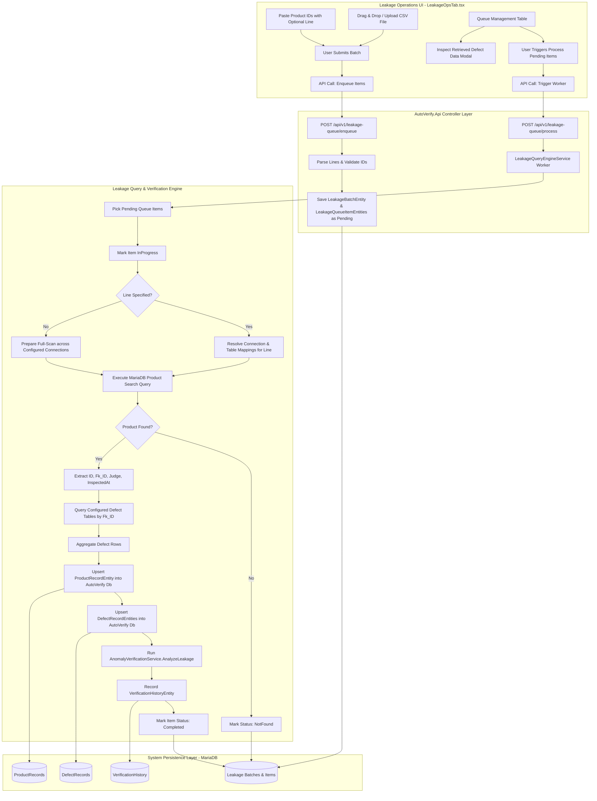

# Technical Specification: Leakage Manual Query & Verification Workflow

## 1. Executive Summary & Problem Context

In electronics manufacturing quality assurance, **Leakage (Escape Risk)** is the critical inverse of Overkill:
- **Overkill (False Alarm)** occurs when a vision inspection machine classifies a good unit as Non-Good (`NG`), resulting in unnecessary scrap or redundant re-inspection.
- **Leakage (Escape / False Negative)** occurs when a vision inspection station classifies a defective unit as Good (`G`, `OK`, `PASS`), allowing severe defects (e.g. solder bridges, missing IC components, microscopic cracks) to escape downstream.

Unlike Overkill scanning which runs periodically in the background over time intervals, **Leakage scanning is an on-demand, targeted manual verification workflow**:
1. Quality Engineers or Line Supervisors receive suspect product serial numbers or lot lists from customer returns, downstream testing stations, or quality audits.
2. The user submits this list into AutoVerify by **pasting raw product IDs** or **uploading / dropping a CSV file** (which may contain `ID` and optionally `Line`).
3. The system **immediately persists these items** into the database marked with status `Pending`.
4. An automated worker processes items (one-by-one or in batches):
   - **Target MariaDB Search**: If a `Line` is specified for an ID, it queries the specific connection/table assigned to that line; if no `Line` is specified, it executes a full-scan lookup across configured MariaDB connections and pipeline tables.
   - **Entity Extraction**: Retrieves the product record and extracts its primary relational key `Fk_ID` along with its station `Judge` and inspection timestamp.
   - **Deep Defect Scanning**: Using the extracted `Fk_ID`, scans deeply across configured multi-defect tables (identical defect table mapping logic as Overkill).
   - **Ingestion & Persistence**: Fetches and stores the retrieved product record into [`ProductRecordEntity`](src/backend/AutoVerify.Api/Persistence/Entities/ProductRecordEntity.cs:3) and defect records into [`DefectRecordEntity`](src/backend/AutoVerify.Api/Persistence/Entities/DefectRecordEntity.cs:3) in AutoVerify's local database.
   - **Leakage Anomaly Verification**: Runs the leakage anomaly verification algorithm via [`AnomalyVerificationService`](src/backend/AutoVerify.Api/Services/AnomalyVerificationService.cs:10) and marks each item's status as `Completed` (flagging `Leakage` or `ConsistentOK`), `NotFound`, or `Failed`.
5. The frontend UI in [`LeakageOpsTab.tsx`](src/web/src/tabs/LeakageOpsTab.tsx:9) provides intuitive ingestion tools (paste box and drag-and-drop CSV dropzone), an interactive queue management table with real-time status badges, triggers to process pending items, and a defect detail modal to inspect the retrieved defects.

---

## 2. End-to-End System Workflow Architecture



---

## 3. Data Model Specifications

### 3.1 Persistence Entities

#### 1. `LeakageBatchEntity`
Represents an ingestion session (either from a pasted batch or an uploaded CSV file).

```csharp
namespace AutoVerify.Api.Persistence.Entities;

public class LeakageBatchEntity
{
    public Guid Id { get; set; }
    public string Name { get; set; } = string.Empty;
    public string SourceType { get; set; } = "Paste"; // "Paste" or "CsvUpload"
    public string? SourceFileName { get; set; }
    public string DefaultLineCode { get; set; } = "ALL";
    public int TotalItems { get; set; }
    public int PendingCount { get; set; }
    public int InProgressCount { get; set; }
    public int CompletedCount { get; set; }
    public int NotFoundCount { get; set; }
    public int FailedCount { get; set; }
    public int LeakageEscapesCount { get; set; }
    public string Status { get; set; } = "Pending"; // "Pending", "Processing", "Completed", "PartiallyFailed", "Failed"
    public string CreatedBy { get; set; } = "admin";
    public DateTimeOffset CreatedAtUtc { get; set; }
    public DateTimeOffset? CompletedAtUtc { get; set; }
}
```

#### 2. `LeakageQueueItemEntity`
Represents each individual product ID entered into the manual query queue.

```csharp
namespace AutoVerify.Api.Persistence.Entities;

public class LeakageQueueItemEntity
{
    public Guid Id { get; set; }
    public Guid BatchId { get; set; }
    public int RowNumber { get; set; }
    public string ProductId { get; set; } = string.Empty;       // Requested ID from user / CSV
    public string? RequestedLineCode { get; set; }              // Specified Line from CSV/input, or null
    public string? Mapping { get; set; }                       // Optional custom feature mapping filter
    public int? MappingInt { get; set; }                       // Optional feature mapping index (e.g. 1 or 2)
    
    // Lifecycle & Execution
    public string Status { get; set; } = "Pending";            // "Pending", "InProgress", "Completed", "NotFound", "Failed"
    public int AttemptCount { get; set; }
    public DateTimeOffset CreatedAtUtc { get; set; }
    public DateTimeOffset? StartedAtUtc { get; set; }
    public DateTimeOffset? ProcessedAtUtc { get; set; }

    // Retrieved Remote Product Data
    public Guid? MatchedConnectionId { get; set; }
    public string? MatchedConnectionName { get; set; }
    public string? MatchedLineCode { get; set; }
    public string? FkId { get; set; }                          // Extracted Fk_ID from target product table
    public string? StationJudge { get; set; }                  // Station judgment: "G", "OK", "NG", etc.
    public DateTime? InspectedAt { get; set; }
    public int TotalDefects { get; set; }

    // Verification Result
    public string? AnomalyStatus { get; set; }                 // "Leakage", "ConsistentOK", "Skipped", "NotFound", "Failed"
    public double AnomalyScore { get; set; }
    public string? AnalysisNotes { get; set; }
    public string? DefectSummaryJson { get; set; }             // Summary of extracted defects/features
    public string? ErrorMessage { get; set; }                  // Query error or network exception message
}
```

### 3.2 EF Core Model & Index Configuration in [`AutoVerifyDbContext.cs`](src/backend/AutoVerify.Api/Persistence/AutoVerifyDbContext.cs:25)

```csharp
modelBuilder.Entity<LeakageBatchEntity>().HasIndex(x => x.CreatedAtUtc);
modelBuilder.Entity<LeakageBatchEntity>().HasIndex(x => x.Status);

modelBuilder.Entity<LeakageQueueItemEntity>().HasIndex(x => x.BatchId);
modelBuilder.Entity<LeakageQueueItemEntity>().HasIndex(x => x.ProductId);
modelBuilder.Entity<LeakageQueueItemEntity>().HasIndex(x => x.Status);
modelBuilder.Entity<LeakageQueueItemEntity>().HasIndex(x => new { x.Status, x.CreatedAtUtc });

// Field length constraints
modelBuilder.Entity<LeakageBatchEntity>().Property(x => x.Name).HasMaxLength(256);
modelBuilder.Entity<LeakageBatchEntity>().Property(x => x.SourceType).HasMaxLength(32);
modelBuilder.Entity<LeakageBatchEntity>().Property(x => x.SourceFileName).HasMaxLength(256);
modelBuilder.Entity<LeakageBatchEntity>().Property(x => x.DefaultLineCode).HasMaxLength(128);
modelBuilder.Entity<LeakageBatchEntity>().Property(x => x.Status).HasMaxLength(64);
modelBuilder.Entity<LeakageBatchEntity>().Property(x => x.CreatedBy).HasMaxLength(128);

modelBuilder.Entity<LeakageQueueItemEntity>().Property(x => x.ProductId).HasMaxLength(128);
modelBuilder.Entity<LeakageQueueItemEntity>().Property(x => x.RequestedLineCode).HasMaxLength(128);
modelBuilder.Entity<LeakageQueueItemEntity>().Property(x => x.MatchedLineCode).HasMaxLength(128);
modelBuilder.Entity<LeakageQueueItemEntity>().Property(x => x.MatchedConnectionName).HasMaxLength(256);
modelBuilder.Entity<LeakageQueueItemEntity>().Property(x => x.FkId).HasMaxLength(128);
modelBuilder.Entity<LeakageQueueItemEntity>().Property(x => x.StationJudge).HasMaxLength(32);
modelBuilder.Entity<LeakageQueueItemEntity>().Property(x => x.AnomalyStatus).HasMaxLength(64);
modelBuilder.Entity<LeakageQueueItemEntity>().Property(x => x.Status).HasMaxLength(64);
modelBuilder.Entity<LeakageQueueItemEntity>().Property(x => x.AnalysisNotes).HasColumnType("text");
modelBuilder.Entity<LeakageQueueItemEntity>().Property(x => x.DefectSummaryJson).HasColumnType("longtext");
modelBuilder.Entity<LeakageQueueItemEntity>().Property(x => x.ErrorMessage).HasColumnType("text");
```

---

## 4. MariaDB Connection Resolution & Query Logic

### 4.1 Connection & Schema Configuration Resolution
When processing a `LeakageQueueItemEntity`:
1. **Target Schema Source**:
   The engine reads table mappings from [`OverkillPipelineConfigEntity`](src/backend/AutoVerify.Api/Persistence/Entities/OverkillPipelineConfigEntity.cs:3) and connection details from [`DatabaseConnectionEntity`](src/backend/AutoVerify.Api/Persistence/Entities/DatabaseConnectionEntity.cs:3). Since both Overkill and Leakage run against the same production MariaDB databases, the schema definitions (Product table, ID column, Fk_ID column, Judge column, and multi-defect table configurations) are shared and consistent.
2. **Line-Specific Query Mode**:
   - If `item.RequestedLineCode` is present and not `"ALL"`:
     - The engine matches pipeline configs or database connections where `LineCode.Equals(item.RequestedLineCode, StringComparison.OrdinalIgnoreCase)`.
     - It restricts the MariaDB query execution strictly to that line's database connection and table.
3. **Full-Scan Lookup Mode**:
   - If `item.RequestedLineCode` is absent, empty, or `"ALL"`:
     - The engine iterates through all active pipeline configurations / database connections.
     - For each connection, it attempts to find the product ID.
     - As soon as a match is located on a connection, that connection is marked as `MatchedConnectionId` and its line is marked as `MatchedLineCode`.
     - Defect extraction proceeds immediately for that matched product.

### 4.2 Safe MariaDB SQL Execution

#### 1. Product Lookup Query
```sql
SELECT `{IdColumnName}`, `{FkIdColumnName}`, `{JudgeColumnName}` [, `{TimestampColumnName}`]
FROM `{ProductTableName}`
WHERE `{IdColumnName}` = @productId OR `{FkIdColumnName}` = @productId
LIMIT 1;
```
- Parameters: `@productId = item.ProductId.Trim()`.
- SQL identifier escaping: Backticks are applied around all table and column names using `EnsureValidIdentifier` regex validation (`^[A-Za-z0-9_]+$`) to eliminate SQL injection risks.

#### 2. Deep Defect Table Scanning Query (matching `Fk_ID`)
Using the extracted `fkId` (or `productId` if `fkId` is empty):
For each configured defect table in `DefectTablesJson`:
```sql
SELECT `{FkColumnName}`, `{DefectNameColumn}`
       [, `{DefectTypeColumn}`]
       [, `{SeverityColumn}`]
       [, `{JudgeColumn}`]
       [, `{ComponentNameColumn}`]
       [, `{CoordXColumn}`]
       [, `{CoordYColumn}`]
       [, `{ImageUriColumn}`]
       [, `{Feature1JsonColumn}`]
       [, `{Feature2JsonColumn}`]
FROM `{DefectTableName}`
WHERE `{FkColumnName}` = @fkId;
```
- Parameter: `@fkId = fkId`.
- Reads all matching defects and normalizes into `RawDefectRow` objects.

### 4.3 Persistence to System Database
To allow seamless investigation in the UI and cross-tab analysis:
1. **Upsert `ProductRecordEntity`**:
   - Matches existing record in `db.ProductRecords` by `KeyId == fkId` (or `productId`).
   - Sets `Judge = productJudge`, `PanelId = rawId`, `MachineCode = connection.MachineCode`, `LineCode = connection.LineCode`, `InspectedAtUtc = inspectedAt`.
2. **Upsert `DefectRecordEntity`**:
   - Removes obsolete defect records for `KeyId` to avoid stale duplicates.
   - Inserts newly extracted defect entities with coordinates, severities, images, and feature vectors.
3. **Record `VerificationHistoryEntity`**:
   - Sets `Category = "Leakage"`, `EntityId = item.ProductId`, `Judge = productJudge`, `AnomalyStatus = analyzed.AnomalyStatus`, `AnomalyScore = analyzed.AnomalyScore`, `AnalysisNotes = analyzed.AnalysisNotes`, `TotalDefects = defectDtos.Count`.

### 4.4 Leakage Verification Verdict Logic
The engine invokes [`AnomalyVerificationService.AnalyzeLeakage`](src/backend/AutoVerify.Api/Services/AnomalyVerificationService.cs:102):
- **Eligibility**:
  - If station `Judge` is `G`, `OK`, `GOOD`, or `PASS`: Item is **eligible** for Leakage inspection.
  - If station `Judge` is `NG` or `N`: Item is marked `Skipped` (`"Leakage verify only evaluates items judged G / OK"`).
- **Leakage Verdict**:
  - If defect features exist (e.g. non-empty `Feature1Json`, `Feature2Json`, or `Severity` in `Critical` / `Major`):
    - **Verdict**: `Leakage` (Escape Risk!).
    - **AnomalyScore**: `0.95`.
    - **Notes**: Highlights matched defect features, table names, and line code.
  - If 0 defect features detected:
    - **Verdict**: `ConsistentOK`.
    - **AnomalyScore**: `0.01`.
    - **Notes**: Product clean, consistent Good.

---

## 5. API Contracts & Endpoints Specification

All endpoints are hosted under `/api/v1/leakage-queue`.

### 5.1 Ingestion Endpoints

#### 1. Paste List Ingestion
- **Route**: `POST /api/v1/leakage-queue/paste`
- **Request**:
```json
{
  "name": "Lot-20260903-Leakage-Audit",
  "rawText": "CUS-1004\tSMT-02\nCUS-1001\tSMT-01\nDXDIAN\tALL",
  "defaultLineCode": "ALL",
  "mappingName": "mappingInt"
}
```
- **Behavior**:
  - Splits `rawText` by line and whitespace/tabs/commas.
  - Generates a new [`LeakageBatchEntity`](src/backend/AutoVerify.Api/Persistence/Entities/ScanListEntity.cs:3) with `Status = "Pending"`.
  - Enqueues rows as [`LeakageQueueItemEntity`](src/backend/AutoVerify.Api/Persistence/Entities/ScanListItemEntity.cs:3) with `Status = "Pending"`.
- **Response (201 Created)**:
```json
{
  "batchId": "c5f171bc-79f9-46be-91c6-11f81d113c19",
  "name": "Lot-20260903-Leakage-Audit",
  "totalItems": 3,
  "pendingCount": 3,
  "status": "Pending",
  "createdAtUtc": "2026-09-03T07:30:00Z"
}
```

#### 2. CSV File Ingestion
- **Route**: `POST /api/v1/leakage-queue/upload-csv`
- **Request**: `multipart/form-data`
  - `file`: CSV / TSV file.
  - `name`: (optional string) Batch name.
  - `defaultLineCode`: (optional string) Default line if not specified in CSV column.
- **CSV Header Mapping**:
  - Automatically identifies header columns:
    - ID column: `ID`, `KeyID`, `ProductId`, `Product_ID`, `Serial`, `Barcode`.
    - Line column (optional): `Line`, `LineCode`, `Line_Code`, `SMT_Line`.
    - Mapping column (optional): `Mapping`, `MappingInt`.
  - If no header row is present, defaults to Column 0 = ID, Column 1 = Line.
- **Response (201 Created)**: Returns batch summary matching the paste endpoint.

### 5.2 Queue Management Endpoints

#### 3. Query Queue Items
- **Route**: `GET /api/v1/leakage-queue/items`
- **Parameters**:
  - `batchId`: (optional Guid) Filter by upload batch.
  - `status`: (optional string) `Pending`, `InProgress`, `Completed`, `NotFound`, `Failed`.
  - `anomalyStatus`: (optional string) `Leakage`, `ConsistentOK`, `Skipped`.
  - `search`: (optional string) Search by `ProductId`.
  - `page`: (int, default 1).
  - `pageSize`: (int, default 25).
- **Response (200 OK)**:
```json
{
  "items": [
    {
      "id": "e818816f-d961-4608-8e6f-967a53c9e99a",
      "batchId": "c5f171bc-79f9-46be-91c6-11f81d113c19",
      "rowNumber": 1,
      "productId": "CUS-1004",
      "requestedLineCode": "SMT-02",
      "matchedLineCode": "SMT-02",
      "status": "Completed",
      "stationJudge": "G",
      "fkId": "FK-99014",
      "totalDefects": 2,
      "anomalyStatus": "Leakage",
      "anomalyScore": 0.95,
      "analysisNotes": "Station judged 'G' on Line 'SMT-02', but detected 2 defect feature(s) in defect table: OpticalAOI_Defects (Critical Escape Risk).",
      "matchedConnectionName": "MariaDB - SMT Line 2",
      "errorMessage": null,
      "createdAtUtc": "2026-09-03T07:30:00Z",
      "processedAtUtc": "2026-09-03T07:31:12Z"
    }
  ],
  "page": 1,
  "pageSize": 25,
  "totalCount": 1,
  "totalPages": 1
}
```

#### 4. List Batches
- **Route**: `GET /api/v1/leakage-queue/batches`
- **Response (200 OK)**: Returns list of recent `LeakageBatchEntity` records with real-time aggregated counts.

### 5.3 Execution & Progress Endpoints

#### 5. Trigger Processing
- **Route**: `POST /api/v1/leakage-queue/process`
- **Request**:
```json
{
  "batchId": "c5f171bc-79f9-46be-91c6-11f81d113c19",
  "itemIds": [],                // If specified, only processes selected IDs; if empty, processes all pending
  "processAllPending": true,
  "maxConcurrency": 4
}
```
- **Behavior**: Launches the background processing job. Items are picked, locked with `Status = "InProgress"`, queried in MariaDB, persisted, and updated.
- **Response (202 Accepted)**:
```json
{
  "message": "Processing started for 3 pending item(s).",
  "batchId": "c5f171bc-79f9-46be-91c6-11f81d113c19",
  "queuedCount": 3
}
```

#### 6. Real-time Progress
- **Route**: `GET /api/v1/leakage-queue/progress`
- **Response (200 OK)**:
```json
{
  "isBusy": true,
  "currentProductId": "CUS-1004",
  "pendingCount": 2,
  "inProgressCount": 1,
  "completedCount": 10,
  "notFoundCount": 1,
  "failedCount": 0,
  "leakageCount": 3
}
```

#### 7. Inspect Item Defect Details
- **Route**: `GET /api/v1/leakage-queue/items/{id:guid}/details`
- **Response (200 OK)**:
```json
{
  "queueItem": {
    "id": "e818816f-d961-4608-8e6f-967a53c9e99a",
    "productId": "CUS-1004",
    "status": "Completed",
    "anomalyStatus": "Leakage",
    "analysisNotes": "Critical Escape Risk: 2 defect features detected on Good product."
  },
  "product": {
    "keyId": "CUS-1004",
    "judge": "G",
    "panelId": "PNL-0821",
    "machineCode": "MACHINE-SMT-02",
    "lineCode": "SMT-02",
    "inspectedAtUtc": "2026-09-03T05:12:00Z"
  },
  "defects": [
    {
      "id": "a0f3299c-b193-4a11-a579-2475143a3db5",
      "keyId": "CUS-1004",
      "defectTable": "OpticalAOI_Defects",
      "defectName": "Solder Bridge",
      "defectType": "Bridging",
      "componentName": "U14-PIN3",
      "coordinateX": 142.5,
      "coordinateY": 88.2,
      "severity": "Critical",
      "judge": "NG",
      "imageUri": "/storage/blobs/leakage-u14.jpg",
      "feature1Json": "{\"confidence\": 0.98, \"area_px\": 450}"
    }
  ]
}
```

#### 8. Retry Failed or Not Found Item
- **Route**: `POST /api/v1/leakage-queue/items/{id:guid}/retry`
- **Response (200 OK)**: Resets item status to `Pending` so it will be re-processed on next run.

#### 9. Clear / Delete Queue Items
- **Route**: `DELETE /api/v1/leakage-queue/items`
- **Request**: `{ "itemIds": ["..."], "batchId": "...", "clearCompleted": true }`

---

## 6. Frontend UI Specification ([`LeakageOpsTab.tsx`](src/web/src/tabs/LeakageOpsTab.tsx:9))

The frontend interface will be restructured into 4 functional areas designed for rapid operational execution:

```
+-----------------------------------------------------------------------------------------------+
| LEAKAGE OPERATIONS (Manual MariaDB Query & Escape Risk Verification)                          |
+-----------------------------------------------------------------------------------------------+
| [Section 1: Ingestion Zone]                                                                   |
| [ Tab: Paste List ]  [ Tab: Upload / Drop CSV ]                                               |
| +---------------------------------------------------------+ +-------------------------------+ |
| | Textarea (Paste Product IDs & optional Line):           | | Batch Details & Settings:     | |
| | CUS-1004    SMT-02                                      | | Batch Name: [Lot-2026-09-03 ] | |
| | CUS-1001    SMT-01                                      | | Default Line: [ALL / Auto  v] | |
| | DXDIAN                                                  | |                               | |
| |                                                         | | [📥 Enqueue Items (Pending) ] | |
| +---------------------------------------------------------+ +-------------------------------+ |
|                                                                                               |
| [Section 2: Real-time Queue Metrics Bar]                                                      |
| [ 24 Total ]  [ 12 Pending ]  [ 1 Processing... ]  [ 9 Completed ]  [ 2 LEAKAGE! ]  [ 1 NotFound]|
| Progress: [===============================>                ] 65%                              |
|                                                                                               |
| [Section 3: Queue Management & Action Controls]                                               |
| Filter: [All] [Pending] [In Progress] [Completed] [Leakage Only] [Not Found] [Failed]        |
| Search: [ Filter Product ID... ]                                                              |
| Actions: [ ▶ Process All Pending ]  [ ▶ Process Selected (2) ]  [ 🔄 Refresh ]  [ 🗑️ Clear ]     |
|                                                                                               |
| [Section 4: Interactive Queue Table]                                                          |
| [x] | #  | Product ID | Line   | Status      | Judge | Fk_ID    | Defects | Verdict | Actions   |
| [ ] | 1  | CUS-1004   | SMT-02 | Completed   | G     | FK-99014 | 2       | Leakage | [Inspect] |
| [ ] | 2  | CUS-1001   | SMT-01 | Completed   | OK    | FK-99015 | 0       | Clean OK| [Inspect] |
| [ ] | 3  | DXDIAN     | ALL    | In Progress | ...   | ...      | ...     | ...     | [...]     |
| [ ] | 4  | UNK-999    | SMT-03 | Not Found   | -     | -        | 0       | Not Found| [Retry]  |
+-----------------------------------------------------------------------------------------------+
```

### 6.1 Ingestion Component Design

1. **Dual Ingestion Mode Switch**:
   - Sub-tab 1: **"Paste List"**:
     - Large multi-line textarea with auto-trimming and row counting.
     - Supports TSV, CSV, or space-delimited formats (`ID \t Line` or just `ID`).
     - Real-time client-side preview indicator (e.g. `"Detected 42 IDs across 3 lines"`).
   - Sub-tab 2: **"Upload / Drop CSV"**:
     - Drag-and-drop file target container accepting `.csv`, `.tsv`, and `.txt`.
     - File dropped -> parses client-side header row, detects ID column and Line column.
     - Displays sample parsed rows (first 5 rows) and total row count before submitting.
2. **Immediate Enqueue Action**:
   - User clicks **"📥 Enqueue Items (Save as Pending)"**.
   - Submits payload to `POST /api/v1/leakage-queue/paste` or `upload-csv`.
   - The server immediately saves items to `LeakageQueueItems` marked `Pending`.
   - UI displays a success banner and refreshes the queue table.

### 6.2 Queue Management & Progress Bar

1. **Real-time Metrics Counter**:
   - Displays count badges for `Total`, `Pending`, `InProgress` (with spinning indicator), `Completed`, `Leakage` (highlighted in red/pink tone), `NotFound` (slate), and `Failed` (crimson).
2. **Dynamic Polling & Progress Bar**:
   - While any item is `InProgress` or processing is active, the tab polls `/progress` every 2.5 seconds.
   - Animated progress bar shows `(Completed + NotFound + Failed) / Total * 100%`.
3. **Execution Controls**:
   - **"▶ Process All Pending"**: Triggers background worker for all pending items in the active batch or queue.
   - **"▶ Process Selected"**: Triggers processing specifically for checked table rows.
   - **"Filter Tabs"**: Quickly isolate `Leakage Only` (escape risks requiring immediate triage) or `NotFound` items.

### 6.3 Interactive Queue Table Columns
1. **Selection Checkbox**: For multi-item batch execution or removal.
2. **Row #**: Original input sequence order.
3. **Product ID**: Clickable identifier linking to defect inspection modal.
4. **Line**: Shows requested line code or resolved line tag (`line-pill`).
5. **Status Badge**:
   - `Pending`: Yellow badge.
   - `InProgress`: Blue pulsating badge with spinner.
   - `Completed`: Green badge.
   - `NotFound`: Gray badge.
   - `Failed`: Red badge with tooltip error message.
6. **Station Judge**: Station judgment retrieved from MariaDB (`G`, `OK`, `NG`).
7. **Fk_ID**: The relational foreign key extracted from the product table.
8. **Defects Count**: Number of defect records located in remote defect tables.
9. **Anomaly Verdict**:
   - `Leakage` (bold red badge: Critical Escape Risk!).
   - `ConsistentOK` (green badge: Clean product).
   - `Skipped` (orange badge: Non-G/OK item).
   - `NotFound` (slate badge: Product missing from MariaDB).
10. **Actions Column**:
    - **"Inspect" Button**: Opens the Defect Details Drawer/Modal.
    - **"Retry" Button**: Re-enqueues item if `NotFound` or `Failed`.

### 6.4 Defect Detail Modal / Drawer
When the user clicks "Inspect" on any completed item:
- **Header**: Shows Product ID, Station Judge badge (`JudgeBadge`), Line, Machine, and InspectedAt timestamp.
- **Anomaly Verdict Summary**:
  - Anomaly status pill (`Leakage` / `ConsistentOK`).
  - Score meter (`0.95` for Leakage).
  - Detailed analysis notes explaining why the item was flagged as an escape risk.
- **Retrieved Defect Records Table**:
  - Columns: Defect Table Name, Defect Name, Component Name, Defect Type, Severity, Coordinates `(X, Y)`.
  - Image Preview thumbnail if `ImageUri` is present (clickable for full zoom).
  - Expandable JSON viewer for `Feature1Json` and `Feature2Json`.

---

## 7. Implementation Plan for Code Mode

### Phase 1: Persistence Layer & Migrations
1. Create [`LeakageBatchEntity.cs`](src/backend/AutoVerify.Api/Persistence/Entities/ScanListEntity.cs:3) and [`LeakageQueueItemEntity.cs`](src/backend/AutoVerify.Api/Persistence/Entities/ScanListItemEntity.cs:3) in `AutoVerify.Api/Persistence/Entities/`.
2. Register `DbSet<LeakageBatchEntity>` and `DbSet<LeakageQueueItemEntity>` in [`AutoVerifyDbContext.cs`](src/backend/AutoVerify.Api/Persistence/AutoVerifyDbContext.cs:20).
3. Add table indexes and column property mappings in [`AutoVerifyDbContext.OnModelCreating`](src/backend/AutoVerify.Api/Persistence/AutoVerifyDbContext.cs:25).
4. Add raw SQL table creation script to [`DatabaseSeeder.cs`](src/backend/AutoVerify.Api/Persistence/DatabaseSeeder.cs:50) to auto-create `LeakageBatches` and `LeakageQueueItems` on startup.

### Phase 2: Backend Query Engine & Processing Service
1. Create `ILeakageQueryEngineService` and implementation `LeakageQueryEngineService`:
   - Connection resolution logic (line-specific vs full-scan).
   - Parameterized MariaDB product search by `ID` or `Fk_ID`.
   - Multi-defect table querying matching `Fk_ID` (chunked/parameterized).
   - Local DB persistence into `ProductRecords` and `DefectRecords`.
   - Invocation of `IAnomalyVerificationService.AnalyzeLeakage`.
   - Updating item status to `Completed`, `NotFound`, or `Failed`.
2. Add background queue processing runner (supporting concurrency limit and cancellation).
3. Register services in [`Program.cs`](src/backend/AutoVerify.Api/Program.cs:1).

### Phase 3: REST API Controllers & DTO Contracts
1. Define request and response records in [`Contracts.cs`](src/backend/AutoVerify.Api/Contracts.cs:40):
   - `PasteLeakageItemsRequest`, `UploadCsvLeakageRequest`.
   - `LeakageQueueItemDto`, `LeakageBatchDto`, `ProcessLeakageQueueRequest`, `LeakageProgressResponse`, `LeakageItemDetailsResponse`.
2. Create `LeakageQueueController.cs`:
   - `POST /api/v1/leakage-queue/paste`
   - `POST /api/v1/leakage-queue/upload-csv`
   - `GET /api/v1/leakage-queue/items`
   - `GET /api/v1/leakage-queue/batches`
   - `POST /api/v1/leakage-queue/process`
   - `GET /api/v1/leakage-queue/progress`
   - `GET /api/v1/leakage-queue/items/{id:guid}/details`
   - `POST /api/v1/leakage-queue/items/{id:guid}/retry`
   - `DELETE /api/v1/leakage-queue/items`

### Phase 4: Frontend API Client & TypeScript Definitions
1. In [`src/web/src/types.ts`](src/web/src/types.ts:68), define:
   - `LeakageQueueItem`, `LeakageBatch`, `LeakageProgress`, `LeakageItemDetails`.
2. In [`src/web/src/api.ts`](src/web/src/api.ts:127), add `leakageQueueApi` client methods.

### Phase 5: Frontend UI Implementation in `LeakageOpsTab.tsx`
1. Re-architect [`src/web/src/tabs/LeakageOpsTab.tsx`](src/web/src/tabs/LeakageOpsTab.tsx:9):
   - Ingestion section with tabs: "Paste List" and "CSV File Dropzone".
   - Immediate Save/Enqueue action creating pending items.
   - Real-time metric cards and animated progress bar with polling while active.
   - Action buttons: "Process All Pending", "Process Selected", "Filter by Status".
   - Paginated queue table with status badges and actions.
   - Defect details modal with full product record, anomaly explanation, and defect table list.
2. Verify TypeScript compile and build using `npm run build` in `src/web/`.
