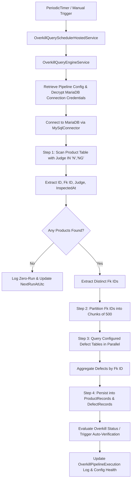

# Technical Specification: Overkill Automated MariaDB Query Pipeline

## 1. Executive Summary & Problem Statement

In automated quality assurance pipelines for high-precision electronics manufacturing (e.g., SMT lines, semiconductor assembly, display modules), vision inspection machines judge products as **Normal (OK)** or **Non-Good (NG/N)**. 

A significant challenge in high-throughput lines is **Overkill (False Alarm)**: inspection systems judgment algorithms (or conservative station thresholds) flag products as **Judge = 'N' or 'NG'**, yet downstream specialized defect classification systems (e.g., Optical AOI, AI Deep-Learning Defect Classifiers, Solder Paste Inspection SPI, X-ray AXI) detect no true critical defects. Identifying and analyzing these overkill candidates allows line engineers to fine-tune inspection thresholds, avoid unwarranted scrap or unnecessary manual re-inspection, and monitor line yield stability.

This document specifies the complete technical architecture and implementation design for the **Overkill Automated Query System**, which:
1. Periodically (e.g. every 2–3 hours) connects to an external or local **MariaDB** database.
2. Scans a designated **Product** table, filtering records where the `Judge` column matches configurable criteria (e.g., `'N'`, `'NG'`).
3. Extracts primary identifying keys: `ID`, `Fk ID`, `Judge`, and inspection timestamp.
4. Performs a deep scan into **multiple configurable Defect tables** using `Fk ID` as the relational join key.
5. Ingests and synchronizes retrieved records into AutoVerify's persistence layer, making them available to the verification engine and Overkill analytics.
6. Provides an intuitive UI to manage pipeline configurations, test table mappings, trigger manual runs, and inspect automated query results.

---

## 2. Existing System Analysis

### 2.1 Backend Architecture
- **Framework & Runtime**: .NET 9 Web API (`AutoVerify.Api`) targeting C# 13 and ASP.NET Core.
- **Database Context**: [`AutoVerifyDbContext`](src/backend/AutoVerify.Api/Persistence/AutoVerifyDbContext.cs:6) using EF Core with `Pomelo.EntityFrameworkCore.MySql` on MariaDB.
- **Database Connection Management**:
  - Entity: [`DatabaseConnectionEntity`](src/backend/AutoVerify.Api/Persistence/Entities/DatabaseConnectionEntity.cs:3) stores `Host`, `Port`, `DatabaseName`, `Username`, `EncryptedPassword` (DPAPI encrypted via `IDataProtectionProvider`), `MachineCode`, and `LineCode`.
  - Controller: [`DatabaseConnectionsController`](src/backend/AutoVerify.Api/Controllers/DatabaseConnectionsController.cs:7) provides endpoints to manage and test MariaDB connectivity.
- **Query Engine**:
  - Service: [`QueryEngineService`](src/backend/AutoVerify.Api/Services/QueryEngineService.cs:13) executes parameterized SQL queries against target MariaDB instances using `MySqlConnector` (`MySqlConnection`, `MySqlCommand`).
  - Validation: Enforces read-only statements (`SELECT`, `WITH`) and prevents destructive SQL keywords (`INSERT`, `UPDATE`, `DELETE`, `DROP`).
- **Product & Defect Entities**:
  - [`ProductRecordEntity`](src/backend/AutoVerify.Api/Persistence/Entities/ProductRecordEntity.cs:3): Stores `KeyId` (primary entity identifier), `Judge`, `PanelId`, `PanelJudge`, `NameDefect`, `MachineCode`, `LineCode`, `InspectedAtUtc`, and `MetadataJson`.
  - [`DefectRecordEntity`](src/backend/AutoVerify.Api/Persistence/Entities/DefectRecordEntity.cs:3): Stores `KeyId` (matching product key), `DefectTable`, `DefectName`, `DefectType`, `ComponentName`, `CoordinateX`, `CoordinateY`, `Severity`, `Judge`, `ConfidenceScore`, `ImageUri`, and AI feature vectors (`Feature1Json`, `Feature2Json`).
- **Scheduler State**: Currently, background jobs or hosted services do not exist in the codebase. All queries are synchronous API requests.

### 2.2 Frontend Architecture
- **Framework**: React 19 + TypeScript + Vite.
- **Navigation Structure**: 4 main categories with horizontal navigation tabs:
  - `Dashboard`: System overview.
  - `Operations`: [`OverkillOpsTab`](src/web/src/tabs/OverkillOpsTab.tsx:7), [`LeakageOpsTab`](src/web/src/tabs/LeakageOpsTab.tsx:1), [`ScansTab`](src/web/src/tabs/ScansTab.tsx:1), [`HistoryTab`](src/web/src/tabs/HistoryTab.tsx:1).
  - `Products & Analysis`: [`ProductsTab`](src/web/src/tabs/ProductsTab.tsx:1), [`OverkillTab`](src/web/src/tabs/OverkillTab.tsx:7).
  - `Configuration & Data`: [`SourcesTab`](src/web/src/tabs/SourcesTab.tsx:7), [`QueriesTab`](src/web/src/tabs/QueriesTab.tsx:15), [`StorageTab`](src/web/src/tabs/StorageTab.tsx:1), [`AuditTab`](src/web/src/tabs/AuditTab.tsx:1).

---

## 3. High-Level Architecture & End-to-End Workflow



---

## 4. Detailed Data Models & Specifications

### 4.1 Persistence Entities

#### `OverkillPipelineConfigEntity`
Stores the configuration for an automated Overkill query pipeline against a MariaDB database:

```csharp
namespace AutoVerify.Api.Persistence.Entities;

public class OverkillPipelineConfigEntity
{
    public Guid Id { get; set; }
    public string Name { get; set; } = string.Empty;
    public Guid DatabaseConnectionId { get; set; }
    public string MachineCode { get; set; } = "MACHINE-A";
    public string LineCode { get; set; } = "LINE-1";
    public bool Enabled { get; set; } = true;
    
    // Scheduling
    public int ScheduleIntervalMinutes { get; set; } = 120; // e.g. 120 (2h) or 180 (3h)
    public DateTimeOffset? LastRunAtUtc { get; set; }
    public DateTimeOffset? NextRunAtUtc { get; set; }
    public string LastRunStatus { get; set; } = "Idle"; // Idle, Running, Success, Failed
    public string? LastRunMessage { get; set; }
    public int LastRunProductsCount { get; set; }
    public int LastRunDefectsCount { get; set; }

    // Product Table Configuration
    public string ProductTableName { get; set; } = "Product";
    public string IdColumnName { get; set; } = "ID";
    public string FkIdColumnName { get; set; } = "Fk_ID";
    public string JudgeColumnName { get; set; } = "Judge";
    public string JudgeFilterValuesJson { get; set; } = "[\"N\",\"NG\"]";
    public string? TimestampColumnName { get; set; } = "InspectedAt";
    public int LookbackHours { get; set; } = 6; // Scan window to avoid full table scans
    public int BatchSize { get; set; } = 1000;

    // Multi-Defect Tables Configuration (Serialized JSON array of DefectTableMapping)
    public string DefectTablesJson { get; set; } = "[]";

    public DateTimeOffset CreatedAtUtc { get; set; }
    public DateTimeOffset UpdatedAtUtc { get; set; }
}
```

#### `DefectTableMapping` (Object Schema stored in `DefectTablesJson`)
```csharp
public sealed record DefectTableMapping(
    string TableName,              // e.g. "aoi_defects", "ai_defects", "spi_defects"
    string DisplayName,            // e.g. "AOI Optical Defects"
    string FkColumnName,           // Foreign key referencing Product Fk_ID (e.g. "product_fk_id")
    string DefectNameColumn,       // Column name for defect name/code (e.g. "defect_name")
    string? DefectTypeColumn,      // e.g. "defect_type" (default: "Optical")
    string? SeverityColumn,        // e.g. "severity" (Critical, Major, Minor)
    string? JudgeColumn,           // e.g. "defect_judge"
    string? ComponentNameColumn,   // e.g. "component_name" / "ref_des"
    string? CoordXColumn,          // e.g. "coord_x"
    string? CoordYColumn,          // e.g. "coord_y"
    string? ImageUriColumn,        // e.g. "image_url"
    string? Feature1JsonColumn,    // e.g. "bbox_features"
    string? Feature2JsonColumn     // e.g. "ai_vector"
);
```

#### `OverkillPipelineExecutionEntity`
Historical audit and operational trace of each scheduled or manual execution:

```csharp
namespace AutoVerify.Api.Persistence.Entities;

public class OverkillPipelineExecutionEntity
{
    public Guid Id { get; set; }
    public Guid ConfigId { get; set; }
    public string PipelineName { get; set; } = string.Empty;
    public string TriggerType { get; set; } = "Scheduled"; // Scheduled | Manual
    public DateTimeOffset StartedAtUtc { get; set; }
    public DateTimeOffset? CompletedAtUtc { get; set; }
    public string Status { get; set; } = "Running"; // Running | Success | PartialError | Failed
    public int ProductsScanned { get; set; }
    public int DefectsExtracted { get; set; }
    public int OverkillCandidatesCount { get; set; }
    public int LatencyMs { get; set; }
    public string? ErrorMessage { get; set; }
    public string? ExecutionSummaryJson { get; set; }
}
```

### 4.2 Data Transfer Objects (DTOs)

To be added in [`Contracts.cs`](src/backend/AutoVerify.Api/Contracts.cs:1):

```csharp
// Configuration Requests & Responses
public sealed record OverkillPipelineConfigResponse(
    Guid Id,
    string Name,
    Guid DatabaseConnectionId,
    string ConnectionName,
    string MachineCode,
    string LineCode,
    bool Enabled,
    int ScheduleIntervalMinutes,
    DateTimeOffset? LastRunAtUtc,
    DateTimeOffset? NextRunAtUtc,
    string LastRunStatus,
    string? LastRunMessage,
    int LastRunProductsCount,
    int LastRunDefectsCount,
    string ProductTableName,
    string IdColumnName,
    string FkIdColumnName,
    string JudgeColumnName,
    IReadOnlyCollection<string> JudgeFilterValues,
    string? TimestampColumnName,
    int LookbackHours,
    int BatchSize,
    IReadOnlyCollection<DefectTableMapping> DefectTables,
    DateTimeOffset CreatedAtUtc,
    DateTimeOffset UpdatedAtUtc
);

public sealed record CreateOverkillPipelineConfigRequest(
    string Name,
    Guid DatabaseConnectionId,
    string MachineCode,
    string LineCode,
    bool Enabled,
    int ScheduleIntervalMinutes,
    string ProductTableName,
    string IdColumnName,
    string FkIdColumnName,
    string JudgeColumnName,
    IReadOnlyCollection<string> JudgeFilterValues,
    string? TimestampColumnName,
    int LookbackHours,
    int BatchSize,
    IReadOnlyCollection<DefectTableMapping> DefectTables
);

// Manual & Test Execution DTOs
public sealed record TestPipelineMappingRequest(
    Guid DatabaseConnectionId,
    string ProductTableName,
    string IdColumnName,
    string FkIdColumnName,
    string JudgeColumnName,
    IReadOnlyCollection<string> JudgeFilterValues,
    IReadOnlyCollection<DefectTableMapping> DefectTables,
    int SampleLimit = 5
);

public sealed record TestPipelineMappingResponse(
    bool Success,
    int SampleProductsCount,
    IReadOnlyCollection<IReadOnlyDictionary<string, object?>> SampleProducts,
    IReadOnlyDictionary<string, int> DefectCountsByTable,
    IReadOnlyCollection<IReadOnlyDictionary<string, object?>> SampleDefects,
    int LatencyMs,
    string? ErrorMessage
);

public sealed record TriggerPipelineExecutionResponse(
    Guid ExecutionId,
    Guid ConfigId,
    string Status,
    string Message
);

public sealed record OverkillPipelineExecutionResponse(
    Guid Id,
    Guid ConfigId,
    string PipelineName,
    string TriggerType,
    DateTimeOffset StartedAtUtc,
    DateTimeOffset? CompletedAtUtc,
    string Status,
    int ProductsScanned,
    int DefectsExtracted,
    int OverkillCandidatesCount,
    int LatencyMs,
    string? ErrorMessage
);
```

---

## 5. Backend Execution Engine Design

### 5.1 Service Layer (`IOverkillQueryEngineService`)

Create a dedicated interface and service implementation:
- Interface: `src/backend/AutoVerify.Api/Services/IOverkillQueryEngineService.cs`
- Implementation: `src/backend/AutoVerify.Api/Services/OverkillQueryEngineService.cs`

#### Key Methods:
```csharp
public interface IOverkillQueryEngineService
{
    Task<TestPipelineMappingResponse> TestMappingAsync(
        TestPipelineMappingRequest request,
        CancellationToken cancellationToken = default);

    Task<OverkillPipelineExecutionEntity> ExecutePipelineAsync(
        Guid configId,
        string triggerType,
        CancellationToken cancellationToken = default);
}
```

### 5.2 MariaDB Query Construction & Safe Execution

#### Product Query Builder:
```sql
SELECT 
    `{IdColumn}`, 
    `{FkIdColumn}`, 
    `{JudgeColumn}`
    {Optional: , `{TimestampColumn}`}
FROM `{ProductTable}`
WHERE `{JudgeColumn}` IN (@judge0, @judge1, ...)
  AND `{TimestampColumn}` >= @lookbackUtc
ORDER BY `{TimestampColumn}` DESC
LIMIT @batchSize;
```
*Security safeguard*: Column and table names are validated against regex `^[A-Za-z0-9_]+$` to prevent SQL injection in dynamic identifier clauses. Values are strictly passed as parameterized `@judge0`, `@judge1`, `@lookbackUtc`.

#### Deep Defect Query Builder (Per Configured Defect Table):
```sql
SELECT 
    `{FkColumn}`,
    `{DefectNameColumn}`
    {Optional: , `{DefectTypeColumn}`, `{SeverityColumn}`, `{JudgeColumn}`, `{ComponentNameColumn}`, `{CoordXColumn}`, `{CoordYColumn}`, `{ImageUriColumn}`}
FROM `{DefectTable}`
WHERE `{FkColumn}` IN (@fk0, @fk1, ... @fkN);
```
*Chunking Optimization*: If the product query yields 800 `Fk_ID`s, the engine slices them into batches of 200–500 IDs before issuing the `IN` query to each defect table. Queries across different defect tables run concurrently using `Task.WhenAll` to minimize overall query latency.

### 5.3 Ingestion & Verification Linking

When products and their defects are retrieved:
1. **Product Ingestion**:
   - Mapped to [`ProductRecordEntity`](src/backend/AutoVerify.Api/Persistence/Entities/ProductRecordEntity.cs:3):
     - `KeyId` = `Fk_ID` (or `ID` if FK is blank)
     - `Judge` = `Judge` from MariaDB (e.g. "N" or "NG")
     - `MachineCode` = Configured machine code
     - `LineCode` = Configured line code
     - `InspectedAtUtc` = Timestamp or UTC Now
   - Upserted into `db.ProductRecords` (updating existing records if already present by `KeyId`).
2. **Defect Ingestion**:
   - Mapped to [`DefectRecordEntity`](src/backend/AutoVerify.Api/Persistence/Entities/DefectRecordEntity.cs:3):
     - `KeyId` = `Fk_ID`
     - `DefectTable` = Defect table name / display name
     - `DefectName` = Defect name extracted
     - `Severity` = Severity extracted (or defaulted to "Minor" / "Major")
     - `Judge` = Defect judge (or defaulted to "NG")
   - Defect records are saved to `db.DefectRecords`.
3. **Automated Overkill Tagging**:
   - Evaluated using existing [`AnomalyVerificationService`](src/backend/AutoVerify.Api/Services/AnomalyVerificationService.cs:8):
     - If product station `Judge` is 'N' or 'NG', but 0 defect records exist (or only non-functional/benign entries), flag as **Overkill (False Alarm)**.
     - Record directly into `VerificationHistory` for auditing and real-time dashboard notifications.

### 5.4 Automated Background Scheduler (`IHostedService`)

Implement `OverkillQuerySchedulerHostedService`:
- Uses `System.Threading.PeriodicTimer` with an internal tick interval of 60 seconds.
- On each tick:
  1. Creates a scoped `IServiceScope` via `IServiceScopeFactory`.
  2. Queries `OverkillPipelineConfigs` where `Enabled == true` and `(NextRunAtUtc == null || NextRunAtUtc <= DateTimeOffset.UtcNow)`.
  3. Uses a `ConcurrentDictionary<Guid, SemaphoreSlim>` to prevent overlapping runs of the same pipeline.
  4. Invokes `IOverkillQueryEngineService.ExecutePipelineAsync(config.Id, "Scheduled", cancellationToken)`.
  5. Updates `LastRunAtUtc`, `NextRunAtUtc = DateTimeOffset.UtcNow.AddMinutes(config.ScheduleIntervalMinutes)`, and `LastRunStatus`.
  6. Catches and logs transient database connection errors without crashing the host application.

---

## 6. REST API Specification

Controller: `src/backend/AutoVerify.Api/Controllers/OverkillPipelineController.cs`

| Method | Route | Description |
|---|---|---|
| `GET` | `/api/v1/overkill-pipeline/configs` | List all Overkill pipeline configurations |
| `GET` | `/api/v1/overkill-pipeline/configs/{id}` | Get single pipeline configuration |
| `POST` | `/api/v1/overkill-pipeline/configs` | Create new pipeline configuration |
| `PUT` | `/api/v1/overkill-pipeline/configs/{id}` | Update pipeline configuration |
| `DELETE` | `/api/v1/overkill-pipeline/configs/{id}` | Delete pipeline configuration |
| `POST` | `/api/v1/overkill-pipeline/configs/{id}/toggle` | Enable or disable automated execution |
| `POST` | `/api/v1/overkill-pipeline/configs/{id}/run` | Manually trigger immediate pipeline scan |
| `POST` | `/api/v1/overkill-pipeline/test-mapping` | Test table and column mappings without saving |
| `GET` | `/api/v1/overkill-pipeline/executions` | Get execution history and status logs |
| `GET` | `/api/v1/overkill-pipeline/configs/{id}/executions` | Get execution history for a specific config |

---

## 7. Frontend UI Design & User Experience

### 7.1 Location in Application Architecture

To provide an optimal user experience, modifications span two coordinated touchpoints:

1. **Configuration Experience**:
   - Location: [`QueriesTab.tsx`](src/web/src/tabs/QueriesTab.tsx:15) under `Settings > Query Profiles`.
   - Enhancement: Add a segmented view toggle:
     - `[ Standard Query Profiles | Overkill Automated Pipelines ]`
     - Allows engineers to manage SQL profiles and Overkill automated pipelines in the same central query management workspace.

2. **Operations & Monitoring Experience**:
   - Location: [`OverkillOpsTab.tsx`](src/web/src/tabs/OverkillOpsTab.tsx:7) under `Operations > Overkill Operations`.
   - Enhancement: Add an **"Automated MariaDB Scanner & Schedule"** operational card directly at the top:
     - Real-time status badge (`Scheduled in 1h 45m`, `Running...`, or `Last run: 12m ago - 142 items`).
     - "Run Now" manual trigger button.
     - Quick link to open the configuration modal or review execution traces.
     - Direct table displaying recently retrieved Overkill batches with drill-down into defect details.

### 7.2 Configuration Modal / Form Structure

The configuration editor supports:
1. **General Pipeline Settings**:
   - Pipeline Name (e.g. `SMT Line 1 Solder & Optical Overkill Scan`)
   - Target MariaDB Connection dropdown (populated from [`DatabaseConnections`](src/web/src/tabs/SourcesTab.tsx:9))
   - Target Machine Code & Line Code
   - Active toggle (`Enabled` switch)
   - Schedule Interval (Presets: `Every 1 hour`, `Every 2 hours`, `Every 3 hours`, `Custom minutes`)
   - Lookback Window (e.g. `Last 2 hours`, `Last 6 hours`, `Last 24 hours`)
2. **Product Table Mapping**:
   - Table Name (default: `Product`)
   - ID Column Name (default: `ID`)
   - FK ID Column Name (default: `Fk_ID`)
   - Judge Column Name (default: `Judge`)
   - Filter Values (Multi-tag input: `N`, `NG`, or custom values)
   - Optional Timestamp Column (default: `InspectedAt`)
3. **Multi-Defect Tables Repeater List**:
   - Dynamic list where users can click `+ Add Defect Table`.
   - Each card contains:
     - Table Name (e.g. `aoi_defects`)
     - Display Label (e.g. `AOI Vision System`)
     - FK Column Name (e.g. `product_fk_id`)
     - Defect Name Column (e.g. `defect_name`)
     - Optional columns: `Defect Type`, `Severity`, `Judge`, `Component`, `X/Y Coordinates`, `Image URL`
     - Delete / Remove button.
4. **Validation & Test Action**:
   - "Test Mapping" button: sends a sample query (`LIMIT 5`) to the selected MariaDB connection.
   - Shows a live preview drawer displaying:
     - Sample Product rows with `ID`, `Fk_ID`, and `Judge`.
     - Defect counts matched per defect table.
     - Latency and syntax validation confirmation.

---

## 8. Database Schema Migrations (MariaDB / EF Core)

Added to [`DatabaseSeeder.cs`](src/backend/AutoVerify.Api/Persistence/DatabaseSeeder.cs:10):

```sql
CREATE TABLE IF NOT EXISTS `OverkillPipelineConfigs` (
    `Id` char(36) COLLATE ascii_general_ci NOT NULL,
    `Name` varchar(256) NOT NULL,
    `DatabaseConnectionId` char(36) COLLATE ascii_general_ci NOT NULL,
    `MachineCode` varchar(128) NOT NULL DEFAULT 'MACHINE-A',
    `LineCode` varchar(128) NOT NULL DEFAULT 'LINE-1',
    `Enabled` tinyint(1) NOT NULL DEFAULT 1,
    `ScheduleIntervalMinutes` int NOT NULL DEFAULT 120,
    `LastRunAtUtc` datetime(6) NULL,
    `NextRunAtUtc` datetime(6) NULL,
    `LastRunStatus` varchar(64) NOT NULL DEFAULT 'Idle',
    `LastRunMessage` text NULL,
    `LastRunProductsCount` int NOT NULL DEFAULT 0,
    `LastRunDefectsCount` int NOT NULL DEFAULT 0,
    `ProductTableName` varchar(128) NOT NULL DEFAULT 'Product',
    `IdColumnName` varchar(128) NOT NULL DEFAULT 'ID',
    `FkIdColumnName` varchar(128) NOT NULL DEFAULT 'Fk_ID',
    `JudgeColumnName` varchar(128) NOT NULL DEFAULT 'Judge',
    `JudgeFilterValuesJson` longtext NOT NULL,
    `TimestampColumnName` varchar(128) NULL,
    `LookbackHours` int NOT NULL DEFAULT 6,
    `BatchSize` int NOT NULL DEFAULT 1000,
    `DefectTablesJson` longtext NOT NULL,
    `CreatedAtUtc` datetime(6) NOT NULL,
    `UpdatedAtUtc` datetime(6) NOT NULL,
    CONSTRAINT `PK_OverkillPipelineConfigs` PRIMARY KEY (`Id`),
    CONSTRAINT `FK_OverkillPipelineConfigs_DatabaseConnections` 
        FOREIGN KEY (`DatabaseConnectionId`) REFERENCES `DatabaseConnections` (`Id`) ON DELETE CASCADE
) CHARACTER SET=utf8mb4;

CREATE TABLE IF NOT EXISTS `OverkillPipelineExecutions` (
    `Id` char(36) COLLATE ascii_general_ci NOT NULL,
    `ConfigId` char(36) COLLATE ascii_general_ci NOT NULL,
    `PipelineName` varchar(256) NOT NULL,
    `TriggerType` varchar(32) NOT NULL DEFAULT 'Scheduled',
    `StartedAtUtc` datetime(6) NOT NULL,
    `CompletedAtUtc` datetime(6) NULL,
    `Status` varchar(64) NOT NULL DEFAULT 'Running',
    `ProductsScanned` int NOT NULL DEFAULT 0,
    `DefectsExtracted` int NOT NULL DEFAULT 0,
    `OverkillCandidatesCount` int NOT NULL DEFAULT 0,
    `LatencyMs` int NOT NULL DEFAULT 0,
    `ErrorMessage` text NULL,
    `ExecutionSummaryJson` longtext NULL,
    CONSTRAINT `PK_OverkillPipelineExecutions` PRIMARY KEY (`Id`),
    CONSTRAINT `FK_OverkillPipelineExecutions_ConfigId` 
        FOREIGN KEY (`ConfigId`) REFERENCES `OverkillPipelineConfigs` (`Id`) ON DELETE CASCADE
) CHARACTER SET=utf8mb4;

CREATE INDEX IF NOT EXISTS `IX_OverkillPipelineConfigs_Enabled_NextRunAtUtc` 
    ON `OverkillPipelineConfigs` (`Enabled`, `NextRunAtUtc`);
CREATE INDEX IF NOT EXISTS `IX_OverkillPipelineExecutions_StartedAtUtc` 
    ON `OverkillPipelineExecutions` (`StartedAtUtc`);
```

---

## 9. Step-by-Step Implementation Roadmap

1. **Step 1: Database Entities & Context Setup**
   - Define `OverkillPipelineConfigEntity` and `OverkillPipelineExecutionEntity` in [`Persistence/Entities/`](src/backend/AutoVerify.Api/Persistence/Entities/).
   - Add DbSets in [`AutoVerifyDbContext`](src/backend/AutoVerify.Api/Persistence/AutoVerifyDbContext.cs:8).
   - Add migration script and seed data in [`DatabaseSeeder.cs`](src/backend/AutoVerify.Api/Persistence/DatabaseSeeder.cs:10).
2. **Step 2: Core Engine & Query Service Implementation**
   - Create `IOverkillQueryEngineService` and `OverkillQueryEngineService` in [`Services/`](src/backend/AutoVerify.Api/Services/).
   - Implement MariaDB connection builder, SQL identifier sanitization, chunked `IN` queries, defect aggregation, and entity upsert logic.
3. **Step 3: Background Scheduler Hosted Service**
   - Create `OverkillQuerySchedulerHostedService` utilizing `PeriodicTimer`.
   - Register the hosted service in [`Program.cs`](src/backend/AutoVerify.Api/Program.cs:46).
4. **Step 4: API Controller & DTO Contracts**
   - Add request/response contracts in [`Contracts.cs`](src/backend/AutoVerify.Api/Contracts.cs:1).
   - Create [`OverkillPipelineController`](src/backend/AutoVerify.Api/Controllers/) with CRUD, manual trigger, and test-mapping endpoints.
5. **Step 5: Frontend API Client & Types**
   - Update [`src/web/src/types.ts`](src/web/src/types.ts:1) with pipeline config and execution interfaces.
   - Update [`src/web/src/api.ts`](src/web/src/api.ts:1) with `overkillPipelineApi`.
6. **Step 6: Frontend UI Components**
   - Build `OverkillPipelineConfigModal` for editing target connections, Product filters, and dynamic defect tables.
   - Integrate configuration view into [`QueriesTab.tsx`](src/web/src/tabs/QueriesTab.tsx:15).
   - Integrate automated scheduler status card and manual trigger into [`OverkillOpsTab.tsx`](src/web/src/tabs/OverkillOpsTab.tsx:7).
7. **Step 7: Verification & Testing**
   - End-to-end integration test connecting to MariaDB, running sample product and multi-defect queries, validating upserted records in `ProductRecords` and `DefectRecords`, and verifying Overkill suspect calculation.

---

## 10. Configurable Defect Bypass Rules Specification

### 10.1 Motivation and Business Need
Inspection machines across different lines, stations, and vendors represent non-defect or noise markings differently (e.g. `Judge = 'OK'`, `Judge = 'PASS'`, `DefectType = 'Dummy'`, `DefectType = 'Reference'`). Furthermore, certain specific defect names or markers (e.g. `'FD'`, `'filter'`) denote alignment flags or excluded categories rather than genuine product defects.

To prevent universal hardcoding, AutoVerify provides a configurable compound Defect Bypass Rule evaluated per pipeline configuration.

### 10.2 Compound Rule Grammar & Semantics
A bypass rule evaluates a compound condition:
```
(custom no-defect predicate) AND (custom name exclusion predicate)
```
When this compound predicate evaluates to `TRUE`, the defect row is deemed a non-defect / noise record and is bypassed (filtered out before persistence and overkill evaluation).

#### Conjunction
- Fixed to `AND` for all enabled rules. `OR` rules are disallowed in validation to ensure both conditions must hold before discarding a defect.

#### No-Defect Condition (`NoDefectCondition`)
- Target field: Whitelisted defect column (`Judge`, `DefectType`, `DefectName`, `Severity`, `ComponentName`, `Reason`, `SpecJudge`, `SpecName`, `SpecReason`, `EqpName`, `EmNo`).
- Supported Operators:
  - **Unary Operators**: `is_null`, `is_not_null`, `is_empty`, `is_not_empty`, `is_null_or_empty`. Must **not** define comparison values.
  - **Scalar Operators**: `equals`, `not_equals`. Must specify a non-empty comparison value (max 100 characters).
  - **List Operators**: `in`, `not_in`. Must specify between 1 and 50 non-empty values (each max 100 characters).
- *Semantic Rule*: No universal assumption is made that `Judge = 'FD'` represents "no defect". The no-defect condition must be explicitly configured per pipeline profile.

#### Name Condition (`NameCondition`)
- Target field: Whitelisted defect name or category field (`DefectName`, `ComponentName`, `DefectType`, `SpecName`, etc.).
- Operator: `NOT IN` (or `IN`, `NOT_IN`, `EQUALS`, `NOT EQUALS`).
- Value List: Editable comma-delimited string (e.g. `FD, filter`), bounded to 50 items, max 100 characters per item.

#### Null Handling Policy (`NullPolicy`)
- `PreserveRow` (Default, Safest): Missing or `NULL` values in tested fields evaluate to `false` across all comparison operators (including `NOT IN`). Consequently, rows with missing or unclassified defect names are **never** bypassed; they are preserved.
- `MatchAsNoDefect`: `NULL` in the no-defect field is treated as matching the no-defect predicate.
- `Strict`: Missing required fields cause condition evaluation to return false.

#### Case Sensitivity
- Configurable via `CaseInsensitive` boolean flag (defaults to `true`).

### 10.3 Legacy Backward Compatibility & SQL Pushdown
- When a pipeline has `DefectBypassRule = null` or `Enabled = false`:
  - The legacy SQL pushdown optimization is activated:
    ```sql
    AND (`{JudgeColumn}` IS NULL OR UPPER(TRIM(`{JudgeColumn}`)) <> 'FD')
    ```
  - Execution summary displays `"Disabled (Legacy Judge = 'FD' SQL pushdown active)"`.
  - Diagnostics accurately reflect materialized rows without falsely counting SQL-filtered rows.
- When `Enabled = true`:
  - Defects are fetched without the legacy pushdown filter.
  - Rows are evaluated against the compound rule in memory.
  - Metrics record exact counts: `DefectsScanned`, `DefectsBypassed`, and `DefectsExtracted` (accepted).

### 10.4 Schema and API Endpoints
- Entity `OverkillPipelineExecutionEntity`:
  - `DefectsScanned`: Total raw defect rows materialized from database tables.
  - `DefectsBypassed`: Defect rows dropped by the bypass rule.
  - `DefectsExtracted`: Defect rows accepted and stored into `DefectRecords`.
  - `BypassRuleSummary`: Formatted string summary bounded to 512 characters.
- Testing API (`POST /api/overkill-pipelines/test-mapping`):
  - Returns `scannedDefectsCount`, `acceptedDefectsCount`, `bypassedDefectsCount`, and `bypassRuleSummary`.
- Frontend UI (`QueriesTab.tsx`):
  - Live status badge: `Bypassed: X | Scanned: Y | Accepted: Z`.
  - Form validation preventing saving or testing an incomplete or invalid bypass rule.
