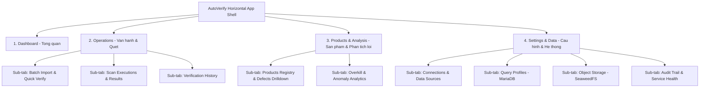

# Kế Hoạch Tinh Gọn Giao Diện AutoVerify & Chuyển Sang Tab Ngang

## 1. Đánh giá hiện trạng giao diện & Điểm trùng lặp

Dự án frontend React (`src/web`) hiện đang áp dụng layout thanh Sidebar bên trái (rộng cố định 224px) chứa **10 tab dọc liên tiếp**:
- `Overview`: Dashboard tổng quan, xu hướng 14 ngày, tình trạng sức khỏe hệ thống, 8 audit event gần nhất.
- `Import`: Dán danh sách ID sản phẩm (Leakage/Overkill), kiểm tra xác minh nhanh, lưu Scan List, xem danh sách scan lists.
- `Scans`: Hiển thị danh sách Scan Executions, kích hoạt scan chạy nền, xem kết quả verify chi tiết.
- `Products`: Quản lý danh sách sản phẩm, tạo sản phẩm/lỗi, chạy quét đa bảng (multi-table scan), xem danh sách ứng viên Overkill (`overkill-candidates`), soi chi tiết defect & feature JSON.
- `Overkill`: Phân tích tỷ lệ chia sẻ lỗi NG theo hệ thống (system NG share), lọc theo máy/line/ngưỡng.
- `Queries`: Quản lý Query Profiles MariaDB, test câu lệnh SQL, gắn với Database Connection.
- `History`: Xem lịch sử xác minh Overkill + Leakage từ API.
- `Sources`: Quản lý Database Connections và Data Sources.
- `Storage`: Upload file JSON, upload ảnh defect, quản lý file trên SeaweedFS.
- `Audit`: Service health và nhật ký kiểm toán hệ thống.

### Các điểm bất cập & Trùng lặp lớn phát hiện được:
1. **Chiếm dụng không gian hiển thị ngang**: Sidebar dọc chiếm 224px khiến các bảng dữ liệu lớn (DataTable), biểu đồ phân tích và bảng so sánh bị bó hẹp, phải cuộn ngang liên tục.
2. **Trùng lặp & rời rạc trong điều tra Overkill**:
   - Tab `Overkill` phân tích tỷ lệ NG share.
   - Tab `Products` lại chứa riêng một bảng "Overkill candidates".
   - Tab `History` lại lưu lịch sử kiểm tra Overkill & Leakage.
   Người dùng muốn điều tra Overkill phải chuyển qua lại giữa 3 tab khác nhau.
3. **Phân mảnh quy trình Vận hành quét (Workflow Disconnection)**:
   - Tab `Import` (nhập danh sách ID, chạy thử) và Tab `Scans` (danh sách đợt quét đã chạy) là hai giai đoạn của một chu trình vận hành duy nhất nhưng bị tách thành hai tab độc lập.
4. **Phân mảnh Cấu hình dữ liệu & Hệ thống**:
   - `Sources` (tạo Database Connection) và `Queries` (viết SQL template cho Connection đó) tách rời nhau dù phụ thuộc trực tiếp vào nhau.
   - `Overview` đã có Health + Audit; Tab `Audit` lại lặp lại Health + Audit log; Tab `Storage` chỉ có 2 tác vụ upload đứng cô lập.

---

## 2. Kiến trúc Giao diện Tinh gọn mới (Horizontal Navigation Architecture)

Chúng ta chuyển đổi toàn bộ giao diện sang kiến trúc **Top Header Bar ngang (Horizontal Main Navigation)** kết hợp **Horizontal Sub-Tabs (Pill Navigation)**, gom 10 tab cũ thành **4 Phân hệ nghiệp vụ chuẩn**:

---

## 3. Chi tiết 4 Phân hệ sau khi gom gọn

### Phân hệ 1: 📊 Tổng quan (Dashboard)
- **Mục tiêu**: Nắm bắt nhanh tình hình toàn hệ thống.
- **Nội dung**:
  - Hàng thẻ chỉ số KPI (Total scans, Processed IDs, Pass rate, Failure rate, Anomaly rate).
  - Biểu đồ xu hướng xác minh 14 ngày (Verification trends).
  - Thẻ tóm tắt tình trạng Platform & Storage.
  - Bảng hoạt động kiểm toán gần nhất (Recent audit trail).

### Phân hệ 2: ⚡ Vận hành Scan & Xác minh (Operations & Verification)
- **Mục tiêu**: Hợp nhất toàn bộ quy trình nhập liệu và chạy quét vào một nơi duy nhất với 3 tab ngang:
  1. **Nhập liệu & Kiểm tra nhanh (Batch Import)**: Dán danh sách ID (Leakage/Overkill), chọn máy/line, chạy test verify batch ngay lập tức, lưu thành Scan List.
  2. **Tiến trình Quét (Scan Executions)**: Danh sách các đợt scan execution, nút kích hoạt scan mới trên các Scan List đã lưu, xem chi tiết kết quả từng batch.
  3. **Lịch sử Xác minh (Verification History)**: Lịch sử toàn bộ kết quả Overkill + Leakage được lọc theo phân loại, mã máy, mã chuyền.

### Phân hệ 3: 🔍 Sản phẩm & Phân tích Lỗi (Products & Anomaly Analysis)
- **Mục tiêu**: Hợp nhất toàn bộ khâu tra cứu sản phẩm và phân tích chuyên sâu Overkill:
  1. **Hồ sơ Sản phẩm & Lỗi (Products & Defects)**:
     - Tìm kiếm theo Key ID, phân loại OK/NG, quét đa bảng (multi-table scan).
     - Soi chi tiết lỗi theo linh kiện, mức độ nghiêm trọng (critical/major/minor), xem payload JSON thuộc tính.
  2. **Phân tích Overkill (Overkill Analytics)**:
     - Tích hợp biểu đồ tỷ lệ chia sẻ NG theo hệ thống (System NG Share).
     - Tích hợp bảng **Ứng viên Overkill (Overkill Candidates)** chuyển từ Products sang để chuyên gia chất lượng phân tích ngay tại một màn hình.

### Phân hệ 4: ⚙️ Cấu hình & Dữ liệu (Settings & Integration)
- **Mục tiêu**: Tập trung toàn bộ quản trị kết nối, mẫu truy vấn và hạ tầng hệ thống:
  1. **Kết nối & Nguồn dữ liệu (Connections & Sources)**: Quản lý kết nối Database (MariaDB, PostgreSQL...) và phân luồng Data Sources.
  2. **Mẫu truy vấn (Query Profiles)**: Tạo và kiểm thử SQL templates trực tiếp tương ứng với các Database Connection đang hoạt động.
  3. **Kho lưu trữ (Object Storage)**: Quản lý file JSON và ảnh lỗi lưu trữ trên SeaweedFS / File store.
  4. **Nhật ký & Sức khỏe (Audit & Health)**: Giám sát chuyên sâu System Health và toàn bộ Audit Log hệ thống có phân trang.

---

## 4. Kế hoạch Triển khai (Action Plan)

1. **Cập nhật Topbar & Header Navigation**:
   - Viết lại phần Header trong `App.tsx`: Brand logo + 4 Main Horizontal Tabs + System status + User profile + Logout.
   - Thêm thanh Sub-tab ngang (Pill / Segmented navigation) mượt mà dưới Header khi vào các phân hệ có nhiều sub-view.
2. **Tổ chức lại các Module & Gom tính năng trùng lặp**:
   - Gom quy trình Quét: `ImportTab` + `ScansTab` + `HistoryTab` vào không gian làm việc `Operations`.
   - Gom phân tích lỗi: `ProductsTab` + `OverkillTab` (chuyển bảng `overkill-candidates` về chung với Overkill analysis) vào `Products & Analysis`.
   - Gom cấu hình: `SourcesTab` + `QueriesTab` + `StorageTab` + `AuditTab` vào `Settings & System`.
3. **Cập nhật CSS & Responsive (`App.css`)**:
   - Bỏ CSS sidebar cố định 224px, tối ưu layout container dạng full-width tối đa 1600px căn giữa hoặc 100% responsive fluid layout.
   - Thêm style cho `main-nav-tabs`, `subnav-bar`, `subnav-pills`.
   - Giúp bảng biểu dữ liệu, biểu đồ hiển thị rộng rãi và chuyên nghiệp hơn.
4. **Kiểm tra và xác minh (Verification)**:
   - Đảm bảo toàn bộ các API calls, modal, form tương tác, phân trang hoạt động hoàn hảo không bị mất bất kỳ tính năng nào.
